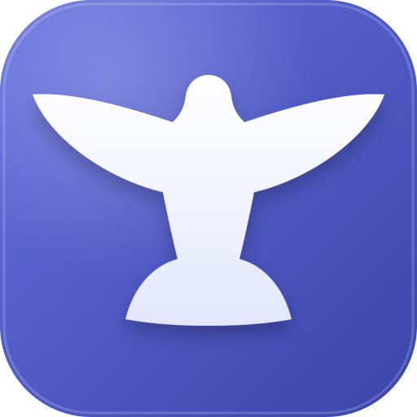
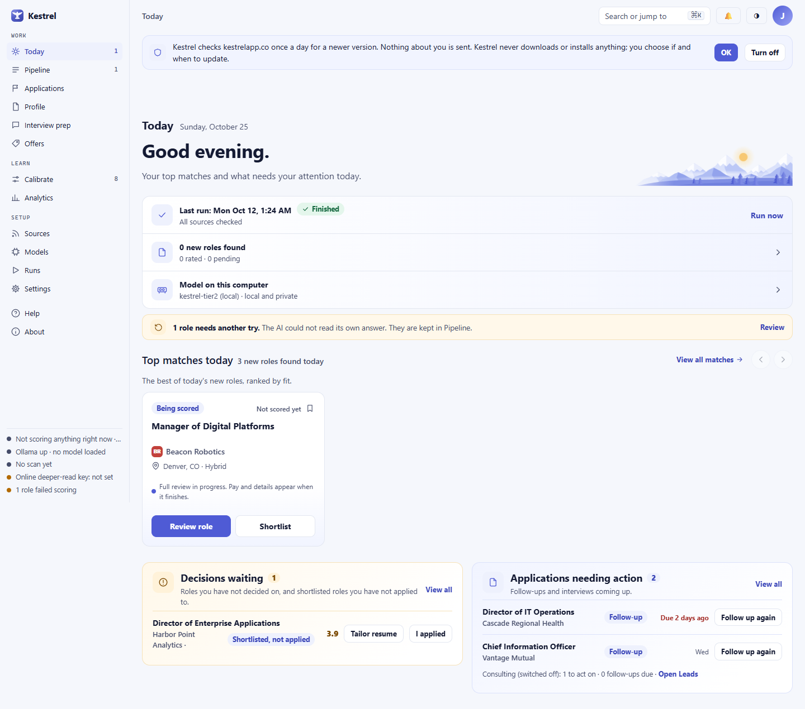
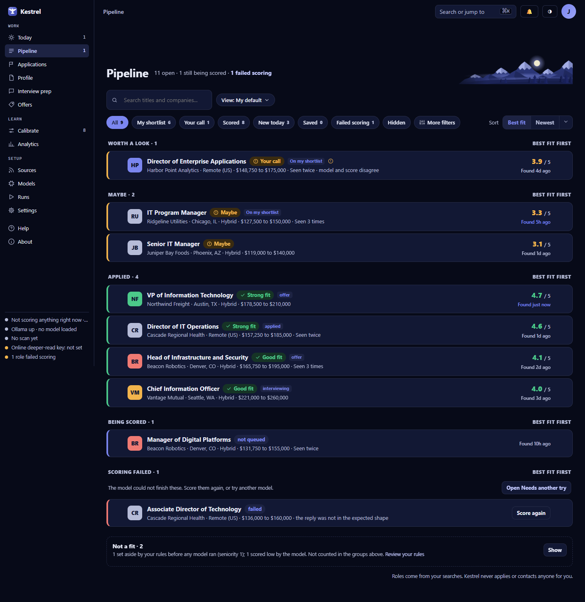
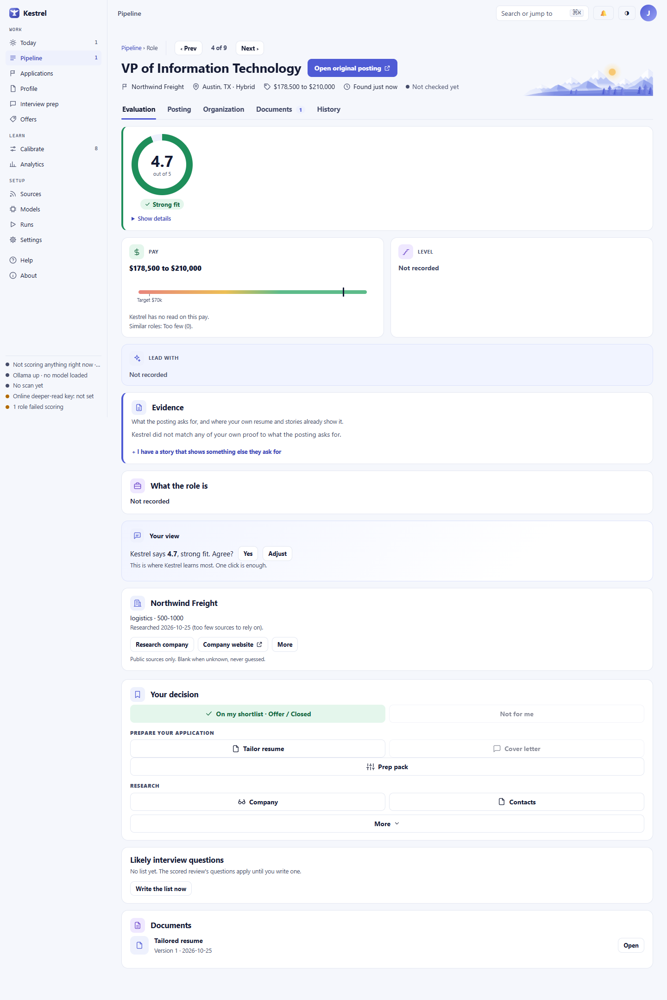
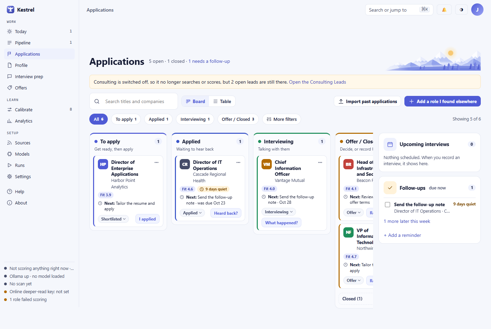

# Kestrel

Kestrel is a free, local-first desktop app for any job seeker. It finds roles, checks fit, tailors your own resume lines, and tracks applications. It runs on Windows, macOS or Linux. There is no account to create and no command line needed to use it.

**You are not the product.** Kestrel shows no ads and never applies, emails or messages anyone for you. AI runs on your computer by default. You can choose OpenRouter, OpenModel, Anthropic, OpenAI or any OpenAI-compatible service with your own key. Kestrel asks before anything goes online and shows what it would send. The source is public under the [PolyForm Noncommercial License 1.0.0](LICENSE.md).

Screenshots use invented data. [See the full screenshot index](docs/images/walk/INDEX.md).

## Install

Download the installer for your computer from [Releases](https://github.com/distantsoil/Kestrelapp/releases): `Kestrel-Setup-x.y.z.exe` for Windows, `Kestrel-x.y.z.dmg` for Apple silicon Macs, or `Kestrel-x.y.z-x86_64.AppImage` for Linux. Open it, then follow the six setup steps. Linux details are in [docs/LINUX.md](docs/LINUX.md).

On first run, choose **On this computer**, **Online model**, or **Both**; add your name, resume text, target roles, and searches. Searches begin only when you press **Start searching**. You can skip the resume and add it later.

### Unsigned beta

The beta installers are not signed yet; signing comes later. On Windows, choose **More info**, then **Run anyway** when SmartScreen warns. On macOS, right-click Kestrel in Applications, choose **Open**, then choose **Open** again.

The [user guide](docs/GUIDE.md) walks through every page, including online consent, confidential mode, Undo, exports, and backups. [What's new](docs/WHATS-NEW.md) covers the current release. Developers can use [docs/DEVELOPERS.md](docs/DEVELOPERS.md).

Built with Claude, ChatGPT, Qwen, DeepSeek, NVIDIA Nemotron, MiniMax M3, LongCat, Kimi K2.7 and MiMo.

## For developers

Build and test instructions are in [docs/DEVELOPERS.md](docs/DEVELOPERS.md). Source checkouts can start with `uv sync --extra dev` and `uv run kestrel setup`.
