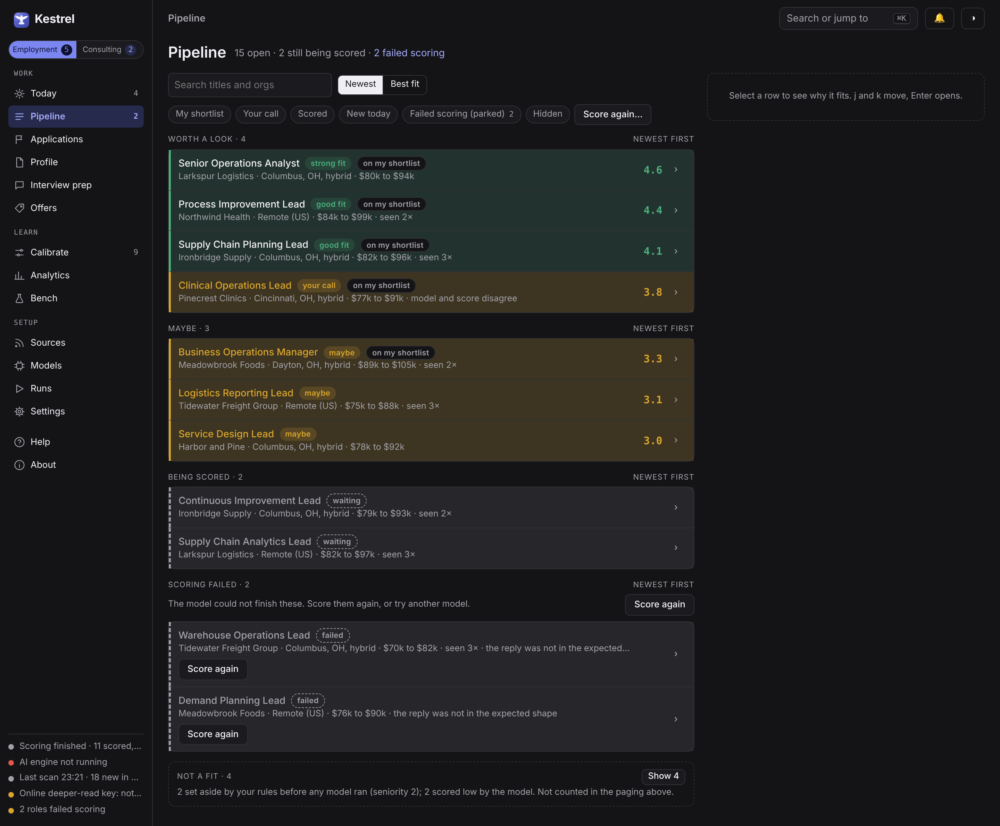

# Kestrel

Kestrel is a free job search app for any job seeker. You are not the product: it costs nothing,
shows no ads, and sends nothing about you anywhere unless you say so. It runs on your own computer
(Windows, macOS or Linux) as a normal desktop app. No account, no AI subscription, no command line.

Screenshots use invented sample data. More in [docs/SCREENS.md](docs/SCREENS.md).

## What it does

| | |
|---|---|
| **Find** | Public job boards, company hiring pages, and a paste box for anything else. |
| **Score** | An AI model screens each role and explains the fit. When unsure, it keeps the role. |
| **Tailor** | The AI picks from bullets you wrote. Every line in your resume is your own text. |
| **Track** | Every application, from first look to outcome. |
| **Prepare** | Interview prep, a story bank, mock interviews and offer comparison. |
| **Learn** | Your decisions sharpen the scoring over time. |

## What Kestrel promises

- **It never acts for you.** It never applies, emails or messages anyone. It drafts and hands over.
- **The AI runs on your computer by default.** Or bring your own key for
  OpenRouter, OpenModel, Anthropic, OpenAI or any OpenAI-compatible service. Kestrel asks before
  anything goes online.
- **Your words stay yours.** The AI selects from your text; it does not invent.
- **Public data only.** It does not search LinkedIn (LinkedIn does not allow automated access),
  though you can paste a LinkedIn posting by hand.

## Install

Download the installer from the [releases page](https://github.com/distantsoil/Kestrelapp/releases),
open it, and follow the "Finish setup" banner. Every step has a button.

| Platform | Download |
|---|---|
| Windows 10/11 (x64) | `Kestrel-Setup-x.y.z.exe` (no admin rights needed) |
| macOS 13+ (Apple silicon) | `Kestrel-x.y.z.dmg` |
| Linux (x86_64) | `Kestrel-x.y.z-x86_64.AppImage` (see [docs/LINUX.md](docs/LINUX.md)) |

For local AI, a GPU with 12 GB or more (or a Mac with 16 GB or more) is recommended. No GPU? Use
an online model with your own key. Full requirements are in the [user guide](docs/GUIDE.md).

### Unsigned beta

This beta is not code-signed yet, so Windows and macOS warn the first time; signing comes later.

- **Windows:** on "Windows protected your PC", click **More info**, then **Run anyway**.
- **macOS:** right-click Kestrel in Applications, choose **Open**, then click **Open** again.

## Learn more

- [User guide](docs/GUIDE.md): requirements, sources, resume import, the learning loop, online
  models, privacy and troubleshooting
- [Screens](docs/SCREENS.md): a tour of every page
- [kestrelapp.co](https://kestrelapp.co) and the [privacy policy](https://kestrelapp.co/privacy)

## License and support

Built with Claude, ChatGPT, Qwen, DeepSeek, NVIDIA Nemotron, MiniMax M3, LongCat, Kimi K2.7 and MiMo. Free for any noncommercial use under the
[PolyForm Noncommercial License 1.0.0](LICENSE.md) (Copyright 2026 M Crowle-Groves). You may not
sell it or build a paid product on it. Report issues on
[GitHub](https://github.com/distantsoil/Kestrelapp/issues). If Kestrel helps you,
[support it on Ko-fi](https://ko-fi.com/distantsoil).

## For developers

Building from source, the `kestrel` command line, model setup and guardrails are in
[docs/DEVELOPERS.md](docs/DEVELOPERS.md). Quick start: `uv sync --extra dev`, then
`uv run kestrel setup`.
