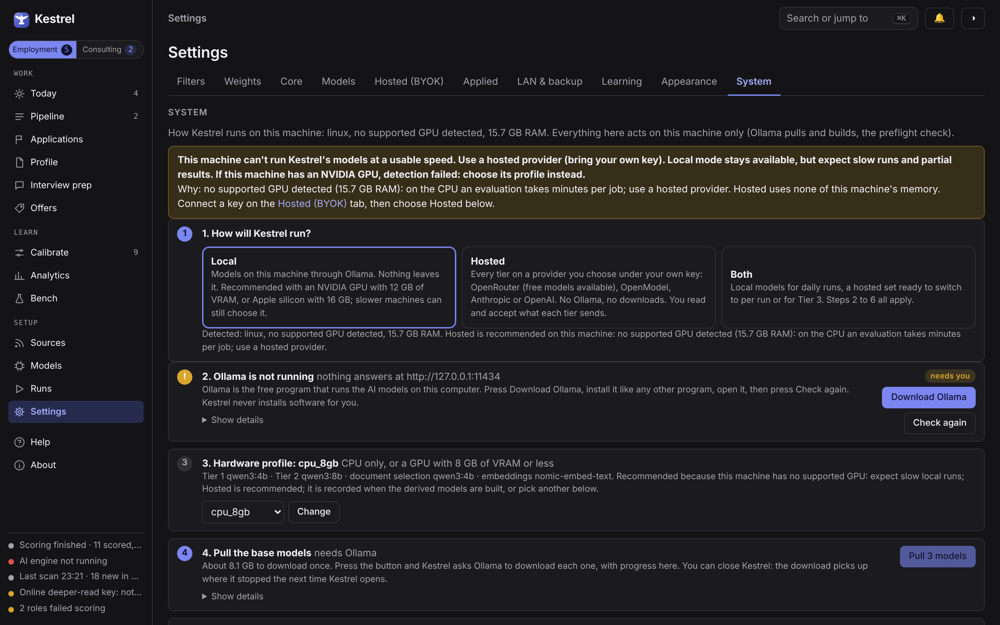
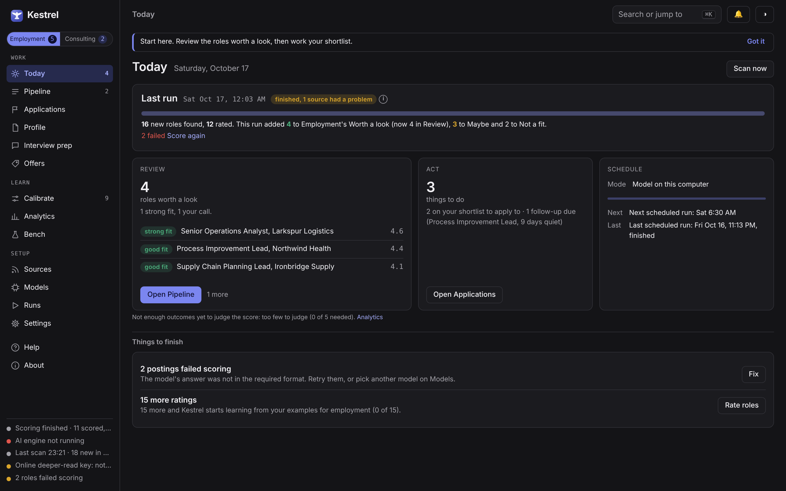
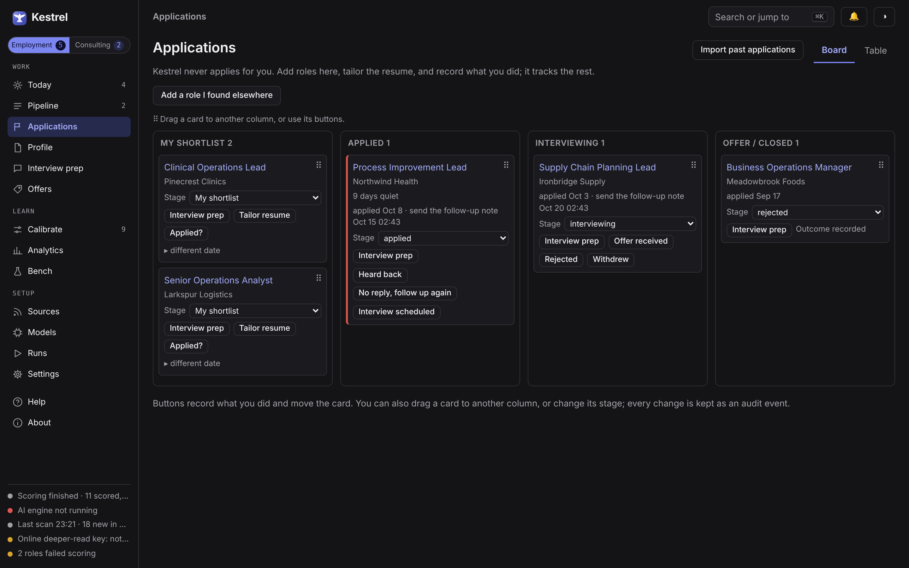
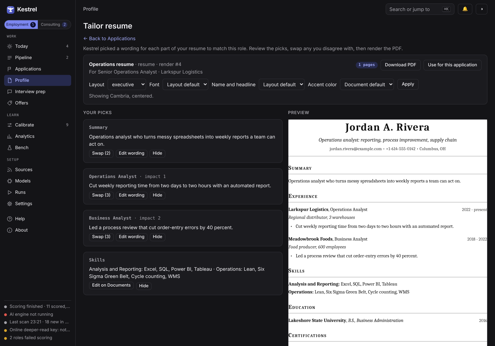
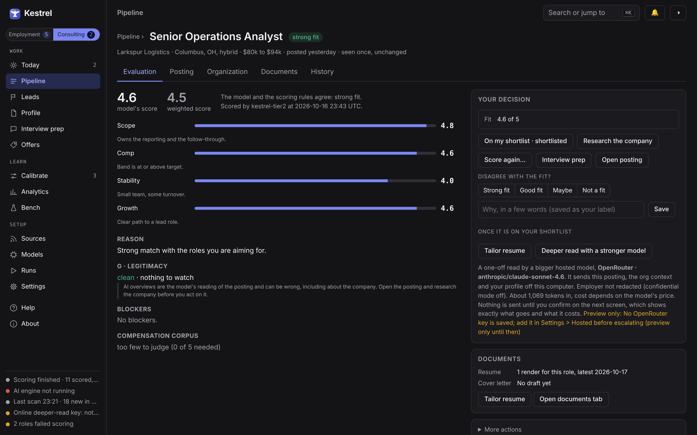
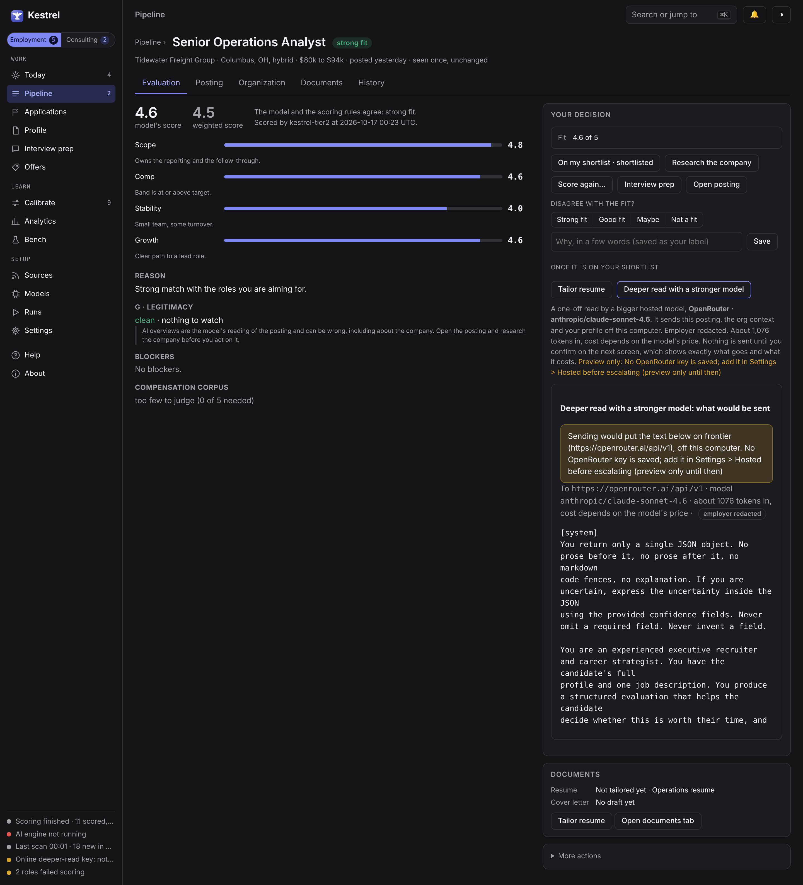
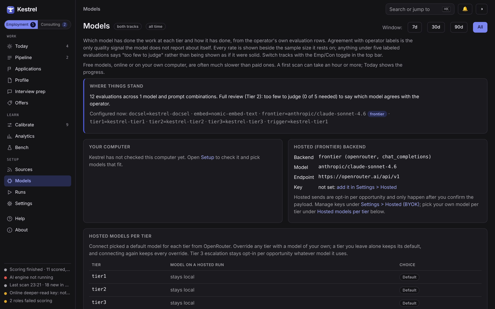
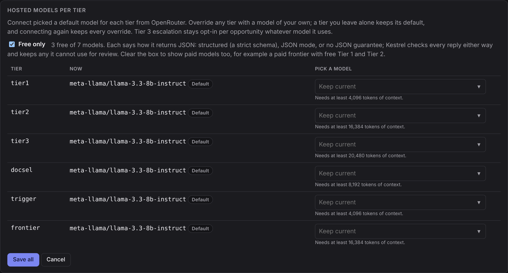
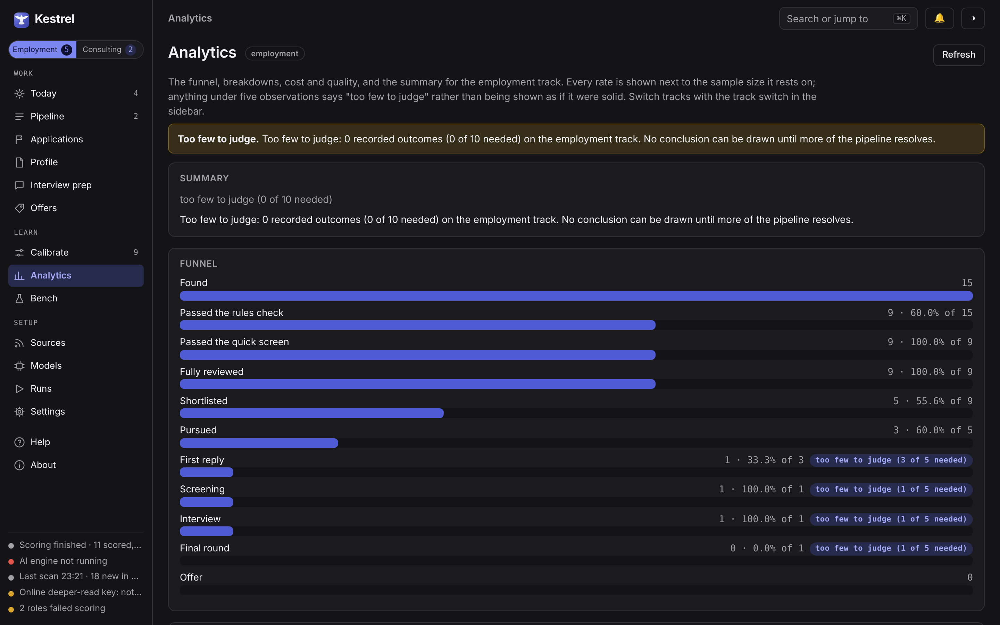
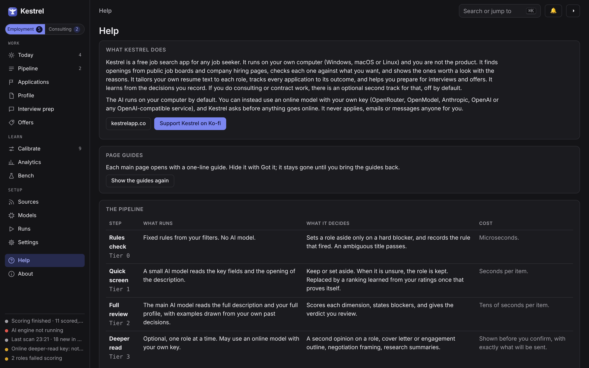

# Kestrel

Kestrel is a free job search app for any job seeker. You are not the product: it costs nothing,
shows no ads, and sends nothing about you anywhere unless you say so. It runs on your own computer
(Windows, macOS or Linux) as a normal desktop app. You double-click it; every setup step has a
button. No account is needed, and no AI subscription: the AI models run free on your own
computer, or on an online model under your own key.

It finds openings, scores each one for fit, tailors your own resume text to each role, tracks
every application through to the outcome, and learns from the decisions you make. An optional
second track covers consulting and contract work; it is off until you switch it on.

**What Kestrel promises**

- **It never acts for you.** It never applies, emails or messages anyone. It drafts, recommends,
  and hands over.
- **The AI runs on your computer by default.** If you would rather use an online model, bring your
  own key for OpenRouter, OpenModel, Anthropic, OpenAI or any OpenAI-compatible service. Kestrel
  asks before anything goes online and shows exactly what would be sent.
- **Your words stay yours.** Every line in a generated resume is text you wrote. The AI picks
  from it; it does not invent.
- **Private by default.** Nothing leaves your computer unless you choose an online model, and
  Kestrel waits for your OK before anything goes. Confidential mode hides your current employer in
  lists, tailored resumes and anything sent to an online model.
- **Public data only.** It reads public job pages politely. It does not search LinkedIn (LinkedIn
  does not allow automated access), though you can paste a LinkedIn posting by hand.

Built with Claude, Qwen and NVIDIA Nemotron. Free to use, read, change and share for any
noncommercial purpose under the [PolyForm Noncommercial License 1.0.0](LICENSE.md) (Copyright 2026
M Crowle-Groves). You may not sell it or build a paid product on it. That is deliberately not an
OSI open-source license. More at [kestrelapp.co](https://kestrelapp.co), including the
[privacy policy](https://kestrelapp.co/privacy). If Kestrel helps you, you can
[support it on Ko-fi](https://ko-fi.com/distantsoil).


> **Every screenshot in this README uses invented sample data.** The organizations, roles,
> compensation and contacts shown are fictional and are generated by
> `kestrel screenshots`, which seeds a throwaway database and deletes it afterward. No real
> opportunity, employer, or personal detail appears in any image here.

## What it does, in the order you meet it

| | |
|---|---|
| **Find** | Public job boards, company hiring pages, a browser extension that captures the page you are reading, and a paste box for anything else. Duplicates are merged. |
| **Score** | A quick screen, then a full review, each by an AI model. Roles worth a look come with the reasons. When the AI is unsure, a role is kept, never silently dropped. |
| **Tailor** | The AI SELECTS from bullets you wrote; it never writes new ones. Every line in a generated PDF is your own text, byte for byte. |
| **Track** | Applications with status history, next actions, and outcome capture. |
| **Prepare** | Interview prep with your own notes, a story bank, mock interviews, and offer comparison. |
| **Learn** | Your ratings and outcomes recalibrate the scoring. The ranking it learns is only used when it beats the model it would replace. |

## Screens

All captures use the fictional seed; the capture never opens your data. The full walk, every page
in this order, is the `docs/images/` set, shown here in dark mode of the default Paper and Indigo scheme (light captures sit beside each one), last refreshed on 2026-10-15 with `kestrel screenshots`.

**Setup is where the first-run banner takes you** (once onboarding is finished the same address opens Settings, System). Local, Hosted or Both, the detected hardware, and every step with
its state, the exact command when the fix is yours, and a button when Kestrel can do it.



**Today answers "what needs me".** A run panel at the top says what the current search or
rating is doing, or how the last run went; then Review (the top roles worth a look), Act (what to
apply to or follow up on) and Schedule (when the next run is), and setup items for when you have
a minute; the sidebar's status rail shows the worker, model, last scan and hosted key at all
times.



**The Pipeline is a triage list in fit groups.** Rows sit under Worth a look, Maybe and Not scored
yet, with Not a fit collapsed at the bottom and its count split between rules and the model. Each
row carries a fit word (strong fit, good fit, your call, maybe), one line of facts and a single fit
number; chips above filter by state, and a drawer holds the evaluation and actions.


**Applications is a four-column board.** To apply, Applied, Interviewing, and Offer / Closed. A card
that has waited past its follow-up date says how many days it has been quiet (here, nine days with
no reply), and each card offers the next honest action: Tailor resume, I applied, Heard back,
Interview scheduled. Kestrel records what you did; it never applies for you. The Table view lists
the same pursuits as rows.



**Tailor shows the picks before the PDF.** Kestrel chooses one of your own wordings for each part
of the resume for the role; you review them, press Swap on any you disagree with, change layout,
font or accent color, and watch the preview. Nothing is rewritten: every line is your text.



**Opportunity detail puts the decision at the top**: title, fit word, then tabs for Evaluation,
Posting, Organization, Documents and History, with Your decision on the right. Disagreeing with the
fit is one click on a fit word (strong fit, good fit, maybe, not a fit) and is recorded as a
training label.



**Nothing leaves your machine unless you say so, and it asks first.** Tier 3 escalation shows
the exact payload, the destination, and the token count, and transmits nothing until you
confirm. Hosted mode, if you turn it on, requires reading what each tier sends first.



**Settings > Hosted (BYOK)** holds the Local/Hosted switch, the disclosure, your key (written to
`.env`, never shown again), the key test with the model list, and the per-tier assignments.


**Models shows which model is doing the work and how well.** Agreement with your own fit calls
per tier and model, with n stated, latency, tokens, and cost for hosted sends.



**With a hosted provider connected, Override models lets you pick a model per tier.** Each tier
shows its model and whether it is the Default or your Override, a Free only filter, and a picker
that states each tier's minimum context. Tier 3 escalation stays opt-in per opportunity whatever
model you pick.



**Analytics states its sample sizes.** Any number resting on fewer than five observations is
labeled insufficient rather than rendered as though it were solid.



**Help lists every source Kestrel can scan**, generated from the adapter registry so it cannot
drift: what each kind fetches, what you must provide, the rate limit, and the region note.



Also captured, in dark and light: [the pursuits table](docs/images/pursuits-dark.png), [documents](docs/images/documents-dark.png)
(optional sections for education and certifications, and an accent color picker),
[the render review](docs/images/render-review-dark.png),
[the calibration page](docs/images/calibrate-dark.png), [runs](docs/images/runs-dark.png),
[sources](docs/images/sources-dark.png), [backup](docs/images/backup-dark.png), and
[about](docs/images/about-dark.png).

## Install

Download the installer for your computer from the
[releases page](https://github.com/distantsoil/Kestrelapp/releases) (also linked from
[kestrelapp.co](https://kestrelapp.co)), open it, and start Kestrel. You do not need to type a
command at any point. Setup walks you through each step on screen.

Tested on Windows 11 with an NVIDIA GPU. Mac and Linux builds are provided but have had less
testing.

| Platform | Download | Install |
|---|---|---|
| Windows 10/11 (x64) | `Kestrel-Setup-x.y.z.exe` | Run it. No admin rights: it installs for your user only, and uninstalling never touches your profile or database. |
| macOS 13+ (Apple silicon) | `Kestrel-x.y.z.dmg` | Open it and drag Kestrel to Applications. |
| Linux (x86_64) | `Kestrel-x.y.z-x86_64.AppImage` | Make the file executable and open it. Needs `libfuse2`, like every AppImage. See [docs/LINUX.md](docs/LINUX.md) for the details by distribution, including the window and tray icon. |

### System requirements

Kestrel runs on Windows 10 and 11, macOS 13 or later on Apple silicon, and 64-bit Linux. The
table is for running the AI models on your own computer.

| | Minimum | Recommended | Best |
|---|---|---|---|
| Windows and Linux | 8 GB RAM, CPU only (slow) | NVIDIA GPU with 12 GB VRAM and 16 GB RAM | NVIDIA GPU with 16 to 24 GB VRAM and 32 GB RAM |
| Mac (Apple silicon) | 16 GB | 32 GB | 64 GB or more |

Disk space: about 8 GB for the smallest set of models up to about 22 GB for the largest, plus
about 1 GB for the app and its data. A computer with no supported GPU still works, either on the
CPU or with an online model under your own key (setup recommends the online route there; see "No GPU? Run everything hosted" below).

## First run

Kestrel opens to a "Finish setup" banner. Follow it: pick local AI on this computer or an online
model with your own key, let Kestrel check your computer, download the models (a one-time
download of a few GB for local AI), and build your profile. Each step has a button, and commands
only appear behind a "Show details" toggle for anyone who wants them. The Setup page is always in
the sidebar if you want to change your mind later.

Your data stays on your computer:

- Windows: `%LOCALAPPDATA%\Kestrel`
- macOS: `~/Library/Application Support/Kestrel`
- Linux: `~/.local/share/kestrel`

### Unsigned beta

This beta is not code-signed yet, so Windows and macOS show a warning the first time you open it.
The installer is the same file you would trust either way; signing comes later. Here is how to
get past the warning once:

- **Windows (SmartScreen):** when "Windows protected your PC" appears, click **More info**, then
  **Run anyway**.
- **macOS (Gatekeeper):** right-click (or Control-click) Kestrel in Applications, choose **Open**,
  then click **Open** again in the dialog. After that it opens normally.

Signing is planned for a later release; `docs/RELEASING.md` says how it will be added.

### Linux

Linux shows its own window when the GTK WebKit bindings are installed, and otherwise opens
Kestrel in your default browser. The tray icon needs a desktop with AppIndicator support. The full
instructions are in [docs/LINUX.md](docs/LINUX.md).

## For developers

Everything below is for developers and anyone who prefers a terminal. The app is the supported way
to use Kestrel; each command here does what a button does.

What the three installers have in common: a PyInstaller one-folder build of the same code, the
same `kestrel` entry point (no arguments opens the window, any argument runs the CLI), no bundled
Chromium, Ollama, or model, and nothing written beside the executable. The CLI is
`%LOCALAPPDATA%\Programs\Kestrel\kestrel-cli.exe` on Windows,
`/Applications/Kestrel.app/Contents/MacOS/Kestrel` on macOS, and the AppImage itself on Linux. Local
AI needs [Ollama](https://ollama.com); the app's Setup page helps you install it.

PDF rendering uses Edge, Chrome, or Playwright's Chromium, whichever is present; if none is, run
`<kestrel> doctor` for the install command.

### From source (developers)

```bash
git clone https://github.com/distantsoil/Kestrelapp && cd Kestrelapp
uv sync --extra dev
uv run kestrel setup              # offers the Ollama install command for your platform
uv run kestrel serve --open       # opens http://127.0.0.1:8765 in your browser
uv run python -m kestrel.desktop  # or the desktop window, where a webview backend exists
```

Building the installers yourself: `packaging/build_windows.ps1`, `packaging/build_dmg.sh`,
`packaging/build_appimage.sh`, each documented at the top of the file.

### `kestrel setup` from a terminal

One command, seven steps, each printed with a check or a cross, the reason, and the exact command
it ran or wants you to run. Nothing runs without your confirmation unless you pass `--yes`.

1. **Hardware.** Detects your OS, GPU memory (NVIDIA) or unified memory (Apple silicon), and RAM,
   and recommends a profile: `cpu_8gb`, `gpu_12gb`, `gpu_16gb`, `gpu_24gb`, `mac_16gb`,
   `mac_32gb`, `mac_64gb`. Override with `--profile`.
2. **Ollama.** Found and running, or the install command for your platform with an offer to run it.
3. **Base models.** Pulls the profile's models that are missing (`ollama pull`), about 3 to 20 GB
   once depending on the profile.
4. **Derived models.** Builds `kestrel-tier1`, `kestrel-tier2`, `kestrel-tier3` and
   `kestrel-docsel` with each tier's context window and guardrails baked in. This is the step
   that matters most; see "Models and guardrails" below.
5. **Profile recorded** so `kestrel doctor` and Settings can show which one is active.
6. **Doctor.** The full preflight, including the needle test that proves each model's real context
   window and the probe that proves thinking is off and JSON schemas are honored.
7. **Config seeded.** Prints where `profile.yml` is and what to do next.

Re-run `kestrel setup` any time; it skips what is already done. `kestrel setup --dry-run` prints
every command without running anything. `kestrel doctor` runs step 6 alone.

The first time the app opens it shows a "Finish setup" banner that leads to the Setup page
(`/setup`), where the same steps have buttons: choose Local, Hosted or Both, pull and build the
models, verify, and link to the hosted key and the resume import. The same steps are available as
`kestrel setup` from a terminal.

### No GPU? Run everything hosted

A machine with no supported GPU (setup recommends this unless it finds an NVIDIA GPU with at
least 12 GB of VRAM or an Apple silicon Mac with at least 16 GB) can skip Ollama and the
model download entirely and run every tier on OpenRouter, OpenModel, Anthropic or OpenAI under
your own key. Setup
offers this on every machine, including when Ollama is missing (choose "Use a hosted provider
instead"), and the three commands are:

```
kestrel setup --hosted            # pick the provider, paste the key, choose a model per tier
kestrel setup --hosted --free     # the same, offering only OpenRouter models priced at zero
kestrel serve --open              # then use it exactly as before
```

What it does: stores the key in `.env`, verifies it, lists the models that can honor a JSON
schema with context and price per million tokens, picks the cheapest for Tier 1 and document
selection and a stronger one for Tier 2 (override with `--model`, `--model-tier1`,
`--model-tier2`, `--model-docsel`; `--provider openmodel`, `anthropic` or `openai` for the
others, where Anthropic defaults to Haiku for Tier 1 and Sonnet for Tier 2 and OpenAI to the
mini and full gpt-5 models when the account lists them), shows the same Hosted
mode disclosure as Settings > Hosted and requires you to type `yes`, then writes the same
settings the page writes and records the `hosted_only` profile. `kestrel doctor` then reports the
Ollama checks as skipped rather than failed. Two things to know: free OpenRouter models carry a
daily request cap and may train on your inputs unless data collection is set to deny (the
shipped default, which can leave no free model to route to); and embeddings never go to a
provider: the `hosted_only` profile runs them on this machine with a small model bundled inside
Kestrel (`all-MiniLM-L6-v2` on the CPU), so few-shot examples and the reranker work with no
Ollama installed.

## Models and guardrails

**Which models.** The profile picks the base models per tier. Default (16 GB GPU): Tier 1
`qwen3:4b` for fast keep/reject, Tier 2 `qwen3:14b` for the six-block evaluation, document
selection `qwen3:4b`, embeddings `nomic-embed-text`. Smaller profiles step Tier 2 down to
`qwen3:8b`; 24 GB and 64 GB Mac profiles step it up to `qwen3:30b-a3b`. Edit
`kestrel/resources/config/models.yml` (or the copy in your config folder) to use anything else that
Ollama serves; `kestrel bench` measures a candidate against the gold set before you commit to it.

**What stops a model going astray.** Five mechanisms, all on by default:

| Guardrail | Where | What it prevents |
|---|---|---|
| Context window per tier, verified by a needle test | derived Modelfile `num_ctx`; `kestrel doctor` | The silent truncation that makes every score quietly wrong |
| Baked sampling limits: `temperature 0.1`, `top_p 0.9`, `repeat_penalty 1.1`, `seed 7`, `num_predict` per tier | derived Modelfile | Rambling, repetition loops, runaway output; a request that sets its own temperature or max tokens still wins |
| Schema-constrained output, one repair, then quarantine | every model call | Prose where JSON was required; a hallucinated key never reaches the database |
| Uncertainty escalates | pipeline rules | A low-confidence reject becomes keep; quarantined items move up a tier, never out |
| Thinking off, verified | `reasoning_effort: "none"` plus a doctor probe | A reasoning model spending ten times the tokens, or leaking `<think>` into JSON |

Two things the guardrails do not do: they do not make a small model smart (use `kestrel bench`
and a bigger profile), and they do not act on your behalf. Kestrel never submits, sends, or
applies; it drafts and hands over.

## Configuring Sources

Two tracks, each with its own sources:

**Employment track:**
- Job boards via `python-jobspy`: Indeed, Glassdoor, ZipRecruiter, Google Jobs, Dice (all public). LinkedIn is not searched.
- ATS platforms: Lever, Greenhouse, Workday, SmartRecruiters, Ashby (via public JSON endpoints)
- SEC EDGAR trigger: new C-suite filings matching your geographic and industry preferences

**Consulting track:**
- Consulting-finder platforms and fractional and interim leadership boards (public sources)
- Email trigger sources: set an email address in your profile, and forward interesting opportunities to trigger ingestion and scoring

Both tracks support manual paste: copy a job posting as plain text or HTML and Kestrel deduplicates it against existing opportunities.

Configure sources and profiles in the Settings page (gear icon) or via the command-line `doc` / profile commands.

## Where the opportunities come from

Every source has a kind, fixed in code: five ATS boards (Greenhouse, Lever, Ashby, Workday,
SmartRecruiters), the JobSpy aggregator (Indeed, Glassdoor, ZipRecruiter, Google Jobs,
Dice), and four consulting signal sources (SEC EDGAR 8-K filings, SAM.gov procurement notices,
RSS/Atom feeds, PE portfolio pages), plus manual capture from the extension or a paste. The Help
page in the app lists each kind with what it scans, what you must provide, its rate limit and its
region, generated from the adapter registries. The same table, with the steps for adding a new
adapter, is in [`docs/SOURCES.md`](docs/SOURCES.md).

The shipped configuration is US-centric (JobSpy defaults to the USA, SEC EDGAR and SAM.gov are US
federal). The boards themselves work worldwide: change the search
location and your profile's `geo_rules` and the pipeline runs unchanged.

## Importing Your Resume and Capability Statement

Kestrel does not write your resume. It takes the one you have, decomposes it into sections, slots
and variants, and later selects among your own bullets per opportunity. Import accepts **PDF, Word
(.docx and .doc), Markdown and plain text**, up to 10 MB, on the Documents page (drop the file or
choose it) or from a terminal with `kestrel doc import <file>`. Legacy `.doc` files are converted
through LibreOffice when it is installed; otherwise save as .docx or .pdf first. Scanned PDFs with
no text layer are refused rather than guessed at.

The page shows the text Kestrel read beside the proposed structure, so a flattened table or a
lost heading is visible before you accept anything. Every proposed variant is checked against your
file word for word; a bullet the model reworded is flagged and cannot be accepted until you make
it your own words again.

### Setup

1. Prepare a markdown file with your resume or capability statement (roles, projects, achievements, skills). Plain markdown; no special formatting required.
2. Run:

```bash
kestrel doc import path/to/resume.md --track employment --doc-kind resume
```

This proposes a decomposition into structured roles, projects, and achievements. Review any flags (non-verbatim variants, too many derived sections) and resolve them in your source if needed.

3. Once clean, accept the import:

```bash
kestrel doc import path/to/resume.md --track employment --doc-kind resume --accept
```

This creates a `doc_master` (your canonical resume) that the system tailors per opportunity.

### Document Selection (P3)

When rendering a PDF for an opportunity, Kestrel runs P3 model-driven selection: it reads the opportunity details and your role variants, and selects which roles and achievements to emphasize. The model always chooses from your existing text; it never generates new content. Every slot defaults to your full text if selection fails or confidence is low.

## Picking a Model with `kestrel bench`

Kestrel ships a benchmark harness so you compare models on a gold set, changing exactly one variable
at a time:

```
kestrel bench --models qwen2.5:14b,llama3.1:8b        # compare two models, prompt fixed
kestrel bench --models qwen2.5:14b --prompt-version evaluate/v2   # compare two prompts, model fixed
```

For each track it runs the real tier-2 evaluation against every model over the gold set and prints a
table: first-attempt JSON validity rate, mean tokens in and out, latency, items per minute at your
configured concurrency, exact-verdict agreement and mean absolute score error against the gold set,
and the projected wall-clock for a 500-item run. Any figure computed from fewer than five samples is
labeled insufficient rather than shown as if it were solid. Promote the winner to a tier from the
Bench page in the app.

The gold set ships as clearly-marked placeholder files (`evals/goldset.*.jsonl`); once you have
labeled your own opportunities, regenerate it from your real judgments with
`kestrel goldset regen --track employment`.

Each tier is also configured separately in Settings by base URL, model name, and API key. Point all
three at local Ollama, or point tier 2 at a hosted inference service.

## Which model is doing the work, and how well

The **Models** page (also `/models`) is the history and comparison view for every model that has
evaluated anything, local or hosted: evaluations per tier and model, agreement with your own
verdicts where you have labeled outcomes, mean absolute score error, latency, tokens, and cost for
hosted sends. Every rate carries its n, and anything under five labeled outcomes reads
"insufficient (n=...)" rather than a number. Use it with `kestrel bench` (the gold-set harness)
when you are choosing between a local profile and a hosted model: bench says which model agrees
with the reference answers; the Models page says which one agrees with you.

## The Learning Loop

Kestrel learns from every decision you make. As you review opportunities, the system captures labels and feeds them back into scoring.

### How It Works

1. **Label as you review:** From the opportunity detail page or the pipeline list, one-click actions let you agree with the score, adjust it, or override it entirely. Your label is recorded immediately.
2. **Calibration:** As labels accumulate (starts at five), run `kestrel calibrate` to recompute dimension weights from your feedback. A proposal shows the new weights and cross-validation error (old vs. new); review and accept in the UI/API to apply.
3. **Reranker:** Once you have fifty+ labeled examples, `kestrel train` builds a learned reranker on top of the tier 2 score. It compares both algorithms on held-out data and only promotes the reranker if all four criteria pass (lower error, better AUC, good coverage, no drift). Nothing is applied without your approval.
4. **Few-shot injection:** High-confidence labels from your gold set are injected as examples into Tier 1 and Tier 2 prompts, teaching the model what you care about.

The loop is slow to warm (week one shows random swings; by month three, you'll see clear signal), so be patient with early scores. Keep labeling; the system improves with every decision.

### Where It Lives, and How to See or Reset It

Every decision is a row in the local database (`data/kestrel.db`: the `label` table for the Calibrate queue, `verdict_override` for Agree, Adjust and Override), accepted calibrations are `calibration` rows plus `scoring.weights.*` rows in the `setting` table, and a trained reranker is an `ml_model` row with its two pickle files under `data/ml/`. The model's own weights are never changed and nothing leaves the machine. Settings > Learning shows all of it: counts and agreement per track (with the n, and labeled insufficient under five), the three floors as "n of N" with active or inactive, current versus shipped weights, the files in the ML folder, and the decisions themselves with a per-row delete. Download all decisions as JSON from the same tab (the export is not redacted; it is your own data), and Reset, with the typed word RESET, removes any combination of decisions, the reranker and its files, and the accepted calibrations, while leaving opportunities, evaluations, pursuits and documents untouched.

## Operational Traps

These are verified against live Ollama, Playwright, and Windows behavior. Learn them once to avoid surprises:

### Context Window Truncation (THE CRITICAL ONE)

Ollama's default context window is far below Kestrel's needs. Long job descriptions are silently cut in half with no error, and scores are quietly wrong. **Solution:** Build the derived models with `kestrel models build` and verify with `kestrel doctor`. This is not optional.

### Disabling Thinking (if Using Reasoning Models)

If your Tier 2 model has reasoning capabilities, you likely want to disable them (they consume 5x tokens for little benefit on deterministic scoring). The parameter is backend-specific:

- **Ollama:** `reasoning_effort: "none"` in the LLM client config
- **oMLX or vLLM:** `extra_body.chat_template_kwargs.enable_thinking = false`

Sending the wrong one is silently ignored; you find out via a massive token bill. Kestrel strips `<think>` spans defensively regardless.

### Structured Output or Failure

Every LLM call returns schema-validated JSON. One repair attempt, then the response is quarantined with the raw output preserved for investigation. Never silently defaulted to a fallback. If this feels noisy, it's by design: a wrong score that you catch is infinitely better than a silent error.

### Document Selection Never Invents

The model selects from your existing text. If selection fails, it defaults to your full document, flagged for review. If you see a hallucinated variant key in the generated PDF, it's a validation bug, not a feature. Report it.

### Sample Sizes

Any number derived from fewer than five observations (comp intelligence, conversion rates, analytics summaries) is labeled "insufficient" rather than presented as solid. Week one feels noisy; month three feels solid.

### Ghost Jobs and Liveness (Weak Early, Good Later)

The system learns which employers post perpetually open roles (ghosts) and which opportunities go live and die fast (liveness). These features start weak and improve as labels accumulate. Don't expect accurate ghost or liveness scores in week one.

## Common Commands

```bash
kestrel setup                  # guided first run on any platform (--dry-run, --profile, --yes)
kestrel serve --open           # run the web UI without the desktop shell (macOS, Linux)
kestrel provider test          # verify a hosted key and list schema-capable models (BYOK)
```

```bash
# Preflight: full health check
kestrel doctor

# Build the derived num_ctx models (critical)
kestrel models build

# Run ingestion: fetch and normalize new opportunities
kestrel scan --all
kestrel scan --track employment
kestrel scan --source "indeed"

# Run the pipeline: Tier 0 sweep, then drain Tier 1, then Tier 2
kestrel run

# Drain Tier 1 or Tier 2 alone (for debugging or recovery)
kestrel run --tier 1
kestrel run --tier 2

# Force a single opportunity through both tiers
kestrel evaluate 42

# Render a document (your resume) as a PDF
kestrel render 1
kestrel render 1 --opportunity 42      # P3 selection for opp 42
kestrel render 1 --redact              # Redact org names

# Seed example documents (resume + capability statement)
kestrel doc seed

# Import your resume
kestrel doc import resume.md --track employment --doc-kind resume --accept

# Propose and accept a capability statement import
kestrel doc import capability.md --track consulting --doc-kind capability --accept

# Recompute calibration proposal from labels
kestrel calibrate

# Train the reranker on labeled data
kestrel train

# Export pipeline to JSON or CSV
kestrel export --format json
kestrel export --track employment --out opps.csv

# Timestamped backup (DB + config, never .env secrets)
kestrel backup
kestrel backup --out /path/to/backups

# Headless mode (API + worker, no desktop window)
kestrel serve

# Drain pending tasks without a new Tier 0 sweep
kestrel worker
```

## Architecture Notes

- **Local-first:** Inference runs on your Ollama instance by default. A hosted Tier 3 backend is optional and opt-in per opportunity.
- **Resumable:** Every task is a queue row; kill the process at any moment and restart. No lost state.
- **Offline:** All static assets (HTMX, Alpine, Tailwind CSS, tiktoken encoding) are vendored. No CDN required.
- **Single machine, single user:** No accounts, no sync, no horizontal scaling. SQLite is the right database.
- **Windows, macOS and Linux:** Driven by `pywebview` (Edge WebView2 on Windows, WebKit on macOS and Linux), tray via `pystray`, PDF rendering via Playwright.

## Troubleshooting

**"context window silently truncates" errors in scores?**  
Run `kestrel models build` to create derived models with explicit `num_ctx` per tier. Then run `kestrel doctor` to verify.

**Ollama not reachable?**  
Check that Ollama is running and accessible at the URL in Settings (default: `http://127.0.0.1:11434`). The preflight wizard can open the download page if you need to install Ollama.

**PDF render fails or is over the page limit?**  
Reduce the number of roles or achievements in your document, or hide optional slots. The CLI will suggest which slots to hide.

**High token usage despite reasoning being disabled?**  
Verify `reasoning_effort: "none"` is set for your backend. Use `kestrel doctor --quick` to skip the slow probes and get a quick report.

**Database locked or corrupted?**  
SQLite uses WAL mode with a 5-second busy timeout. If the database is stuck, kill Kestrel, then:
```bash
rm %LOCALAPPDATA%\Kestrel\kestrel.db-wal
rm %LOCALAPPDATA%\Kestrel\kestrel.db-shm
```
Then restart. Queued tasks are resumable; only in-flight tasks are lost.

## Reaching Kestrel from your phone (optional, off by default)

Kestrel listens on this machine only until you set `server.bind_all` in `settings.yml` or as
`KESTREL_SERVER__BIND_ALL=true`, and restart. With it on, generate a shared secret under
**Settings > LAN** and scan the QR code from a phone on the same network.

Read this before you turn it on. That secret is **one shared password for the whole application**.
There are no accounts, no per-device access, and no record of who did what. Traffic is plain HTTP
and is not encrypted. Use it on a home network or a VPN you control; do not use it on shared,
public or office Wi-Fi, do not forward the port through a router, and do not put a local proxy in
front of Kestrel, which would make every request look local and switch the secret off entirely.

## Bringing your own hosted model (BYOK, optional, off by default)

Everything Kestrel does runs on your machine. The one exception is **Tier 3 escalation**: when you
open an opportunity and press Escalate, you see exactly what would be sent, and only after you
confirm does that payload go to a hosted model. That model is yours: you bring a key from a
provider you pay directly, Kestrel ships no key and no proxy.

Four providers are known by name, and any OpenAI-compatible chat-completions server can be added
as `provider: generic` in `settings.yml`:

| Provider | What Kestrel speaks to it | Key |
|---|---|---|
| **OpenRouter** (`frontier` backend) | chat completions, with privacy routing: providers that store prompts are excluded by default, Zero Data Retention is a checkbox, and the request is refused rather than routed to an endpoint that ignores the JSON schema. The one provider with free models | `OPENROUTER_API_KEY` |
| **OpenModel** (`openmodel` backend) | the Messages or Responses protocol, per model, which are the two openmodel.ai serves | `OPENMODEL_API_KEY` |
| **Anthropic** (`anthropic` backend) | the Claude API directly: the Messages protocol with the API's own structured output, so a Claude model answers with the JSON object and nothing else. No sampling parameters are sent, because current Claude models reject them; a safety refusal quarantines the item with its category instead of failing the run | `ANTHROPIC_API_KEY` |
| **OpenAI** (`openai` backend) | the OpenAI API directly: chat completions with a strict JSON schema. Reasoning models (gpt-5, o-series) take no temperature; the model list is trimmed to chat models because OpenAI lists every family in one place. A refusal quarantines with the model's own words | `OPENAI_API_KEY` |

Every hosted provider is gated the same way: the same per-opportunity Tier 3 confirmation, the same
Hosted mode disclosure, the same redaction of your current employer in confidential mode. A direct
key sends exactly what an OpenRouter key sends, so it gets no shortcut. The OpenRouter privacy
options (data collection, Zero Data Retention) exist only there; with a direct key the vendor's own
retention terms apply, linked from the Settings page. Reasoning effort is a row per provider on the
same tab, each list holding only the words that provider accepts; lower is cheaper and faster, and
"model default" leaves the provider's own setting in place.

Set it up under **Settings > Hosted (BYOK)** in three steps: paste the key (it is written to `.env`
in the data folder, never shown again, never logged, never included in a backup), press **Test**
(two authenticated metadata requests, the key check and the model list, that send nothing about
you or any opportunity, and show the models that can honor a JSON schema with their context and
price), then pick the model and press **Use for
Tier 3**. No restart. The same three steps from a terminal:

```bash
kestrel provider set-key frontier          # prompts for the key, writes .env
kestrel provider test                      # verifies the key, lists schema-capable models
kestrel provider use frontier anthropic/claude-sonnet-4.6
kestrel provider status
```


**Local or hosted, as a switch.** The top of the Hosted tab is a two-way choice, **Run Kestrel
on: Local models / Hosted models**. Local is the default and shows the active hardware profile
and its tier models; Hosted shows the provider and the per-tier hosted models you assigned in the
**Hosted assignments** table below it (Tier 1, Tier 2, document selection; the frontier tier is
hosted in either mode). Hosted cannot be chosen until you have read and acknowledged the
disclosure and assigned a hosted model to Tier 1 and Tier 2; the button says what is missing.
Switching never touches the local models, so switching back costs nothing. `kestrel setup
--hosted` fills the table and sets the switch to hosted for you.

**Local or hosted, for one run.** The standing choice governs every run and the serve loop; one
run can differ. The **Runs** page has a **Run now** form with a Local / Hosted choice that queues
the next worker cycle on that set and then returns to the Settings choice. From a terminal,
`kestrel run --hosted` or `kestrel run --local` does the same (`kestrel scan` takes the flags too,
because filing and feed classification run through a model; job boards and ATS scans never do).
Every run in the Runs list carries a `local` or `hosted` badge, the status strip says which set
is running, and each evaluation records the model that answered.

What is enforced, not merely promised: an external backend is reached only through a confirmed
Tier 3 escalation or on a hosted run after the acknowledged opt-in, and the worker has no code
path that opts in on its own; `kestrel doctor` reports the hosted routing and warns when it
cannot be used; every Tier 3 send is recorded with the provider's own token counts and, where
reported, its cost; a confirmation token that has already been used, even for a send that
failed, is refused and you must open a fresh preview.

## Running Kestrel as a web app

Kestrel is a desktop application because the work happens on your GPU: local models, Playwright
with Edge for PDFs, and a scraper that needs a residential connection. A full port to Cloudflare
Pages or Workers is **not feasible** on the free plan, or on any plan, without rewriting the data
layer and giving up local inference; `docs/WEBAPP.md` records the evaluation.

What is feasible, and free, is to keep Kestrel running on your PC and publish it through a
**Cloudflare Tunnel** behind **Cloudflare Access** (one-time PIN to your email, up to 50 users on the
free plan). You get a password-protected `https://kestrel.yourdomain.com` on your phone with no port
forwarded and no shared secret in a QR code. The steps, what changes in `settings.yml`, and the
gotchas (HTMX behind an expired Access session, the 100-second response limit on long Tier 2
runs, the MCP port) are in `docs/WEBAPP.md`.

## Privacy

- Your search and profile are confidential. The data directory (`%LOCALAPPDATA%\Kestrel`) is never committed to version control.
- Generated PDFs contain no metadata tags, headers, footers, or generator strings that identify organizations.
- Confidential mode redacts your current employer everywhere in generated output and list views if enabled.
- All inference is local unless you explicitly opt in to a hosted Tier 3 backend for a specific opportunity.
- Backups never include `.env` secrets; they contain only the database and YAML config.
- The Backup page in the app downloads that same archive and exports or imports `profile.yml` on its own; nothing in it ever carries an API key.

## Support and diagnostics

Kestrel is free. Source code, issues and feature requests live at
https://github.com/distantsoil/Kestrelapp; if it earned you an interview, you can support its
development at https://ko-fi.com/distantsoil. Both links, the version, and a **Download
diagnostics** button are on the app's About page. The diagnostics zip holds the version and build
facts, hardware, the preflight report, redacted settings, the log tails, row counts and the last
quarantine rows; it never holds `.env` or any key, `profile.yml`, your document text, posting
descriptions, contacts or the database, so it is safe to attach to an issue.

## Learn More

- `SPEC.md`: core architecture, data model, pipeline, scoring, and platform traps
- `SPEC-INTERFACES.md`: desktop shell, web UI, API, CLI, and MCP server
- `SPEC-MODULES.md`: documents, research, learning loop, and intelligence
- `PROMPTS.md`: every LLM prompt and schema
- `CLAUDE.md`: standing orders and hard rules (for developers)

---

**Version:** 1.0: complete scope.  
**Target hosts:** Windows, macOS and Linux desktop app. Hardware profiles run from CPU-only to a 64 GB Mac.  
**Author:** Mark Crowle-Groves.
