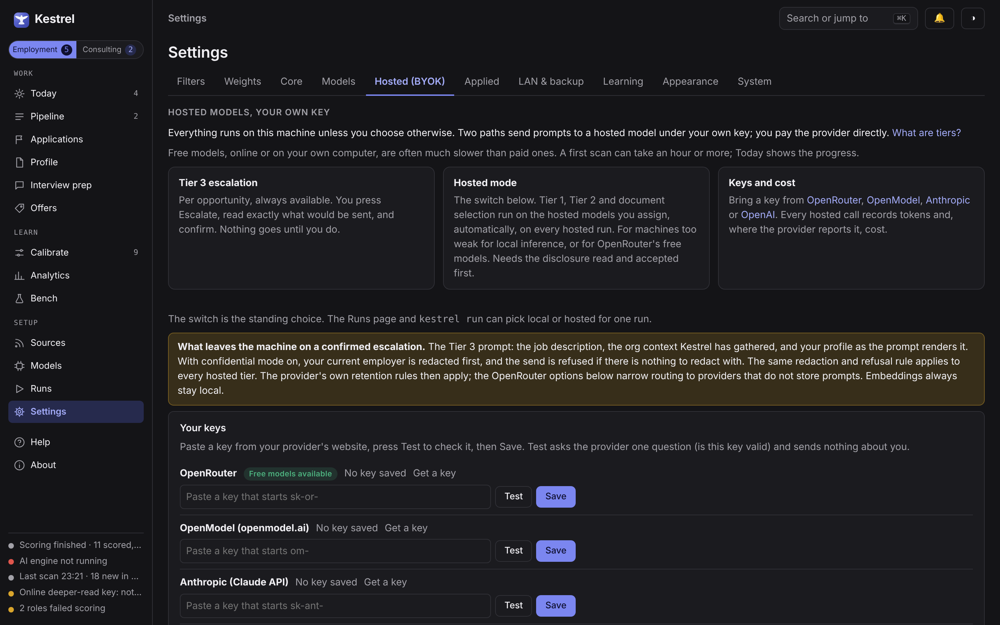

# Kestrel user guide

[Back to README](../README.md)

Everything here can be done from the app. Commands appear only for those who prefer a terminal.

## System requirements

Kestrel runs on Windows 10 and 11, macOS 13 or later on Apple silicon, and 64-bit Linux. The
table is for running the AI models on your own computer.

| | Minimum | Recommended | Best |
|---|---|---|---|
| Windows and Linux | 8 GB RAM, CPU only (slow) | NVIDIA GPU with 12 GB VRAM and 16 GB RAM | NVIDIA GPU with 16 to 24 GB VRAM and 32 GB RAM |
| Mac (Apple silicon) | 16 GB | 32 GB | 64 GB or more |

Disk space: about 8 GB for the smallest set of models up to about 22 GB for the largest, plus
about 1 GB for the app and its data. A computer with no supported GPU still works, either on the
CPU or with an online model under your own key (setup recommends the online route there; see [No GPU? Run everything hosted](DEVELOPERS.md#no-gpu-run-everything-hosted)).

## First run

Kestrel opens to a "Finish setup" banner. Follow it: pick local AI on this computer or an online
model with your own key, let Kestrel check your computer, download the models (a one-time
download of a few GB for local AI), and build your profile. Each step has a button, and commands
only appear behind a "Show details" toggle for anyone who wants them. The Setup page is always in
the sidebar if you want to change your mind later.

Your data stays on your computer:

- Windows: `%LOCALAPPDATA%\Kestrel`
- macOS: `~/Library/Application Support/Kestrel`
- Linux: `~/.local/share/kestrel`

## Unsigned beta

This beta is not code-signed yet, so Windows and macOS show a warning the first time you open it.
The installer is the same file you would trust either way; signing comes later. Here is how to
get past the warning once:

- **Windows (SmartScreen):** when "Windows protected your PC" appears, click **More info**, then
  **Run anyway**.
- **macOS (Gatekeeper):** right-click (or Control-click) Kestrel in Applications, choose **Open**,
  then click **Open** again in the dialog. After that it opens normally.

Signing is planned for a later release; [RELEASING.md](RELEASING.md) says how it will be added.

## Linux

Linux shows its own window when the GTK WebKit bindings are installed, and otherwise opens
Kestrel in your default browser. The tray icon needs a desktop with AppIndicator support. The full
instructions are in [docs/LINUX.md](LINUX.md).


## Configuring sources

Two tracks, each with its own sources:

**Employment track:**
- Job boards via `python-jobspy`: Indeed, Glassdoor, ZipRecruiter, Google Jobs, Dice (all public). LinkedIn is not searched.
- ATS platforms: Lever, Greenhouse, Workday, SmartRecruiters, Ashby (via public JSON endpoints)
- SEC EDGAR trigger: new C-suite filings matching your geographic and industry preferences

**Consulting track:**
- Consulting-finder platforms and fractional and interim leadership boards (public sources)
- Email trigger sources: set an email address in your profile, and forward interesting opportunities to trigger ingestion and scoring

Both tracks support manual paste: copy a job posting as plain text or HTML and Kestrel deduplicates it against existing opportunities.

Configure sources and profiles in the Settings page (gear icon) or via the command-line `doc` / profile commands.

## Where the opportunities come from

Every source has a kind, fixed in code: five ATS boards (Greenhouse, Lever, Ashby, Workday,
SmartRecruiters), the JobSpy aggregator (Indeed, Glassdoor, ZipRecruiter, Google Jobs,
Dice), and four consulting signal sources (SEC EDGAR 8-K filings, SAM.gov procurement notices,
RSS/Atom feeds, PE portfolio pages), plus manual capture by paste. The Help
page in the app lists each kind with what it scans, what you must provide, its rate limit and its
region, generated from the adapter registries. The same table, with the steps for adding a new
adapter, is in [`SOURCES.md`](SOURCES.md).

The shipped configuration is US-centric (JobSpy defaults to the USA, SEC EDGAR and SAM.gov are US
federal). The boards themselves work worldwide: change the search
location and your profile's `geo_rules` and the pipeline runs unchanged.

## Importing your resume and capability statement

Kestrel does not write your resume. It takes the one you have, decomposes it into sections, slots
and variants, and later selects among your own bullets per opportunity. Import accepts **PDF, Word
(.docx and .doc), Markdown and plain text**, up to 10 MB, on the Documents page (drop the file or
choose it) or from a terminal with `kestrel doc import <file>`. Legacy `.doc` files are converted
through LibreOffice when it is installed; otherwise save as .docx or .pdf first. Scanned PDFs with
no text layer are refused rather than guessed at.

The page shows the text Kestrel read beside the proposed structure, so a flattened table or a
lost heading is visible before you accept anything. Every proposed variant is checked against your
file word for word; a bullet the model reworded is flagged and cannot be accepted until you make
it your own words again.

### Setup

1. Prepare a markdown file with your resume or capability statement (roles, projects, achievements, skills). Plain markdown; no special formatting required.
2. Run:

```bash
kestrel doc import path/to/resume.md --track employment --doc-kind resume
```

This proposes a decomposition into structured roles, projects, and achievements. Review any flags (non-verbatim variants, too many derived sections) and resolve them in your source if needed.

3. Once clean, accept the import:

```bash
kestrel doc import path/to/resume.md --track employment --doc-kind resume --accept
```

This creates a `doc_master` (your canonical resume) that the system tailors per opportunity.

### Document selection (P3)

When rendering a PDF for an opportunity, Kestrel runs P3 model-driven selection: it reads the opportunity details and your role variants, and selects which roles and achievements to emphasize. The model always chooses from your existing text; it never generates new content. Every slot defaults to your full text if selection fails or confidence is low.


## Which model is doing the work, and how well

The **Models** page (also `/models`) is the history and comparison view for every model that has
evaluated anything, local or hosted: evaluations per tier and model, agreement with your own
verdicts where you have labeled outcomes, mean absolute score error, latency, tokens, and cost for
hosted sends. Every rate carries its n, and anything under five labeled outcomes reads
"insufficient (n=...)" rather than a number. Use it with `kestrel bench` (the gold-set harness)
when you are choosing between a local profile and a hosted model: bench says which model agrees
with the reference answers; the Models page says which one agrees with you.

## The learning loop

As you review opportunities, Kestrel captures your labels and feeds them back into scoring.

### How it works

1. **Label as you review:** From the opportunity detail page or the pipeline list, one-click actions let you agree with the score, adjust it, or override it entirely. Your label is recorded immediately.
2. **Calibration:** As labels accumulate (starts at five), run `kestrel calibrate` to recompute dimension weights from your feedback. A proposal shows the new weights and cross-validation error (old vs. new); review and accept in the UI/API to apply.
3. **Reranker:** Once you have fifty+ labeled examples, `kestrel train` builds a learned reranker on top of the tier 2 score. It compares both algorithms on held-out data and only promotes the reranker if all four criteria pass (lower error, better AUC, good coverage, no drift). Nothing is applied without your approval.
4. **Few-shot injection:** High-confidence labels from your gold set are injected as examples into Tier 1 and Tier 2 prompts, teaching the model what you care about.

The loop is slow to warm (week one shows random swings; by month three, you'll see clear signal), so be patient with early scores.

### Where it lives, and how to see or reset it

Every decision is a row in the local database (`data/kestrel.db`: the `label` table for the Calibrate queue, `verdict_override` for Agree, Adjust and Override), accepted calibrations are `calibration` rows plus `scoring.weights.*` rows in the `setting` table, and a trained reranker is an `ml_model` row with its two pickle files under `data/ml/`. The model's own weights are never changed and nothing leaves the machine. Settings > Learning shows all of it: counts and agreement per track (with the n, and labeled insufficient under five), the three floors as "n of N" with active or inactive, current versus shipped weights, the files in the ML folder, and the decisions themselves with a per-row delete. Download all decisions as JSON from the same tab (the export is not redacted; it is your own data), and Reset, with the typed word RESET, removes any combination of decisions, the reranker and its files, and the accepted calibrations, while leaving opportunities, evaluations, pursuits and documents untouched.


## Reaching Kestrel from your phone (optional, off by default)

Kestrel listens on this machine only until you set `server.bind_all` in `settings.yml` or as
`KESTREL_SERVER__BIND_ALL=true`, and restart. With it on, generate a shared secret under
**Settings > LAN** and scan the QR code from a phone on the same network.

Read this before you turn it on. That secret is **one shared password for the whole application**.
There are no accounts, no per-device access, and no record of who did what. Traffic is plain HTTP
and is not encrypted. Use it on a home network or a VPN you control; do not use it on shared,
public or office Wi-Fi, do not forward the port through a router, and do not put a local proxy in
front of Kestrel, which would make every request look local and switch the secret off entirely.

## Bringing your own hosted model (BYOK, optional, off by default)

Everything Kestrel does runs on your machine. The one exception is **Tier 3 escalation**: when you
open an opportunity and press Escalate, you see exactly what would be sent, and only after you
confirm does that payload go to a hosted model. That model is yours: you bring a key from a
provider you pay directly, Kestrel ships no key and no proxy.

Four providers are known by name, and any OpenAI-compatible chat-completions server can be added
as `provider: generic` in `settings.yml`:

| Provider | What Kestrel speaks to it | Key |
|---|---|---|
| **OpenRouter** (`frontier` backend) | chat completions, with privacy routing: providers that store prompts are excluded by default, Zero Data Retention is a checkbox, and the request is refused rather than routed to an endpoint that ignores the JSON schema. The one provider with free models | `OPENROUTER_API_KEY` |
| **OpenModel** (`openmodel` backend) | the Messages or Responses protocol, per model, which are the two openmodel.ai serves | `OPENMODEL_API_KEY` |
| **Anthropic** (`anthropic` backend) | the Claude API directly: the Messages protocol with the API's own structured output, so a Claude model answers with the JSON object and nothing else. No sampling parameters are sent, because current Claude models reject them; a safety refusal quarantines the item with its category instead of failing the run | `ANTHROPIC_API_KEY` |
| **OpenAI** (`openai` backend) | the OpenAI API directly: chat completions with a strict JSON schema. Reasoning models (gpt-5, o-series) take no temperature; the model list is trimmed to chat models because OpenAI lists every family in one place. A refusal quarantines with the model's own words | `OPENAI_API_KEY` |

Every hosted provider is gated the same way: the same per-opportunity Tier 3 confirmation, the same
Hosted mode disclosure, the same redaction of your current employer in confidential mode. A direct
key sends exactly what an OpenRouter key sends, so it gets no shortcut. The OpenRouter privacy
options (data collection, Zero Data Retention) exist only there; with a direct key the vendor's own
retention terms apply, linked from the Settings page. Reasoning effort is a row per provider on the
same tab, each list holding only the words that provider accepts; lower is cheaper and faster, and
"model default" leaves the provider's own setting in place.

Set it up under **Settings > Hosted (BYOK)** in three steps: paste the key (it is written to `.env`
in the data folder, never shown again, never logged, never included in a backup), press **Test**
(two authenticated metadata requests, the key check and the model list, that send nothing about
you or any opportunity, and show the models that can honor a JSON schema with their context and
price), then pick the model and press **Use for
Tier 3**. No restart. The same three steps from a terminal:

```bash
kestrel provider set-key frontier          # prompts for the key, writes .env
kestrel provider test                      # verifies the key, lists schema-capable models
kestrel provider use frontier anthropic/claude-sonnet-4.6
kestrel provider status
```



**Local or hosted, as a switch.** The top of the Hosted tab is a two-way choice, **Run Kestrel
on: Local models / Hosted models**. Local is the default and shows the active hardware profile
and its tier models; Hosted shows the provider and the per-tier hosted models you assigned in the
**Hosted assignments** table below it (Tier 1, Tier 2, document selection; the frontier tier is
hosted in either mode). Hosted cannot be chosen until you have read and acknowledged the
disclosure and assigned a hosted model to Tier 1 and Tier 2; the button says what is missing.
Switching never touches the local models, so switching back costs nothing. `kestrel setup
--hosted` fills the table and sets the switch to hosted for you.

**Local or hosted, for one run.** The standing choice governs every run and the serve loop; one
run can differ. The **Runs** page has a **Run now** form with a Local / Hosted choice that queues
the next worker cycle on that set and then returns to the Settings choice. From a terminal,
`kestrel run --hosted` or `kestrel run --local` does the same (`kestrel scan` takes the flags too,
because filing and feed classification run through a model; job boards and ATS scans never do).
Every run in the Runs list carries a `local` or `hosted` badge, the status strip says which set
is running, and each evaluation records the model that answered.

What is enforced, not merely promised: an external backend is reached only through a confirmed
Tier 3 escalation or on a hosted run after the acknowledged opt-in, and the worker has no code
path that opts in on its own; `kestrel doctor` reports the hosted routing and warns when it
cannot be used; every Tier 3 send is recorded with the provider's own token counts and, where
reported, its cost; a confirmation token that has already been used, even for a send that
failed, is refused and you must open a fresh preview.

## Running Kestrel as a web app

Kestrel is a desktop application because the work happens on your GPU: local models, Playwright
with Edge for PDFs, and a scraper that needs a residential connection. A full port to Cloudflare
Pages or Workers is **not feasible** on the free plan, or on any plan, without rewriting the data
layer and giving up local inference; [WEBAPP.md](WEBAPP.md) records the evaluation.

What is feasible, and free, is to keep Kestrel running on your PC and publish it through a
**Cloudflare Tunnel** behind **Cloudflare Access** (one-time PIN to your email, up to 50 users on the
free plan). You get a password-protected `https://kestrel.yourdomain.com` on your phone with no port
forwarded and no shared secret in a QR code. The steps, what changes in `settings.yml`, and the
gotchas (HTMX behind an expired Access session, the 100-second response limit on long Tier 2
runs, the MCP port) are in [WEBAPP.md](WEBAPP.md).

## Privacy

- Your search and profile are confidential. The data directory (`%LOCALAPPDATA%\Kestrel`) is never committed to version control.
- Generated PDFs contain no metadata tags, headers, footers, or generator strings that identify organizations.
- Confidential mode redacts your current employer everywhere in generated output and list views if enabled.
- All inference is local unless you explicitly opt in to a hosted Tier 3 backend for a specific opportunity.
- Backups never include `.env` secrets; they contain only the database and YAML config.
- The Backup page in the app downloads that same archive and exports or imports `profile.yml` on its own; nothing in it ever carries an API key.

## Support and diagnostics

Kestrel is free. Source code, issues and feature requests live at
https://github.com/distantsoil/Kestrelapp; if it earned you an interview, you can support its
development at https://ko-fi.com/distantsoil. Both links, the version, and a **Download
diagnostics** button are on the app's About page. The diagnostics zip holds the version and build
facts, hardware, the preflight report, redacted settings, the log tails, row counts and the last
quarantine rows; it never holds `.env` or any key, `profile.yml`, your document text, posting
descriptions, contacts or the database, so it is safe to attach to an issue.


## Troubleshooting

**"context window silently truncates" errors in scores?**  
Run `kestrel models build` to create derived models with explicit `num_ctx` per tier. Then run `kestrel doctor` to verify.

**Ollama not reachable?**  
Check that Ollama is running and accessible at the URL in Settings (default: `http://127.0.0.1:11434`). The preflight wizard can open the download page if you need to install Ollama.

**PDF render fails or is over the page limit?**  
Reduce the number of roles or achievements in your document, or hide optional slots. The CLI will suggest which slots to hide.

**High token usage despite reasoning being disabled?**  
Verify `reasoning_effort: "none"` is set for your backend. Use `kestrel doctor --quick` to skip the slow probes and get a quick report.

**Database locked or corrupted?**  
SQLite uses WAL mode with a 5-second busy timeout. If the database is stuck, kill Kestrel, then:
```bash
rm %LOCALAPPDATA%\Kestrel\kestrel.db-wal
rm %LOCALAPPDATA%\Kestrel\kestrel.db-shm
```
Then restart. Queued tasks are resumable; only in-flight tasks are lost.

