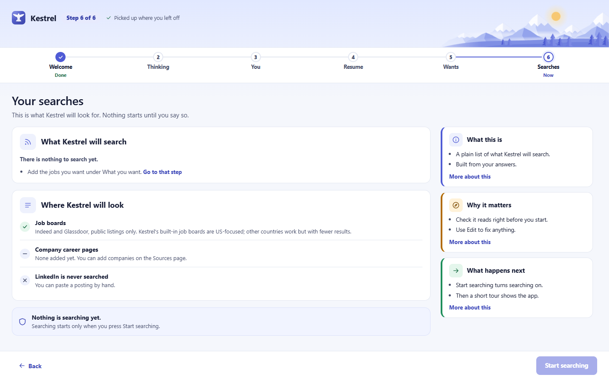
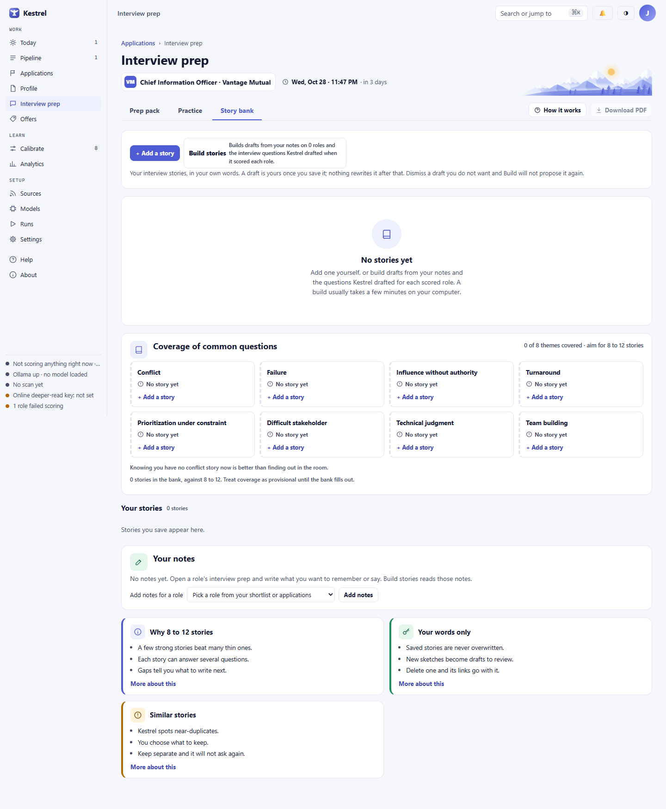
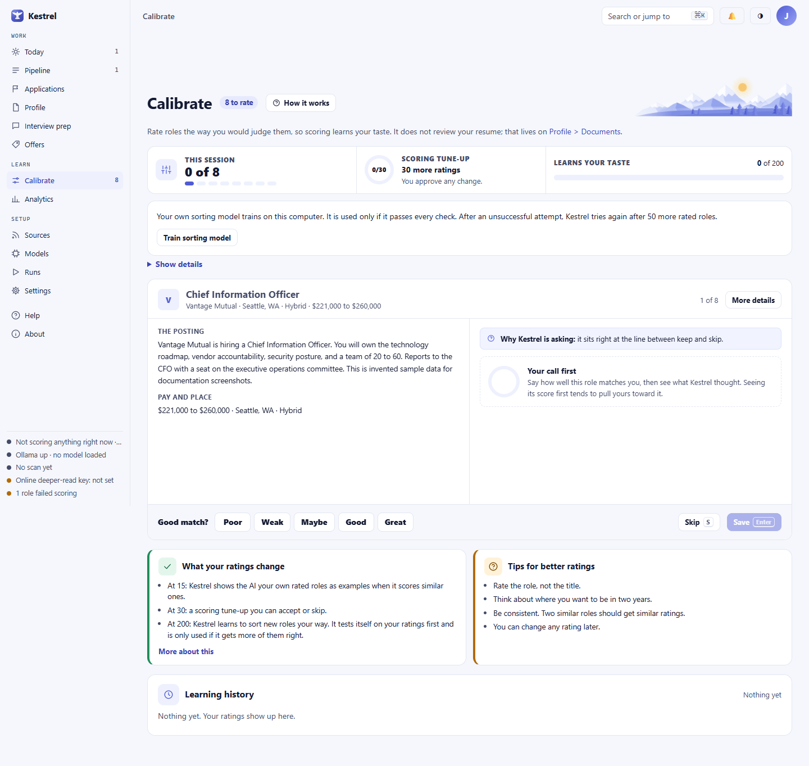
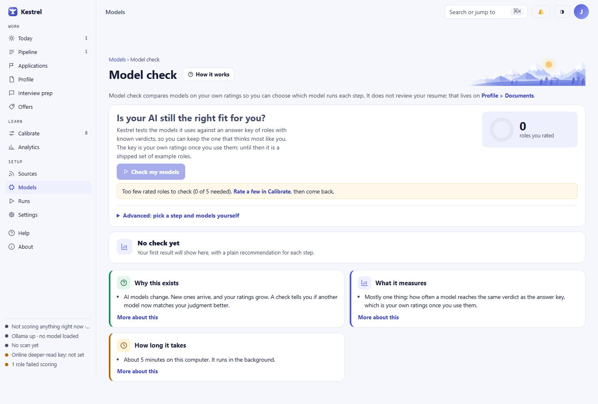
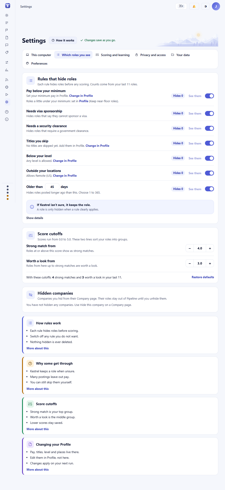

# Kestrel user guide

Kestrel helps you find roles, decide which are worth your time, prepare your own materials, and track what happens. It never applies or contacts anyone for you. The screenshots use invented people, companies, roles, and offers.

## First run: set up your search

Open Kestrel and follow the six steps. [See the first screen](images/walk/onboarding-welcome-light.png). **Welcome** explains the boundary: Kestrel drafts and hands over; you decide what to send. **Thinking** asks where the AI should run. **You** collects the name Kestrel uses to greet you and the contact details for your resume. **Resume** lets you inspect imported text before accepting it. **Wants** sets your target titles, pay, work mode, and places. **Searches** previews the public searches. Nothing searches until you press **Start searching**. Use **Back**, **Next**, or **Skip for now** where offered. The wizard saves its place if you close the app.

**On this computer** runs the model locally. Kestrel may need to download models first. **Online model** uses a key you provide and your own service account; you must connect that key to continue with this choice. **Both** can use local and online models for different steps. The setup screen explains what each choice sends. You can stay local without a key, change the choice later in **Settings > This computer**, and see the active models on **Models**. Never enter a key in a screenshot or support request.

The walkthrough after setup points to Today, Pipeline, Calibrate, and Applications. **Replay the walkthrough** is in Help. To restart setup later, open **Settings > Your data**. [See the empty first run](images/walk/first-run-empty-light.png).

## Today: decide what needs attention

Start here for a daily pass. The status strip shows the last or next run, new roles, and the model in use. **Run now** starts a scan. **Top matches today** holds new roles: **Save for later** bookmarks one, **Shortlist** puts it in Applications, and **Review role** opens its reasons. **Decisions waiting** lists roles you still need to decide on. **Applications needing action** calls out follow-ups and interviews. If scoring failed, **Review** opens Needs another try.

Many decisions show a toast with **Undo**. Use it promptly if you clicked the wrong action. Undo is tied to that action, so it can refuse if later changes would be overwritten. [See the Undo toast](images/walk/today-undo-toast-light.png).

## Pipeline: narrow and review roles

Use **Search titles and companies...** to find a posting. The chips **All**, **My shortlist**, **Your call**, **Scored**, **New today**, **Saved**, **Failed scoring**, and **Hidden** narrow the list. **More filters** opens pay, fit, work type, date, company, source, and warning controls. **Save as a view** keeps a set of filters; the **View: My default** menu recalls a view. **Best fit**, **Newest**, and the adjacent sort menu change order. Hidden and failed roles remain recoverable.

Select a row for the side panel, where you can inspect fit, pay, gaps, and the reason given before choosing **Shortlist**, **Not for me**, or **Open full role**. **Not for me** asks why. The **Not a fit** section contains roles set aside by rules or by a low score; **Show** expands it. A role Kestrel could not score stays under **Scoring failed**. [See the panel](images/walk/pipeline-role-panel-light.png) and [filters](images/walk/pipeline-filters-light.png).

## Role: check the evidence

The **Evaluation** tab shows the score, pay, level, evidence, gaps, and **Your view**. Press **Yes** if the score fits your judgment, or **Adjust** to give your own rating. **Posting** preserves the posting text, **Organization** shows sourced company facts, **Documents** links related resume work, and **History** shows what happened to the role. **Open original posting** hands you to the system browser. Kestrel does not click Apply.

**More > Deeper read** opens an ask-first dialog. Read the service, model, text preview, and cost before choosing whether to send. If the online key is absent, the dialog says **Preview only**. Closing it sends nothing. [See the dialog before Send](images/walk/role-online-ask-light.png). The same principle applies to online resume import, scoring, research, prep, and negotiation: an online step names what leaves this computer and needs your confirmation.

## Applications: keep the next action visible

The **Board** groups pursuits by stage. Use a card's stage button to update it, its next-step button to record progress, and its three-dot menu for actions such as **Mark high priority**. The **Table** view makes scanning and sorting easier. Search, **More filters**, recent-activity choices, and the Closed-column control reduce clutter. A quiet application can offer **Mark as ghosted?**. The status history stays with the pursuit.

Adding a role to Applications records your decision; it never submits an application. Keep the next action and due date current. [See the list](images/walk/applications-list-light.png) and [card menu](images/walk/applications-card-menu-light.png).

## Profile: tell Kestrel what to look for

**About you** holds contact details. **Employment** sets target titles, pay, and other criteria; suggested titles are only added when you press **Accept**. **Consulting** appears when that track is on. **Location** matches named places and your aliases, plus remote work; it does not calculate mileage. **Stories** holds examples in your own words. The **Documents** tab opens your resume material. The edit tabs have an explicit save; document edits save as you go.

## Documents: keep the source text accurate

Import a Word, PDF, plain text, or pasted resume. Check **What Kestrel read** against the source and resolve any flagged line before accepting the proposed sections. In Documents, edit sections, slots, and alternate bullets. The text you accept is the only text Tailor can place in a resume.

## Tailor: choose lines for one role

Open Tailor from a role or application. It selects among your saved bullets and cannot write a new claim into the PDF. On the review page, open **Other wordings** to select another of your own variants, inspect **Preview**, then use **Download PDF** or **Use for this application**. **Pick for this role** asks the configured model to choose from your saved text.

## Interview prep: prepare your examples

Open **Interview prep** from an applied role. **Prep pack** gathers the role, likely questions, your stories, and questions to ask. **Practice** lets you rehearse; **Story bank** links reusable examples you wrote. **Download PDF** is available after a pack exists.

## Story bank: keep your own examples

Write short accounts of what happened, what you did, and what changed. Reuse them in prep and practice. Kestrel can suggest a relevant story, but the saved account remains yours to edit.

## Mock interview: practice in private

Open **Mock interview** from a role or prep pack to rehearse likely questions and review your answers. This is a practice session inside Kestrel; it does not contact an interviewer.

## Offers: compare terms you received

Use **+ Record an offer** to enter the terms you received. **Compare** lays out first-year and longer-term money and your own ratings of scope, reporting, location, risk, and direction. Under five similar roles, the comparison says **Too few** instead of presenting a shaky market range. **Negotiate** helps draft language above the walk-away amount you set; you copy it into your own message. Kestrel never sends it. **History** keeps prior offers.

## Company: research a known organization

Open a company from a role. The page keeps public facts, source links, research, and contacts together. **Research company** asks Kestrel to collect public information; unknown facts stay blank. Treat a summary marked **too few sources** as a lead to verify, not a confirmed profile.

## Sources: control where roles come from

Review enabled searches and company boards, their last results, and errors here. **Score everything now** handles roles waiting in the background and may take considerable time. When its configured model is online, Kestrel shows the destination and asks before sending. You can paste a posting yourself. Kestrel does not automatically search LinkedIn; paste a public posting if you want it considered.

## Runs: check what finished

**Runs** shows current work and scan history. Open a run to see counts and source errors. A board rate limit makes a run partial rather than hiding its other results. If a model answer cannot be read, its role remains in Pipeline and appears in Needs another try.

## Needs another try: recover failed scoring

This page lists roles kept after a model answer failed validation. Read the error, choose **Score again** when the model is ready, or inspect the role yourself. An online retry asks first. Nothing here silently rejects a role.

## Calibrate: teach Kestrel your judgment

Rate roles that need your call. Your rating and optional note become examples for later scoring. A few labels cannot establish a reliable pattern; Kestrel says when there are too few. You control whether proposed scoring changes are applied.

## Analytics: see whether the search works

Choose **Last 30 days**, **Last 90 days**, or **All time** for the whole page. **Summary** gives a short written account; check it against the numbers. The charts show application stages, the narrowing funnel, replies by fit score, sources, timing, and pace. **Table view** exposes the same data without charts. **Export** offers **Summary and charts (PDF)**, **All numbers on this page (CSV)**, and **Every application and its history (CSV)**. Exports save locally and send nothing to a service.

## Models: know what reads your data

**Models** shows which model handles each scoring step, whether it runs locally or online, local model downloads, health checks, and quality and cost. **Run check** tests the local setup. **Change model** lets you select a model for a step; an online choice names what it can read and asks for confirmation.

## Model check: compare alternatives against your ratings

**Check my models** opens Model check from Models. It compares models against your own ratings when there are enough examples. The check runs in the background and can resume after a restart. Review the recommendation and the numbers before choosing a change.

## Settings: adjust the app and protect your data

**This computer** controls how models run. **Which roles you see** holds rules and score cutoffs. **Scoring and learning** contains rating controls and exports. **Privacy and access** contains **Confidential mode** and access settings. **Your data** has backup, restore, clear-data, and restart-setup controls. **Preferences** holds the track switches, **Theme**, **Color scheme**, region, text size, and notifications. Changes save as you go, often with **Undo**.

Turn on **Confidential mode** to hide the current employer you marked in Documents. Check **Hide ... as ...** and its preview. The editor retains your real source text, while list views and generated documents use the replacement. If no employer is selected, Kestrel warns that nothing is being hidden and refuses online sends until you choose one. [See confidential mode](images/walk/settings-confidential-on-light.png).

In **Your data**, press **Download a backup** before a move or restore. A backup includes your local working data, so store it privately. **Restore from a file** asks you to confirm before replacing the active data and keeps a dated copy of what it replaced. Online keys are stored on this computer and are excluded from backups. [See the data section](images/walk/settings-data-light.png).

## Help: find an answer offline

**Help** works offline. Search an article, choose a topic, or press **How it works** on a page. **Replay the walkthrough** is here if you want to revisit the tour.

## About: check the version or report a problem

**About** shows the version, update check, release notes, data and log locations, license, credits, and component versions for a bug report. Kestrel checks for updates but does not install one on its own.

