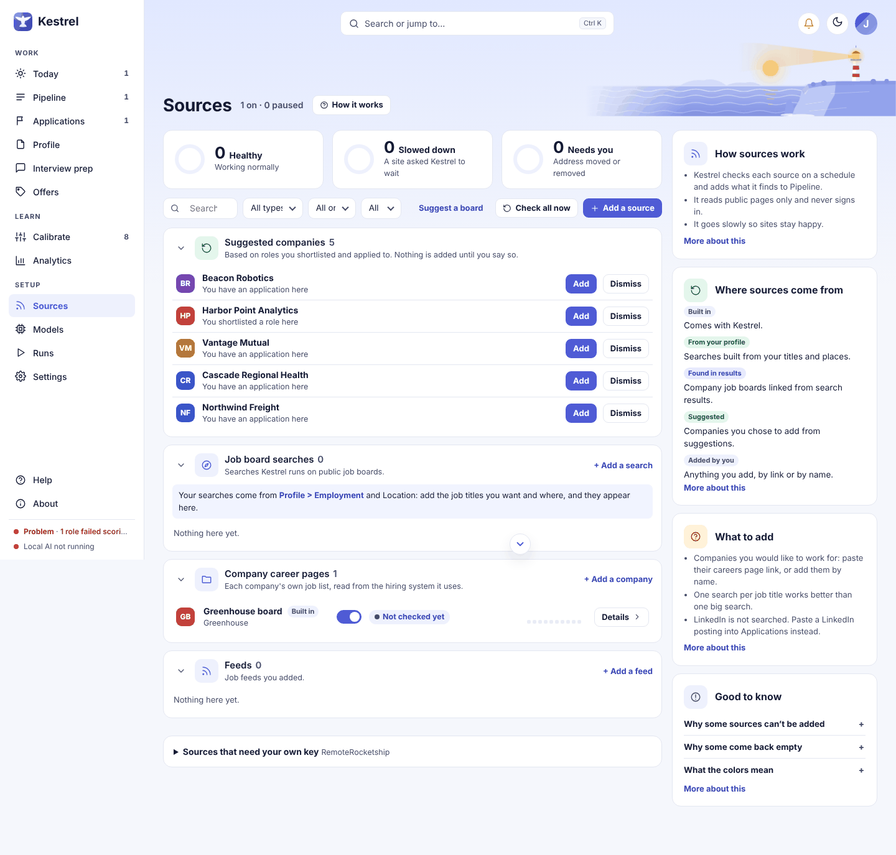

# How Kestrel finds roles

> **In brief**
>
> Sources tell Kestrel where to look for public job postings, company career boards, filings, news feeds, and consulting opportunities. Kestrel checks enabled sources on their schedules, then normalizes and deduplicates what it finds before sending new items into the right pipeline. For one role you found yourself, add a single capture instead of setting up a recurring search.

## Employment searches start with your profile

When you save your profile, Kestrel builds searches from your target titles and locations. It makes searches for each onsite metro and, if remote work is allowed, for remote roles. It can also include common title variants, such as “Director of IT” and “Director of Information Technology.” Variants are spelling and abbreviation changes, plus a curated set of title-family swaps, never reordered titles. You can remove variants from Profile. Kestrel caps the generated plan at 12 searches and limits how much title variants can expand it.

Generated searches use JobSpy to ask Indeed and Glassdoor for public results. You can add a custom job-board search under Sources and choose other supported boards, but some options have limits: ZipRecruiter blocks these requests, and Google Jobs currently returns no results through JobSpy. Indeed accepts only one extra filter per search, so use a separate search if you need a different filter.

## Company career boards add another layer

Job-board searches look across employers. A company’s career board is different: each board belongs to one employer, so Kestrel reads it separately. It supports public postings on Greenhouse, Lever, Ashby, Workday, SmartRecruiters, Rippling, ADP, Paylocity, Workable, Recruitee, Teamtailor, Personio, and Breezy HR. Any other careers page that publishes its openings as search-engine job data is read too; a page that builds its list with JavaScript is reported as one Kestrel cannot read yet. Use the company lookup where it is available. When a search result points to a supported company board, Kestrel can add that board as a daily source. A board you turn off stays off and is not automatically added again. Kestrel can track up to 40 discovered boards per track.

## Consulting includes posted work and public signals

The consulting track can search for posted contract work, including fractional and interim roles, using profile terms and service lines. SAM.gov is a separate source for US federal RFPs. It needs a free API key and can be set up under Sources. Its adapter is written against the published API shape, but the implementation has not been verified with a live key.

Consulting also watches for public events that may point to a need for outside help. The supported signal sources are SEC filings, configured RSS or Atom feeds, and configured private-equity portfolio pages. The SEC watch defaults to field-neutral phrases about acquisitions and officer departures. You can opt in to sending up to three target titles in those searches; SEC requests require a real contact address. Portfolio-page reads respect the page’s robots.txt rules.

Kestrel classifies each signal and records its evidence on the organization. A relevant signal above the configured confidence threshold can become a consulting trigger. Lower-confidence signals remain recorded; three distinct weak signals for the same organization within 90 days can promote that organization. A trigger describes a possible need.

## Add one role you found yourself

If you already have a posting, add its link or text as a one-off capture from Applications or Leads. Manual capture is not a scheduled source. LinkedIn is never searched automatically; paste a LinkedIn posting if you want it in Kestrel. Kestrel does not apply, send email, or message anyone for you.

## What happens during a check

An enabled source runs on its own cadence. You can check one source from its details or choose **Check all now**. Kestrel reads public pages and feeds, identifies itself in requests, rate-limits requests by host, and respects robots.txt where required. Workday, for example, is limited to one request per second; the SEC limit is lower than its published ceiling. Pages behind a login are not fetched.

Fetched postings are normalized into common fields such as title, employer, location, description, and compensation when available. Kestrel groups duplicates using the employer, title, and normalized description, with a title-similarity check within the same organization. When a company ATS copy exists, it has priority as the canonical record.

A source can finish as **partial** if a request is limited, one query fails, or one posting cannot be processed. Kestrel keeps the results it already collected and continues with other work. The Sources page shows the issue so you can decide whether to retry, edit, or pause that source. After three consecutive failures, Kestrel turns a source off and records a notice.

## Where to find it in the app

- [Sources](../guide/sources.md) explains source status, searches, company boards, and consulting signals.
- [Profile](../guide/profile.md) covers the titles, locations, and work preferences used to build searches.
- [Pipeline](../guide/pipeline.md) explains how found roles move through review.
- [Applications](../guide/applications.md) covers one-off role capture and application tracking.
