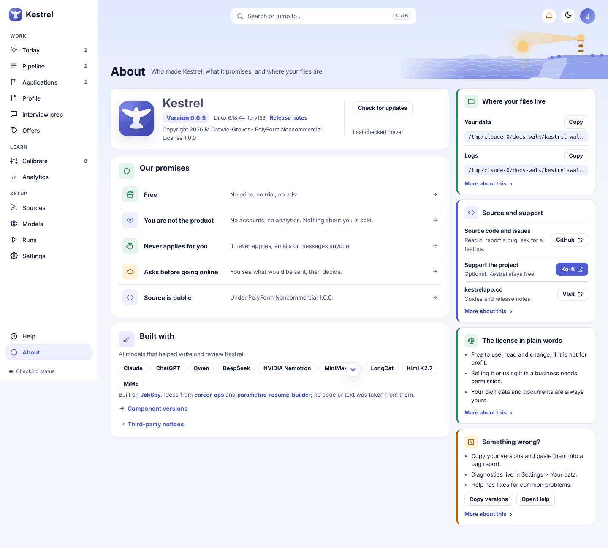

# About: version, updates, files, and bug reports

Use **About** to confirm your Kestrel version, check for an update, open release notes, find your data and log folders, and gather version or diagnostics details for a bug report. Kestrel never installs an update or sends a diagnostics bundle for you. The page also explains its promises, license, credits, and software components.

## Version and updates

The identity card shows **Version** and the operating system running Kestrel. Select **Release notes** to open the project changelog in a browser.

Choose **Check for updates** to check kestrelapp.co. The button is disabled while the check runs; the result appears beside it:

- **You have the latest version** means the installed version is current.
- **Kestrel _version_ is available. Get it from kestrelapp.co** means a newer version is available. Select the link to visit the download page, then choose when to download and install it.
- **Couldn’t reach kestrelapp.co. Kestrel will try again later.** means the check could not reach the site. Check your connection and try again later.

**Last checked** shows the local time of the most recent check. Before the first recorded check, it says **Last checked: never**. Checking for updates sends no information about you beyond the request itself; the site still sees the network address the request comes from. Kestrel does not download or install updates on its own. In [Settings](settings.md), **Check for updates automatically** controls the separate automatic check.

## Your files

The **Where your files live** card shows **Your data** and **Logs** with their current folder paths. Paths depend on where Kestrel stores data on this computer.

- Select **Copy** beside a path to copy it. The button briefly says **Copied**.
- In the desktop app, select **Open** to open that folder in your file browser. Kestrel reports **Opened.** or says **Could not open it. It is at _path_.** if the folder could not be opened.
- In a browser session, the **Open** control is not available. You can still copy each path.

Your data includes your profile, roles, ratings, documents, and backups. Logs are a plain record of what Kestrel did. The folders contain private information, so review files before sharing them. [Settings](settings.md) explains backup, restore, and data controls.

## Versions for a bug report

Open **Built with**, then **Component versions**, to see the Kestrel and installed software versions. Rows include **Python**, **FastAPI**, **SQLAlchemy**, **Pydantic**, **pywebview**, **scikit-learn**, **Playwright (makes the PDFs through Microsoft Edge)**, **Database (SQLite)**, **Kestrel is serving on port**, and **Hardware profile** when available. The **Ollama (on this computer)** row starts at **Checking…** and then shows its version or **not found**. A component that is not installed may not have a row.

Choose **Copy versions for a bug report** in this list, or **Copy versions** in the **Something wrong?** card. Kestrel copies the Kestrel version and the component rows that have finished loading. The button briefly says **Copied**, and a notice says **Copied. No personal data is included.** If copying is unavailable, the button stays unchanged.

## Diagnostics for a bug report

Open **Diagnostics for a bug report** to review the bundle before creating it. In the desktop app, choose **Save diagnostics**. While Kestrel builds the ZIP, the button says **Building the diagnostics zip…**. The file is saved to Downloads, or to Kestrel's exports folder if Downloads cannot be written. The page shows **Saved to** and the saved path. If available, choose **Open folder** to show the file in Explorer. If saving fails, the page says **Could not save the diagnostics bundle** with an explanation.

In a browser session, choose **Download diagnostics**. The browser downloads the ZIP. If the bundle cannot be built, the page says **Could not build the diagnostics bundle** with an explanation.

The ZIP contains:

- **README.txt**: a contents list and privacy notes.
- **summary.json**: app and system details, hardware, active profile, data-folder path, database schema, run mode, hosted-mode state, counts, and recent runs and scans.
- **doctor.json**: the saved preflight report, or a quick check if no report has been saved.
- **settings.redacted.yml**: effective settings with secret values replaced and backend addresses hidden.
- **logs/**: the last 2,000 lines from each log file.
- **quarantine.json**: up to 20 recent quarantined responses, with each raw response cut to 500 characters.
- **packages.txt**: installed Python packages and their versions.

Every text file masks bearer and API tokens. When confidential mode is on, the current employer is replaced by your placeholder in logs and quarantine text. Apart from the quarantine excerpts described below, the bundle never includes `.env` or secret values, `profile.yml`, resume or other document text, opportunity titles, descriptions or URLs, organization names, contacts, outreach drafts, or the database file itself. The summary does include system details, counts, backend names and model names, and the data-folder path.

Review the ZIP before sharing it. A quarantined model response can repeat part of a posting, so **quarantine.json** may contain up to 500 characters of raw response text. Delete that file from the ZIP if you do not want to share those excerpts. The bundle is saved or downloaded locally; Kestrel does not send it. You choose whether to attach it to a GitHub issue or give it to a reviewer. The [Help guide](help.md) covers common problems, and [Settings](settings.md) describes the diagnostics option under **Your data**.

## Promises, license, and credits

Under **Our promises**, select a row to read its details. The promises are **Free**, **You are not the product**, **Never applies for you**, **Asks before going online**, and **Source is public**. Kestrel does not apply, email, or message anyone. Online model use asks first and shows what would be sent; local processing is the default.

Kestrel's license is **PolyForm Noncommercial License 1.0.0**. The **The license in plain words** card explains that personal, hobby, research, and similar noncommercial use is allowed. Commercial use requires permission. The full license text is in `LICENSE.md` in the source repository. Each bundled library has its own license; open **Third-party notices** and choose **Open the notices as a page** to read those license texts.

**Built with** credits the AI models that helped write and review Kestrel: Claude, ChatGPT, Qwen, DeepSeek, NVIDIA Nemotron, MiniMax M3, LongCat, Kimi K2.7, and MiMo. **Built on** links to JobSpy, which provides the job-board ingestion layer. **Ideas from** links to career-ops and parametric-resume-builder; Kestrel says it took no code or text from them. The plain-writing rules for generated text (no dashes as punctuation, no stock words, no invented detail) take their idea from the open source avoid-ai-writing skill by Conor Bronsdon (MIT license). Kestrel copies none of its text or code, and the check that looks over generated text is Kestrel's own.

The **Source and support** card links to the GitHub source and issues, Ko-fi, and kestrelapp.co. Ko-fi support is optional and does not buy features or priority. The **Something wrong?** card offers **Open Help** and bug-report guidance.

## Loading and error states

Some information appears after opening a section or checking a service:

- **Ollama (on this computer)** may show **Checking…** until its local version check finishes. If Ollama cannot be found, the row says **not found**.
- **Third-party notices** initially says **Loading…**. If the notices fail to load, the section says **The notices could not be loaded. Use the link above to open them as a page.**
- An update check that cannot reach the site shows the message described above and leaves the page available.
- A diagnostics build or save error appears inline, next to the diagnostics controls, so you can retry or use the browser download path when available.

The [Models guide](models.md) covers model status and checks. For the complete page image list, see the [screenshot index](../images/walk/INDEX.md).

## Related guides

[Settings](settings.md) · [Help](help.md) · [Models](models.md) · [Screenshot index](../images/walk/INDEX.md)
