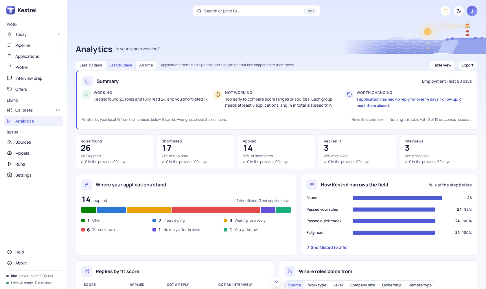
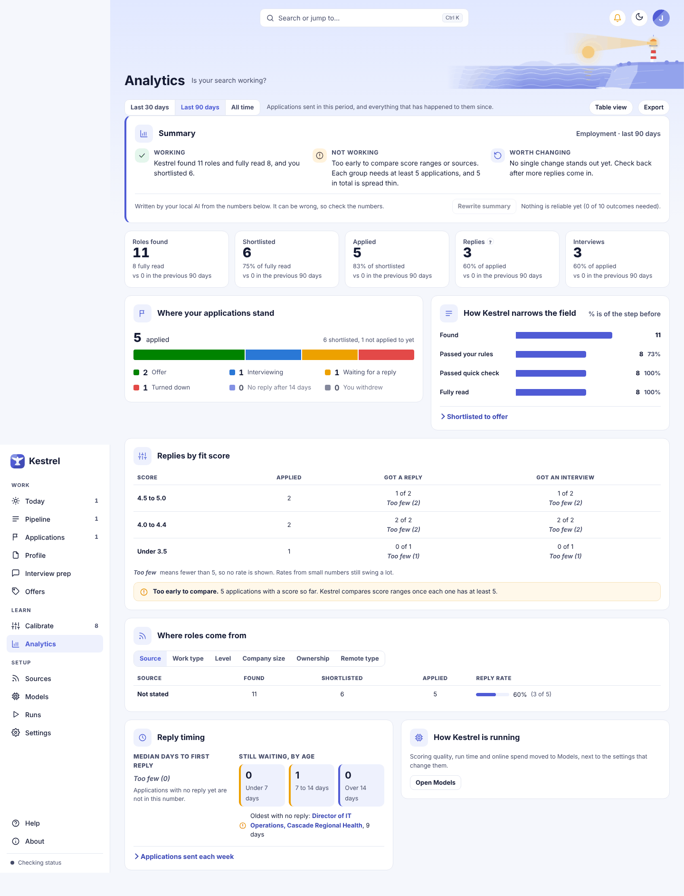
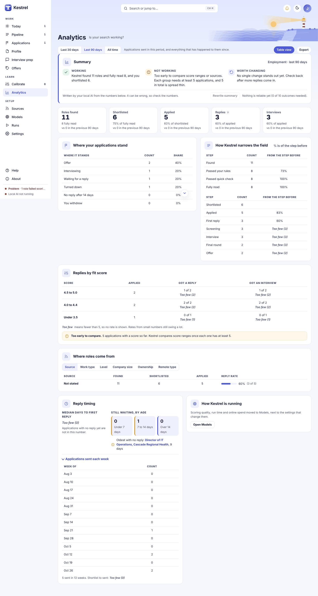
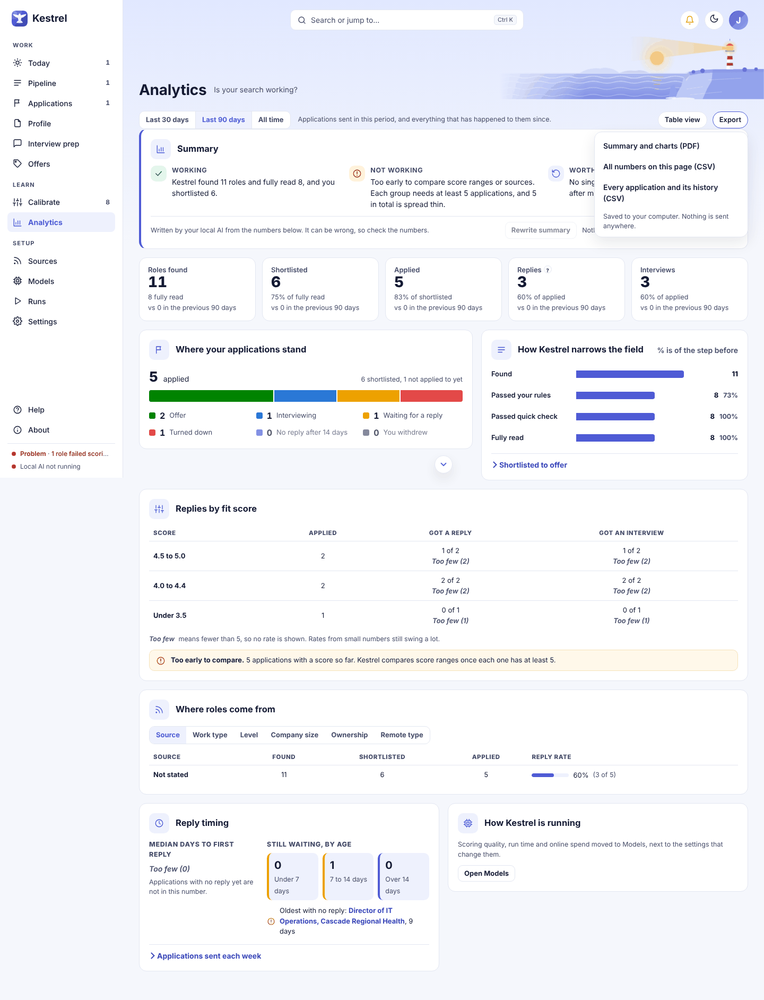

# Analytics: see whether the search works

Use Analytics to check whether your search is producing useful applications or consulting conversations. Choose a date range, then read the code-built summary alongside the counts and rates; Kestrel labels small samples so they are not mistaken for reliable patterns.

## Choose a date range

Use **Last 30 days**, **Last 90 days**, or **All time**. The default is **Last 90 days**. One selection updates the whole page, including the summary, counts, charts, and breakdowns. The PDF and numbers exports use the same selection; the applications history export always covers every tracked item on the track. The note beside the controls says whether the page counts **Applications sent** or **Leads contacted** during the period, followed by everything that happened to those items since.

Analytics groups roles found by when Kestrel first found them. For tracked applications and leads, it uses the sent date when available, then the first shortlist date, later activity, or the date first found. The page keeps that group consistent across its cards and charts.

## Read the summary

The **Summary** card always starts with three explanations built from the counts on the page:

- **Working** says how many roles or leads Kestrel found and fully read, and how many you shortlisted or added to leads.
- **Not working** flags when there are too few sent items to assess the results, when score ranges are not comparable, or when the scores are not distinguishing stronger results.
- **Worth changing** points to a follow-up when an item has waited more than 14 days, or suggests what to do while results are still limited.

These explanations appear without calling a model. **Rewrite summary** can add a model-written account beneath them. It uses the selected track and date range, and a saved account appears again for that same track and range. Check the model's wording against the counts. The card says **It can be wrong, so check the numbers.**

If there are not enough outcomes to support a summary, the card says **Nothing is reliable yet** and gives the number of outcomes needed. **Rewrite summary** is unavailable until there is enough data.

## Charts and breakdowns

The count cards at the top show the main steps. Employment uses **Roles found**, **Shortlisted**, **Applied**, **Replies**, and **Interviews**. Consulting uses **Leads found**, **Added to leads**, **Reached out**, **Replies**, and **Proposals**. When a date range is not **All time**, a card may also compare its count with the previous period of the same length.

**Where your applications stand** or **Where your leads stand** groups sent items by their current stage. The legend shows the counts for each stage. Employment stages include **Offer**, **Interviewing**, **Waiting for a reply**, **Turned down**, **No reply after 14 days**, and **You withdrew**. Consulting uses **Won**, **In conversation**, **Waiting for a reply**, **Lost**, **No reply after 14 days**, and **You stepped back**.

**How Kestrel narrows the field** shows how many roles or leads were found, passed your rules, passed the quick check, were fully read, and then moved through later stages such as shortlisting, replies, interviews, or proposals. Percentages compare each step with the step before it.

**Replies by fit score** groups sent items into score ranges. It shows how many were sent, how many got a reply, and how many reached a later stage. The column names change by track, such as **Got an interview** for employment and **Got to scoping** for consulting.

**Where roles come from** or **Where leads come from** has **Group by** tabs for **Source**, **Work type**, **Level**, **Company size**, **Ownership**, and **Remote type**. Consulting also has **Trigger type**. Choose a tab to regroup the same roles or leads by that attribute. Each table shows counts found, shortlisted or added, sent or contacted, and a reply rate when the sample is large enough.

**Reply timing** shows the median days to a first reply when there are enough replies. Items with no reply are excluded from that median. **Still waiting, by age** groups unanswered items into **Under 7 days**, **7 to 14 days**, and **Over 14 days**. If there is an oldest item without a reply, its link opens the Pursuits list.

The weekly pace chart shows applications sent or leads contacted each week, up to 26 weeks. It also reports the median time from shortlist to sending when the sample supports that number. Performance and online-spend details are on [Models](models.md), under **How Kestrel is running**.

## Use Table view

Select **Table view** to show the same summary and results in labeled tables. This is useful when you want to read exact values or use a screen reader. Select **Table view** again to return to the charts. The current date range stays selected.

## Understand small samples

Kestrel needs at least five observations before it shows a rate or median as a usable pattern. With fewer, a value is labeled **Too few (number)** or **Not enough data yet (number)**, and the percentage is withheld. The score card can say **Too early to compare** when score groups do not yet have enough observations. Small counts remain visible, so you can see what the conclusion rests on.

When there is no activity in a breakdown, its table says **Nothing in this period yet.** With no roles or leads in the selected period, the summary says Kestrel has not found any in that period yet. Review [Pipeline](pipeline.md) and [Applications and Leads](applications.md) to add or update items that should be counted.

## Rewrite summary with an online model

If **Rewrite summary** uses an online model, selecting it opens an ask-first dialog. The dialog names the provider and model, says it uses your own credit, and lists the information sent. For this summary, that is the counts and rates for the chosen track and date range, with their supporting counts. It also says **Not sent: your name, contact details and your resume file.** The provider handles received information under its own terms; a free model may use it for training.

In Confidential mode, the dialog says when your current employer is hidden before sending. If Confidential mode is on and no current employer is selected, it says **This send will be held** and provides a link to Settings. There is no send button until you choose an employer. Select **Cancel** to close the dialog, or **Send and rewrite** to confirm the request. Nothing is sent before that confirmation. Review [Settings](settings.md) and [Models](models.md) for privacy and model choices.

If Kestrel refuses a request because the dialog was not confirmed or the model destination changed, it says **Nothing was sent. Confirm in the dialog first.** With Confidential mode on and no employer selected, the message directs you to choose your current employer in Settings. If the model is unavailable, the page says **Summary unavailable** and keeps the computed numbers. If the model does not provide a usable answer, it says **The model did not give a usable answer. The numbers are unchanged.**

When a local model is selected, **Rewrite summary** shows **Asking the model. This takes a few seconds.** while it works. Opening Analytics alone never calls a model.

## Export results

Open **Export** and choose one of these files:

- **Summary and charts (PDF)** saves a PDF of the summary and charts.
- **All numbers on this page (CSV)** saves each figure with its count base and any small-sample note.
- **Every application and its history (CSV)** saves each tracked item and its status history for the selected track.

The menu says **Saved to your computer. Nothing is sent anywhere.** The numbers CSV and PDF use the selected date range. The applications history CSV includes every tracked item on that track. If Confidential mode is on but no current employer is set, Kestrel refuses all three exports because it cannot hide the employer name. Add your current employer in Profile, then export again. If PDF creation fails because Microsoft Edge is unavailable, Kestrel explains that the PDF needs Edge on this computer.

## Consulting track

Analytics follows the selected track. On Consulting, the summary and count cards refer to leads and outreach. The status chart, funnel, replies-by-score columns, and weekly pace use consulting stages and terms. The source breakdown adds **Trigger type** for public events that may signal a need for outside help. See [Profile](profile.md) for consulting setup and [Applications and Leads](applications.md) for recording lead progress and outcomes.

## Related guides

- [Pipeline](pipeline.md) explains how Kestrel finds and screens roles or leads.
- [Applications and Leads](applications.md) explains tracking stages, follow-ups, and outcomes.
- [Models](models.md) explains local and online model choices.
- [Settings](settings.md) explains Confidential mode and data controls.
- [Profile](profile.md) explains Employment and Consulting setup.
