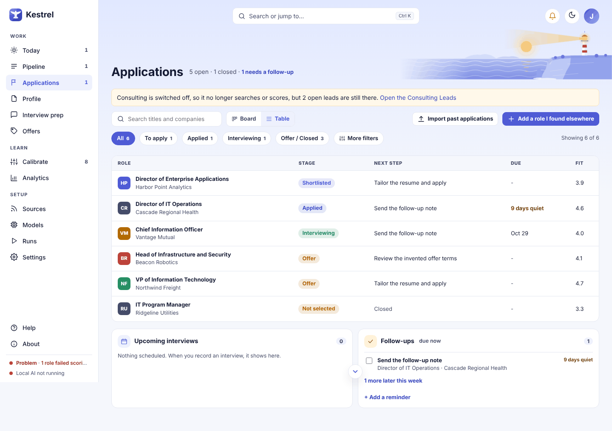
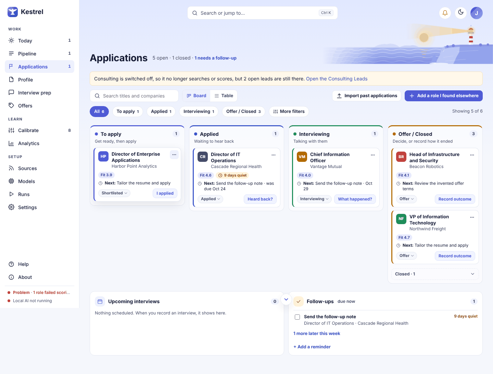

# Applications and Leads

Use this page to track roles you have applied to and the next step for each one. Kestrel records what you tell it, such as applying, hearing back, or scheduling an interview; it never submits an application or contacts anyone for you.

The same page is called **Applications** for employment and **Leads** for consulting. Its columns and action labels change with the selected track. See the [Pipeline guide](pipeline.md) to decide which roles to track, and the [Role guide](role.md) for the full posting and role details.

## Board and Table

Choose **Board** to see the four stages side by side. The stage chips above the board filter to one column. Cards show the role and organization, fit score (or **Being scored**), priority, quiet time, and the next action when one is set. A card's **Next:** line and due date help you see what needs attention.

Choose **Table** for a compact list with **Role** (or **Lead**), **Stage**, **Next step**, **Due**, and **Fit**. Select a card or table row to open its side panel. The panel slides over the board without moving it. It shows the role's next step, record actions, documents, notes, and stage history.

Drag a card to another column to move it to that column's first stage. For a specific stage, select the stage name on the card and choose one from the list. Each stage change is recorded in the History timeline. You can also select a card and press Enter or Space to open its panel.

### Employment stages

- **To apply:** Shortlisted, Preparing
- **Applied:** Applied, Screening
- **Interviewing:** Interviewing, Final round
- **Offer / Closed:** Offer, Accepted, and the **Closed** group for Not selected, Withdrew, and No reply

### Consulting stages

- **To contact:** Shortlisted, Researching
- **In conversation:** Reached out, In conversation
- **Proposal:** Scoping, Proposal sent, Negotiating
- **Won / Closed:** Won, and the **Closed** group for Lost and No response

The **Closed** group in the last column can be expanded or collapsed. Offer, Accepted, and Won remain visible in the column so you can review or update their outcome.

## Search and filters

Type in **Search titles and companies** to narrow the current board or table as you type. Select **More filters** for these controls:

- **Fit score:** Any, 3.5 and up, or 4.0 and up. Unscored roles remain visible.
- **Priority:** Any or High priority only.
- **Work type:** Any, Remote, Hybrid, or On-site.
- **Company:** Match a company name.
- **Added:** Any time, Last 30 days, or Last 90 days.
- **Follow-ups:** Show all or Only overdue.
- **Updated:** Last 7 days, Last 14 days, Last 30 days, Last 90 days, or All time.
- **Per column:** Show 5, 10, 25, 50, or All cards in each board column.

The stage chips, filters, search, and **Showing _x_ of _y_** count work together. When nothing matches, Kestrel shows **Nothing matches. Try fewer words or a different stage.** Select **Clear filters** to reset the selection. The per-column limit applies to the Board view; use **Show all** below a column to reveal its remaining cards.

## Card actions and the side panel

The three-dot **More actions** menu on a card contains:

- **Tailor resume** for employment, or **Capability statement** for consulting.
- **Open full role** to view the complete role page.
- **Mark high priority**, or **Remove high priority** if it is already marked.
- **Copy link** to copy the full role's link.
- **Remove from Applications** or **Remove from Leads** to take it off this list.

The card's stage label opens the stage picker. The button beside it changes with the current stage. For example, **I applied** opens a form, **Heard back?** opens choices, **What happened?** opens choices for an interview, and **Record outcome** opens the outcome form. These controls save your record; they do not perform the action on your behalf.

In the side panel, **Record what happened** offers the same stage-specific actions. The employment form for **I applied** lets you choose which resume you sent, the date, and a follow-up date. The **Interview scheduled** form records the date, optional time, and kind of interview. For a lead, **Reached out** records the contact straight away, and **Call scheduled** opens a form for the date, optional time, and kind of call. Use **Notes** in the panel for details you want to keep with the role. Notes save as you type.

When a role or lead ends, **How did it end?** lets you record the result, furthest stage, days to first reply, and an optional reason. For employment, results include Accepted, Declined, Not selected, and No reply. For consulting, results include Won, Lost, and No response. Select **Save outcome** to update the card and keep the outcome in its history.

## Follow-ups and reminders

The right rail lists upcoming interviews (or **Upcoming calls** for consulting) and follow-ups. Select a listed role to open its panel, or **Prepare** beside an upcoming item to open its prep page. Check a follow-up to mark it done. If a follow-up is due, **Draft follow-up** opens a draft for you to review. Kestrel writes it on your computer, or with an online model after you confirm. You can edit it, select **Copy draft**, and paste it into your own email. Kestrel never sends it.

Select **+ Add a reminder**, choose an application or lead, enter **What to do**, and choose **Today**, **This week**, or **Next week**. Select **Save reminder** to add it to the role's next action. The **Follow-ups** card lists items due now. Select **N more later this week** to see the rest.

## Add a role or lead you found elsewhere

Select **Add a role I found elsewhere** or **Add a lead I found elsewhere**. Paste a link to a public posting, its text, or both. **Title** and **Organization** are optional. A link is read once; if it cannot be read, Kestrel keeps the text you pasted. When Kestrel can use the link or text, it adds the role to the first column, **To apply** for employment or **To contact** for leads, and scores it in the background.

Kestrel refuses a link that leads to a sign-in or CAPTCHA page or redirects to another site. The notice explains that it did not read the link and asks you to copy and paste the posting text instead. If neither a link nor text can be used, the form explains what to provide. Kestrel does not submit applications or contact employers.

If there are no tracked items, the empty state explains how to shortlist a role in Pipeline, add one you found elsewhere, or bring in applications or leads you already have. Use **Import past applications** or **Import past leads** to open the import section in Settings. If your search and filters hide every tracked item, use **Clear filters** to bring the board back.

## Removal, errors, and Undo

Removing a card takes it off Applications or Leads and returns the role to Pipeline. If a saved offer exists, Kestrel asks you to confirm and warns that the offer will be deleted and cannot be restored with Undo. When Undo is available, the confirmation toast includes an **Undo** button. Select it to restore the change; the board refreshes to show the restored card.

If an action cannot be completed, Kestrel displays a notice on the page and keeps the board available. For example, it may say **That card is no longer on the board**, **Choose how it ended**, or explain why a posting link could not be read. Follow the notice, correct the missing information, or reopen the current role from Pipeline.

## Related guides and screenshots

- [Tailor a resume or capability statement](tailor.md)
- [Review a role](role.md)
- [Record and compare offers](offers.md)
- [Screenshot index](../images/walk/INDEX.md)
