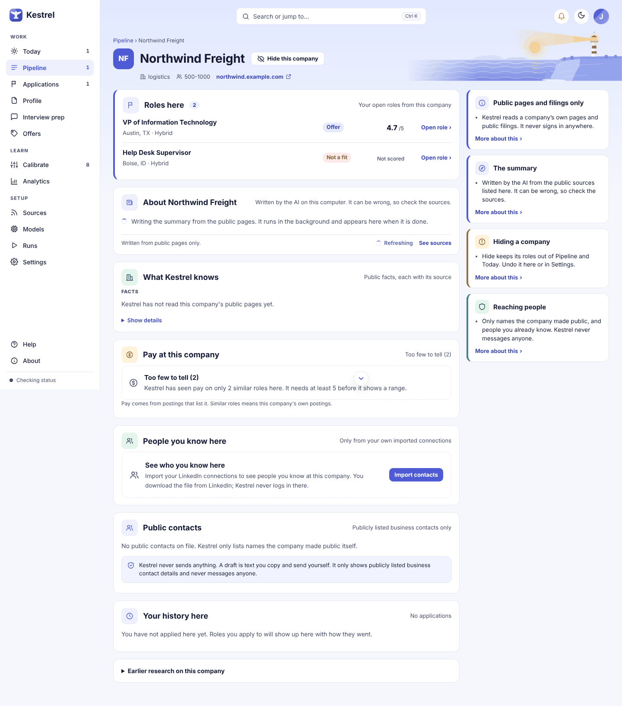

# Company: public research, roles, and contacts

Open a company from the **Organization** tab on a [role](role.md) to review its public information, open roles, pay, and contacts. Use the source links to check what Kestrel found. Kestrel reads public information only and never contacts anyone for you.

## Company details and roles

The breadcrumb returns to [Pipeline](pipeline.md). Under the company name, the page shows its sector, size, headquarters, and website when Kestrel has those details. Select the website to open it in your browser.

**Roles here** lists this company's open roles. Each row shows its title, location, a liveness note when there is one, its stage, its fit score or **Not scored**, and **Open role ›**. A liveness note may say **Looks active** or **Possibly stale: posted [number] days ago, still listed**. A stale note means the role was still on the company's careers page when Kestrel last checked; it does not confirm that the company is still hiring. Closed and archived roles do not appear here. If none remain, the page says **No open roles from this company right now.**

## About this company

The **About this company** summary is written from public page excerpts. Its label says **Written by the AI on this computer**, or names the model that wrote it, and reminds you that it can be wrong. Numbered markers point to the source for each sentence; check them against **What Kestrel knows** below. The summary can also show these tags: **What they do**, **Who they serve**, **Recent direction**, and **How they hire**.

Opening a company can queue a missing or old summary when a model on this computer writes it. The work runs in the background, and the card checks for updates while it waits. The message **Writing the summary from the public pages. It runs in the background and appears here when it is done.** means the work is in progress. **Refreshing** is disabled while a pass is queued. If a refresh is already waiting, the card says **A summary refresh is already waiting**.

Kestrel needs at least two public sources before it asks a model to write. With fewer, the card says **Not enough public information to write a summary yet.** and gives the number of sources it found. It does not ask the model to guess. If the model's answer cannot be used, the card says **The AI's answer could not be used this time.** Nothing is made up; Kestrel keeps the answer, and you can choose **Refresh summary** to try again. A failed or unusable answer does not make the company page unavailable.

When the summary would use an online model, nothing is sent when the page opens. Choose **Refresh summary** to see an ask-first panel. It names the model and says that the company's name and short excerpts from its public pages will go to the online service, using your own credit. **Not sent** lists your resume, your profile, your contacts, and your name. **Show details** shows the online setting you agreed to. **Cancel** closes the panel without sending. **Send and refresh** sends the request.

Kestrel refuses an online refresh when the model or service has changed since the panel opened, or when Confidential mode means the company name cannot be sent. In that case the notice explains why the refresh did not run. You can review Hosted mode in [Models](models.md) and set your current employer in [Profile](profile.md).

## What Kestrel knows

This section lists public facts and their sources, with the date Kestrel last saw each fact. Source labels link to the original page when a safe web address is available. A numbered marker in the summary jumps to the source for that sentence. **Recent signals** lists other public statements Kestrel found and when it saw them. Use **Show details** to read how Kestrel handles public pages and filings. Kestrel reads only public pages and filings, follows each site's rules for automated visitors, identifies itself, waits between requests, and never signs in.

If the list is empty, it says **Kestrel has not read this company's public pages yet.** A blank means Kestrel did not find a public fact, not that the company has no such fact. Small or private companies may publish less. For each statement, check the source if the detail matters.

## Pay at this company

Kestrel uses the posted yearly pay ranges in this company's own public postings. Each range becomes its midpoint. Postings with no pay listed, and postings listed per hour or per month, are left out. With at least five similar roles, the card shows **Typical**, **Middle half of roles**, and **Lowest to highest**. These are posted ranges, not what people were offered. **Show details** explains the calculation.

Below five roles, the card says **Too few to tell ([number])** and shows no range. It needs at least 5 before it shows a pay summary.

## People you know here

This section uses only your own imported connections. Select **Import contacts** to open Settings, then import a LinkedIn connections file that you downloaded yourself. Kestrel never logs in to LinkedIn. After import, people are grouped under **Works here now** or **Used to work here**. A possible match is labeled **Possible match, not confirmed**. The heading shows when you imported the connections.

If you have not imported connections, the card says **See who you know here**. If you imported them but no one matches, it says **No one in your contacts is listed here.** A **View draft** button opens a draft you can review and copy. Kestrel does not send it.

## Public contacts

**Public contacts** contains business contacts the company listed publicly, not people from your imported connections. Each entry shows its name, title, source page, and the date seen when available. **Open page** visits the source. **Copy details** copies the listed details so you can use them yourself. If copying fails, Kestrel says **Could not copy. Select the text and copy it yourself.** **View draft** opens any saved draft for you to review or copy. Kestrel never sends messages or emails.

If no public contacts were found, the card says **No public contacts on file. Kestrel only lists names the company made public itself.**

## Your history here

The history shows applications to this company, with the role, date, status, and any saved note. If there are no applications, it says **You have not applied here yet. Roles you apply to will show up here with how they went.**

Kestrel shows a reply rate only after five applications. With fewer, it says **Reply rate: Too few to tell ([number]). A rate needs at least 5 applications.** This avoids presenting a rate from a small sample as a reliable pattern. See [Applications](applications.md) to review and update pursuit history.

If earlier research exists, **Earlier research on this company** expands to show when it was written, its summary, its angle, and what Kestrel did not find. If the research rested on too few public sources, the page says so, so you know to verify it.

## Hide or restore a company

Choose **Hide this company** to keep its roles out of Pipeline and Today. Hiding does not delete anything Kestrel found. A banner then reads **Hidden. Its roles stay out of Pipeline and Today. Nothing Kestrel found was deleted.** Its **Undo** button restores the company, and **Show this company here** does the same later. You can also manage hidden companies in [Settings](settings.md). If an old Undo no longer matches the latest hide action, Kestrel says **This can no longer be undone.**

If a company link is no longer valid, Kestrel shows **Company not found** with the note that the company may have been removed or the link may be old, and offers **Back to Pipeline**.

For role decisions, see [Role](role.md). For imported data and privacy controls, see [Settings](settings.md).
