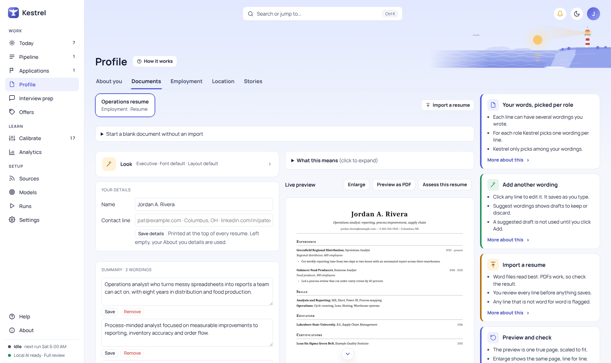

# Documents: keep the source text accurate

Use **Documents** to import or build a resume for Job search, or a capability statement for Consulting. Check the extracted text and proposal before saving, then correct the details and wording in **Profile > Documents**. Tailor chooses only from the text saved here; suggested alternate wording is not added until you choose it.

## Import or start a blank document

In **Import a resume or capability statement**, choose a **Track** and **Kind**, then select a file or paste markdown. Supported files are `.docx`, `.doc`, `.pdf`, `.md`, and `.txt`. If you choose a file, it takes precedence over pasted text. Word (`.docx`) gives the cleanest result. A PDF's text is laid out by position, so open the extracted text and check it before accepting.

Select **Propose import**. For an uploaded file, Kestrel shows **Text read from...** and **Extracted markdown** before it maps the text into sections. Compare that text with your source, and fix anything that does not match before relying on the proposal. The stages are **Uploading**, **Reading**, and **Processing**.

On **Proposed import**, review the bullets and role details. Kestrel flags any bullet that is not verbatim from the source; **Accept and create master** stays disabled until flagged items are fixed in the source and imported again. Correct company, title, or date details after accepting with **Edit role details**. If lines were not placed, choose **Leave out**, **Add to skills**, or **Add to** the relevant role for each line. Nothing is saved until you accept the proposal.

If an import action uses an online model, Kestrel opens a confirmation that names the provider, model, and information to be sent. Choose **Send and import** to continue or **Cancel** to stop. A failed proposal shows its error beside the form and may offer **Try again**, which reuses the text already read. If Kestrel cannot read the file, the error appears beside the form; choose another file or paste the text, then select **Propose import** again.

To build without importing, open **Start a blank document without an import**, choose **Track** and **Kind**, enter a **Name**, and select **Create it**. If there are no saved documents yet, the page says **No documents yet. Start a blank one or import one below.**

## Edit sections, bullets, and wording

Select a document card to edit it. **Your details** sets the name and contact line printed at the top; **Save details** saves them. If these fields are empty, Kestrel uses the corresponding details from **About you** in [Profile](profile.md). Each summary has its own **Save** button. Use **+ Add a wording** to add the first summary, or **+ Add another wording** to add another. **Skills groups** can be saved, removed, or added; a group prints as its name, a colon, then its skills.

Open a section in the tree to inspect its entries. **Edit role details** opens the company, title, start, end, and context line fields. Correct details that import flagged or misread. For a current employer, **This is my current employer** reveals **Show it as** and the names to hide when confidential mode is on.

Each **Bullet** is a slot for one achievement or proof point. **Your wording** is the original text. Edit the bullet text, or its themes (comma separated), then select **Save**. Kestrel also saves when you leave the field. Mark **Can be left out when it does not fit the role** when a bullet is optional for a shorter or less relevant document. **Add a bullet** lets you enter another bullet in your own words. **Add a role** creates a section and requires its first bullet.

**Suggest wordings** asks the configured model to draft up to two alternatives to a bullet. The model writes these drafts, so review each one against your own experience, then select **Add** to save only the ones you accept. A saved draft is labeled **Alternate wording** and marked **reworded**; it remains editable. Compare it with the original before using it. The model does not change your original wording by itself, and Tailor uses an alternate only after you add it. If an online model is selected, Kestrel asks before sending the bullet and its role details.

## Choose a look and check the preview

Open **Look** to choose the **Layout**, **Header**, **Font**, and **Accent color** for this document. These controls save the choices and update the preview. **Live preview** shows the document using its default wording. Select **Enlarge** to inspect it at a larger size or **Preview as PDF** to make a test PDF. **Assess this resume** or **Assess this capability statement** opens the model choice and asks for feedback; the assessment does not edit your text. Kestrel requests confirmation before an assessment sends document text to an online model.

## Consulting capability statements

When Consulting is enabled, choose **Consulting** under **Track** and **Capability statement** under **Kind** to import or start this type of document. Its layouts organize content such as positioning, service lines, proof engagements, and differentiators. Review the layout and preview to confirm that your own offer and proof points appear as intended. For help with employment resumes, see [Tailor](tailor.md) to learn how saved wording is selected for a role.

## Empty states, errors, and removal

An empty document says **This document has no roles yet. Add one below.** Open **Add a role** and enter its first bullet. An empty optional section is labeled **empty, not shown**; it appears in the document only after it has entries.

Import and save errors appear beside the related form. Read the message and correct the source, field, or model setup it names. When an import offers **Try again**, it reuses the extracted text, so you do not need to upload the file again.

There is no Undo for document edits or confirmed removals. **Remove bullet** deletes that bullet and all its wordings. **Remove role** deletes the role and all its bullets. Kestrel asks you to confirm these actions and states that they cannot be undone.
