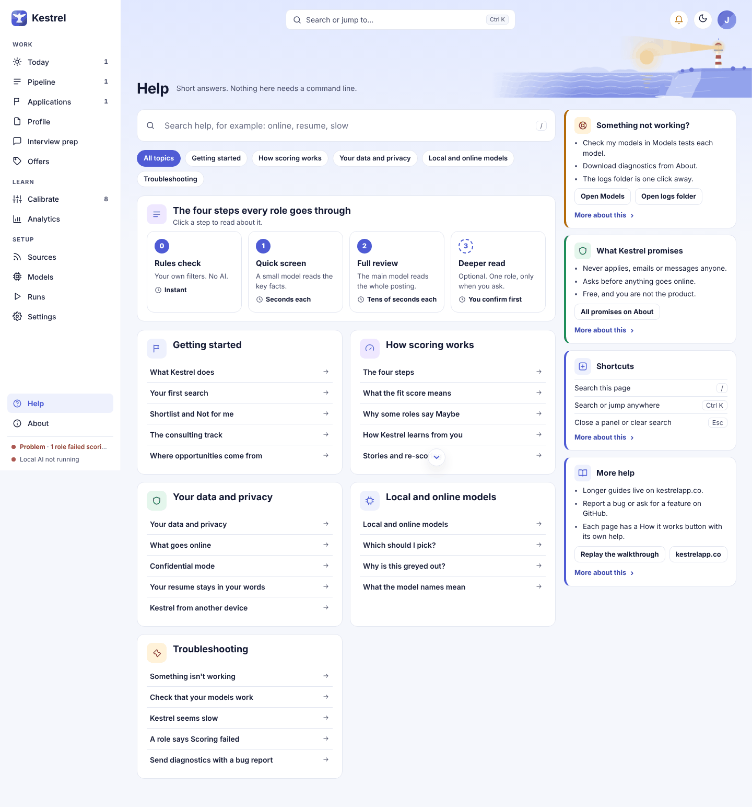

# Help: find an answer offline

**Help is Kestrel’s built-in reference for features, privacy, models, and common problems. Search its 21 local articles, filter by topic, or open a page’s How it works help; the walkthrough is available here when you want to revisit setup.**

## Search and browse

Type a word or phrase in **Search help**. Kestrel searches article titles and text as you type, and marks matching words in the article titles. You can search terms such as `online`, `resume`, or `slow` without an internet connection.

Choose **All topics** to show every article, or select a topic to narrow the list:

- **Getting started** covers the app, first search, role decisions, and consulting.
- **How scoring works** explains the four steps, fit scores, uncertain results, and how ratings affect future matches.
- **Your data and privacy** explains where information stays, online sends, confidential mode, and resume text.
- **Local and online models** explains model choices and why an option may be unavailable.
- **Troubleshooting** covers model checks, slow work, scoring failures, and diagnostics.

The search and topic filter work together. Select **All topics** and clear the search to restore the full page. Press `/` when you are not typing in another field to focus **Search help**. Press **Esc** in the search field to clear it. **Ctrl K** opens search or jump anywhere; on a Mac, use **Cmd K**.

Choose an article title to open it in the **Article** panel. The small label above the title shows its topic. Use the **Close** button to dismiss the panel. The page behind it is inactive until it closes.

## The four steps and detail sections

The cards under **The four steps every role goes through** are **Rules check**, **Quick screen**, **Full review**, and **Deeper read**. Select any card to read **The four steps** article. **Deeper read** is optional and asks before using an online model.

Use the three **Show details** sections for reference information:

- **Show details: the model names on Settings** maps model names to their work. Online assignments are used in Hosted mode, and an online deeper read waits for your confirmation. See the [Models guide](models.md) for setup.
- **Show details: Where opportunities come from** lists the source types, what each reads, required settings, region support, and rate limits. It also explains LinkedIn, RemoteRocketship, and regions. **Sources** opens the Sources page in the app.
- **Show details: Kestrel from another device** explains optional LAN access. It is off by default, and your computer must stay running. The switch is in [Settings](settings.md), under Privacy and access.

These sections appear when **All topics** is selected and the search is empty. If they are hidden, reset the topic and search filters. Links from other pages can open a section directly, for example `/help#sources`, `/help#remoterocketship`, `/help#lan`, or `/help#tiers`.

## Help cards and actions

The right column has four cards. Select **More about this** on a card to open its short explanation. Inside that explanation, **Open the full article** opens the matching article in the **Article** panel.

- **Something not working?** Use **Open Models** to check the models. **Open logs folder** opens the log location described on [About](about.md). The flyout recommends checking the models, opening the role and choosing **Score again**, then saving diagnostics on About and attaching the zip to a GitHub issue if the problem remains.
- **What Kestrel promises** links to **All promises on About**. Its full article explains privacy and that Kestrel does not apply, email, or message anyone.
- **Shortcuts** lists `/`, **Ctrl K**, and **Esc**. The flyout explains that Mac users can use Cmd instead of Ctrl, and that Tab and Enter work for keyboard navigation.
- **More help** offers **Replay the walkthrough** and **kestrelapp.co**. The first opens the setup walkthrough; the second opens the Kestrel website in a new browser tab and needs an internet connection.

Each page also has a **How it works** control with help for that page. For first-run setup, see the [Onboarding guide](onboarding.md). For the Today tour, see [Today](today.md).

## Empty results and problems

If no article matches the current search and topic, Help shows **No articles match. Try “online”, “resume” or “slow”.** Clear the search or select **All topics** to broaden the results. This is a normal empty state, not a network error.

Help’s articles and search index are included with the app, so they remain available offline. Opening **kestrelapp.co** requires a connection. If a page control or model is not working, use **Something not working?** and follow its troubleshooting order. About provides the app version, logs, and diagnostics for a bug report.

## Walkthroughs

Select **Replay the walkthrough** to open the setup walkthrough again. The [Onboarding guide](onboarding.md) explains each setup step.

The separate **Take a short tour of Today** control starts a spotlight tour of the Today page and sidebar. Use **Next** and **Back** to move through the tour, **Skip tour** to leave before the last step, or **Close** on the final card. You can also press the left and right arrow keys to move and **Esc** to close it. The [Today guide](today.md) describes the page after the tour.

## Related guides

[About](about.md) · [Models](models.md) · [Onboarding](onboarding.md) · [Settings](settings.md) · [Sources](sources.md) · [Today](today.md) · [Screenshot index](../images/walk/INDEX.md)
