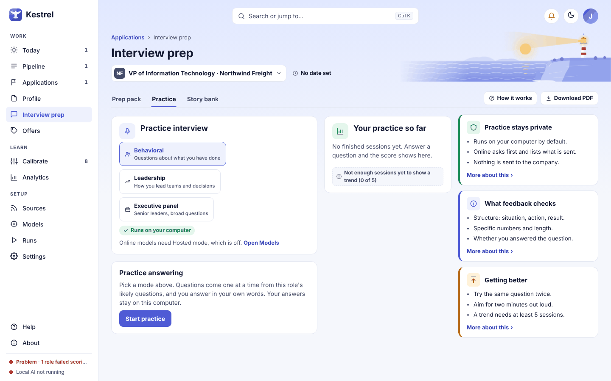

# Mock interview: practice one answer at a time

Open **Practice** in **Interview prep** or **Discovery call prep** to rehearse likely questions for a role. Kestrel asks one question at a time; you type your answer, then review scores, feedback, and claims it could not find in your resume or stories. Practice does not contact an interviewer or submit anything for you.

## Start a session

Choose a role, then open **Practice**. For a job interview, choose **Behavioral**, **Leadership**, or **Executive panel**. For a consulting lead, the only mode is **Discovery call**. The descriptions under the mode names summarize their focus: past actions, leading teams and decisions, questions from senior leaders, or a first call with a buyer.

If you opened Practice from a question in the prep pack, Kestrel shows **Starting with:** and uses that question first. Otherwise, it starts with a likely question for the role. Select **Start practice**. Starting a session does not call a model. The question and session are saved, so you can return to an unfinished session after leaving the page.

## Answer and review

Type in **Your answer**. The prompt suggests an answer you could speak for about two minutes. Answers are typed. The word count updates as you type.

Select **Show a hint** to reveal the story matched to the question, if one is available. The hint may suggest starting with what you did and the result. If there is no matching story, it suggests thinking of a similar example and adding it from the **Prep pack** tab. Select **Hide hint** to close it.

Select **Get feedback** to have the configured model review your answer. While it works, the button area says **Reviewing your answer on your computer** or **Reviewing your answer with the online model**. The feedback shows four scores out of five: **Structure**, **Specific numbers**, **Answered it**, and **Length**. It also says what worked and lists possible improvements.

Kestrel flags a claim it cannot find in your resume or stories. Choose **Add it as a story** to open the story sheet, or **Got it** to dismiss that flag from the review. Dismissing it does not add the claim to your stories or change your answer. Add only details you can support.

After feedback, choose **Next question** to show the next question. Choose **Skip** to replace the pending question with another likely question; skipping does not save an answer or produce feedback. If there are no other questions, Kestrel says **No other question to ask. This one stays.** Choose **End session** to save the answers you have completed. The unanswered question is dropped, and the finished session can be reviewed but not continued.

## Review a session

The **Your practice so far** card shows session scores and recent sessions. Before you have five finished sessions, it says **Not enough sessions yet to show a trend**. With no finished sessions, it says **No finished sessions yet. Answer a question and the score shows here.** Select a session in the list to read its questions, answers, and feedback. A finished session is read-only; choose **Back to practice** to return to the current Practice tab.

Practice does not have an **Undo** action for a submitted answer, a skipped question, or an ended session. Review the answer before choosing **Get feedback**. If you end a session by mistake, you can review its saved answers from the session list and start another session.

## Choose where feedback runs

Practice runs on your computer by default. The route line says **Runs on your computer**. If online use is available, **Use an online model instead** opens a confirmation dialog. When the full-review step is already set to an online service in **Models**, the route names the provider and offers **See what is sent** before an answer is sent.

Read the dialog before choosing **Use online model**. It names the provider, lists what will be sent and what will not, and shows the model and estimated cost for an answer when model choices are available. The practice disclosure says that questions, your typed answers, and the stories and resume lines used to check claims are sent. Your name, contact details, and resume file are not sent; the role title and company are not sent separately. The provider's own terms apply, and a free model may use submitted text for training. When the dialog opens from the computer route, choose **Stay on my computer** to close it without sending.

If you select an online model in the dialog, that choice applies only to this practice session and is not saved as a setting. Reloading the page returns to your computer. Choose **Switch back to my computer** to return to local practice; nothing further is sent. A model already assigned online in **Models** remains the configured model and still needs confirmation before an answer is sent. If Confidential mode is on, Kestrel hides your current employer before sending when it is selected in Settings. If no current employer is selected, Kestrel holds the send and explains how to continue. For provider setup and model choices, see [Models](models.md) and [Settings](settings.md).

## Empty states, refusals, and errors

- If there is no matching story for a question, **Show a hint** explains that and points to the **Prep pack** tab.
- If there are no finished sessions, **Your practice so far** displays **No finished sessions yet. Answer a question and the score shows here.**
- If Hosted mode is off, the route says **Online models need Hosted mode, which is off** and links to **Open Models**. If no online model is available, the dialog says **No online model is available** and explains what setup is needed. Practice remains available on your computer.
- An online request that lacks confirmation, uses a changed or unavailable model, or is blocked by Confidential mode is refused with a **Nothing was sent** message. Reopen the dialog to review the current provider and disclosure, or practice on your computer.
- If the model is not running or cannot be reached, the alert begins **Practice needs the model running**. If the feedback cannot be validated, it says **The feedback failed and was set aside for review. Try again.** The answer was not saved, so copy it before retrying if you want to keep it.
- An empty answer prompts **Write an answer before submitting.** If a page action takes time, the page shows **Getting the first question.** or **Saving the session.** while it works.

For the prep pack and question list, see [Interview prep](prep.md). To add or edit examples, see [Story bank](stories.md).
