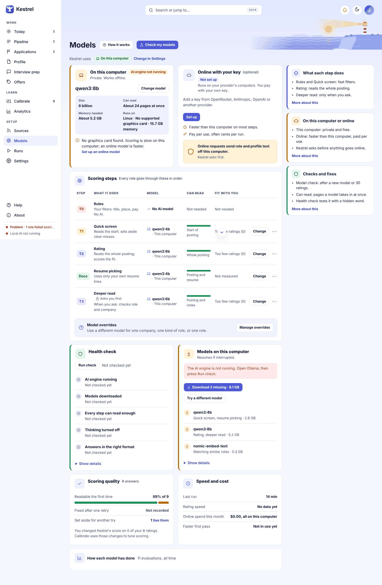
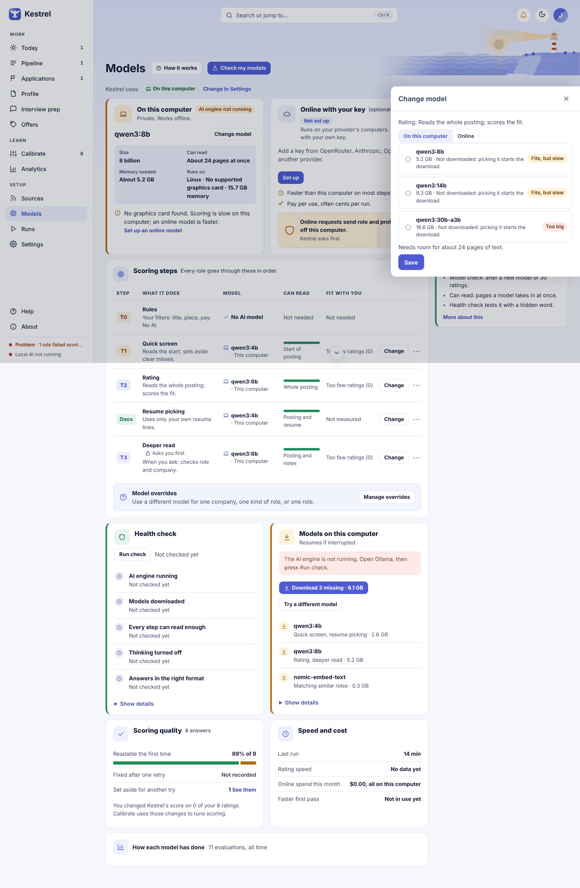

# Models: see and choose the models behind each step

Open **Models** to see which model handles each scoring step and whether it runs on this computer or online. Choose **Change** on a step to select another model, or choose **Check my models** to compare alternatives against your ratings. Use the download and health cards to finish or repair a local setup; online keys and sends have separate controls and approval.

## See the active setup

The line below the page title says whether Kestrel uses **On this computer**, **Online model**, or **Both**. Choose **Change in Settings** to change that mode. The [Settings guide](settings.md) explains the model and privacy settings.

The **Scoring steps** table is the per-step view. It lists **Rules**, **Quick screen**, **Rating**, **Resume picking**, and **Deeper read**. Rules uses no AI model. Other rows show the model name, where it runs, whether it is the **Default** or an **Override**, how much text it can read, and its fit with your ratings. Deeper read runs only when you ask. A **Change** button opens that step's model picker. **Manage overrides** opens the separate hosted-model override panel.

The **On this computer** card summarizes model size, reading capacity, memory needs, and detected hardware. Its status says **Ready**, **Needs downloads**, **AI engine not running**, or **Not used right now**. The step table shows where a particular step is active. The online card shows **Ready** or **Not set up**, the connected provider, and which steps use it. A warning on that card explains that online requests send role and profile text off this computer.

In **Fit with you**, fewer than five labeled ratings appear as **Too few ratings yet (n)**. Resume picking is **Not measured** and Rules is **Not needed**. When Kestrel finds a better match, choose **See Model check** or **Check my models** to review the comparison. The [Model check guide](model-check.md) explains the results and rating threshold.

## Download local models and check them

The **Models on this computer** card lists each model Kestrel needs and whether it is ready. **Download _n_ missing** starts the downloads and shows each model's progress. While work is running, the card refreshes its status and offers **Pause**. After pausing or an interruption, press the download button again. It reads **Download _n_ missing**. If a download fails, its row shows the error and says to press Download to continue. After the downloads, Kestrel tunes its models for the reading room each step needs; if tuning remains, choose **Tune models for Kestrel**. When a local setup has no missing downloads or tuning, **Show details** says **Nothing left to download** and reveals the speed controls.

If the AI engine is down, the card says to open Ollama and press **Run check**. When Kestrel is using an online-only profile, the local card says downloads are not needed. For supported local setups, the health check begins with five **Not checked yet** rows. Press **Run check** to test whether Ollama is running, needed models are downloaded, each step has enough reading room, thinking is off, and model answers use the required format. While it runs, the button reads **Checking…** and is disabled; the card refreshes until the result appears.

For a failed or warned reading-room, thinking, or answer-format check, press **Fix it**. Kestrel rebuilds its models, then checks them again and shows progress. The engine and download checks explain what needs attention but do not offer an automatic fix. **Show details** reveals technical results and recent log lines. If a check is already running, Kestrel says so. A failed check leaves its result and remediation on the page.

## Change a step's model

Choose **Change** beside **Quick screen**, **Rating**, **Resume picking**, or **Deeper read**. In the drawer, select **On this computer** or **Online**.

For a local model, select a radio option. Each option shows its size, whether it is the default, whether it is downloaded, and how it fits the detected hardware. The drawer also shows how many pages of text the step needs. **Save** applies the choice. Choosing a model that is not downloaded starts its download, but Kestrel does not switch to it yet. When it is ready, open the drawer and choose it again. Kestrel may tune a downloaded model for the step before switching to it. A successful save names the step and model; **Undo** reverses that change, and **Reset to default** clears an override. If the step currently uses an online model, reset it to the default before choosing a local model.

For an online model, choose **Online**. The drawer requires a connected provider and shows its name, the models that fit this step, price, and available context. Select **Free only** to filter the list. Models that cannot be used for this step stay visible but disabled, with the reason. Read **What is sent**, check the confirmation box naming the provider and credit use, then press **Save**. If no model is selected, the drawer says **Pick a model first**. If the provider is missing, the model list cannot load, or the step cannot run online, the drawer explains the refusal and leaves the setting unchanged. If Kestrel says online models need your approval, give it with the disclosure checkbox under **Use Other service** (see Set up an online provider below). The pick cannot be saved until then.

## Set up an online provider

The **Online with your key** card is optional. Choose **Set up** if no key is connected, or **Manage keys** when one is saved. In the drawer, choose a provider and paste its key into **Key**. **Test** checks the typed key without saving it; if it works, press **Save** to keep it. **Save** stores the key and asks you to press **Test** to check it. **Remove saved key** deletes that provider's saved key. The key is stored on this computer and excluded from backups; Kestrel does not echo the full key back. **Get a key** opens the provider's key page. To use another compatible service, set its address under **This computer** in Settings, or follow the **Set up another service in Settings** link on this card, then open **Use Other service** here.

Testing a key or listing available models sends the key and a provider request, not profile or role text. If no key is typed or saved, Kestrel asks you to paste one. A failed key test says the provider did not accept it and that nothing was saved. Connecting **Other service** also tests the key and lists models without sending profile or role text. Its disclosure lists the data each hosted tier sends and the provider's retention terms. Check **I understand what each hosted tier sends and that the provider's retention rules apply** to acknowledge that disclosure. Check **Switch Kestrel to online models now** only if you also want to change the model mode, then choose **Connect Other service**. A missing address, unchecked acknowledgement, invalid key, or failed provider connection appears as an inline message; correct the setup and try again.

These setup actions do not submit a role or profile to a model. Before later work runs online, Kestrel checks the hosted-use approval and shows the applicable send disclosure and confirmation at the action. Model assignment also has its own checkbox: **I understand this goes to [provider] and uses my credit**. If no provider is connected, the drawer says **No online provider is connected. Set one up under Online model first.** If approval is missing, it says **Online models need your approval first.** Give approval with the disclosure checkbox described above, then try again. See [Settings](settings.md) for privacy controls.
