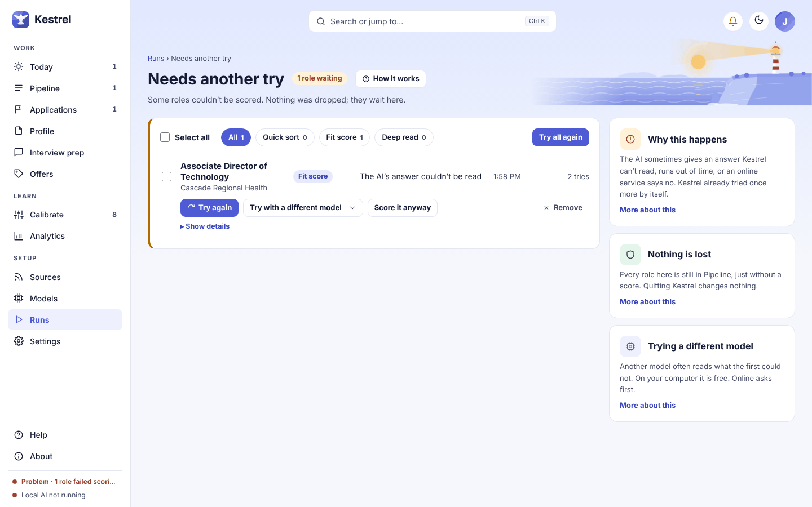

# Needs another try: recover failed scoring

Needs another try lists Employment roles and Consulting leads that Kestrel could not score. A failure is not a rejection: the item stays in Pipeline, and any earlier score remains in place. Kestrel keeps any model answer and the recorded error for review; the page uses the general word “role” for both tracks. Open it from **Runs**, from the **Failed scoring** chip in [Pipeline](pipeline.md), or from the **Review** link on Today.

See the [dark mode screen](../images/walk/needs-another-try-main-dark.png) and [narrow screen](../images/walk/needs-another-try-main-narrow.png).

## Why an item appears here

An AI answer may be unreadable, repeat itself, run out of room, time out, or be refused by an online service. Kestrel retries scoring once by itself. If it still cannot finish, the item waits here for you. A held online send can also appear here, but its **Not sent** label means the model never received it.

Each row identifies the scoring step: **Quick sort**, **Fit score**, **Deep read**, or **Other step**. The reason is shown in plain words, with the time and number of tries. A row marked **(hidden)** is a role hidden from the main Pipeline view. **No role attached** means the failure record no longer has a linked role.

## Filter and select items

The count at the top says how many items are waiting, or **All clear** when none are. The filter chips are **All**, **Quick sort**, **Fit score**, and **Deep read**. Select **All** to return to the full list. **Other step** items appear under **All**.

Select a role or organization name to open it. **Show details** expands the saved **What the AI said**, **Which model**, and, when available, **What Kestrel recorded**. These details help explain the failure; they do not count as a score. If the role had already been scored before a second look failed, the row says **Your earlier score stands. This was a second look.**

Use a row checkbox to select items, or **Select all** to select every item currently shown. The bulk button starts as **Try all again**. With selections, it changes to **Try selected again (N)**. With no selection, **Try all again** uses the current filter. With no selection, it skips items already waiting for a retry. Each row is re-queued the same way **Try again** re-queues it.

**How it works** opens a short explanation of the scoring steps and the recovery choices.

## Retry one item

**Try again** queues another scoring attempt with the same model. Scoring runs in the background. While it is queued, the row says **Trying again…** and refreshes periodically. If scoring succeeds, the row leaves the waiting list and appears in **Scored since** history. If it fails again, it stays on the list with an updated try count and reason.

If the failed attempt used an online model, **Try again** will not silently send the posting to that service again. The row explains that you can choose a model on this computer or use **Try with a different model** to confirm another online send.

**Try with a different model** opens a menu with **On this computer, free** first and **Online, uses your credit** below it. If there is no other local model available, the menu says so.

Choosing an online service opens a dialog titled `Try <role title> with an online model?`. Review **What will be sent**, the model choices, and the estimated cost for this item. The dialog says what is not sent, including your name, contact details, and resume file. It also explains that the provider handles received data under its own terms and that Kestrel cannot recall it. Free models may use submitted data for training. If Confidential mode is on and a current employer is selected, Kestrel says that employer is hidden before sending. Nothing is sent just by opening the dialog. Choose **Cancel** to close it, or **Send and try** to confirm the selected model and send.

**Score it anyway** opens a confirmation explaining that Kestrel will skip your rules check, such as the places, pay limits, and titles you set aside. Confirm with **Score it anyway** only when you want a role that your rules would normally pass on to receive a score. You can still hide it from Pipeline later. Choose **Cancel** to leave the role unchanged.

## Remove and restore

**Remove** takes the item off this list only. It does not delete the role or its saved failure details, and any earlier score stays in place. The toast offers **Undo** to restore it to this list. If a later change makes restoring unsafe, Kestrel says **This can no longer be undone.**

## Empty, waiting, and refusal messages

When the current filter has no items, the page says **Nothing in this step needs another try.** and **Choose All to see the other roles waiting.** When there are no items in any step, it says **Nothing needs another try.** and **Roles that can’t be scored will wait here until you decide.** The bulk button is disabled. Older failures that later received a score remain available under **Scored since (N)**.

When an action cannot be queued, Kestrel shows an explanation on the row or in a notice. For example, **Pick a model first.** asks you to choose a model, and **Not queued** gives the reason a model choice was refused. If the online service refused its key, open [Models](models.md) to check the key or choose a local model. If no online service is configured, the model menu says **No online service is set up. Add a key under Models to use one.** If no online model can score the item, the dialog says **No online model can score a role right now. Check Models.**

If Confidential mode is on but no current employer is selected, Kestrel says **Held, not sent.** Choose the employer in [Settings](settings.md), then retry. If confirmation is missing, Hosted mode is off, or the chosen model is no longer available, Kestrel says **Nothing was sent** and leaves the item waiting. Review the current dialog before confirming an online retry.

## Related guides and screenshots

- [Runs](runs.md)
- [Pipeline](pipeline.md)
- [Applications and Leads](applications.md)
- [Models](models.md)
- [Settings](settings.md)
- [Screenshot index](../images/walk/INDEX.md)
