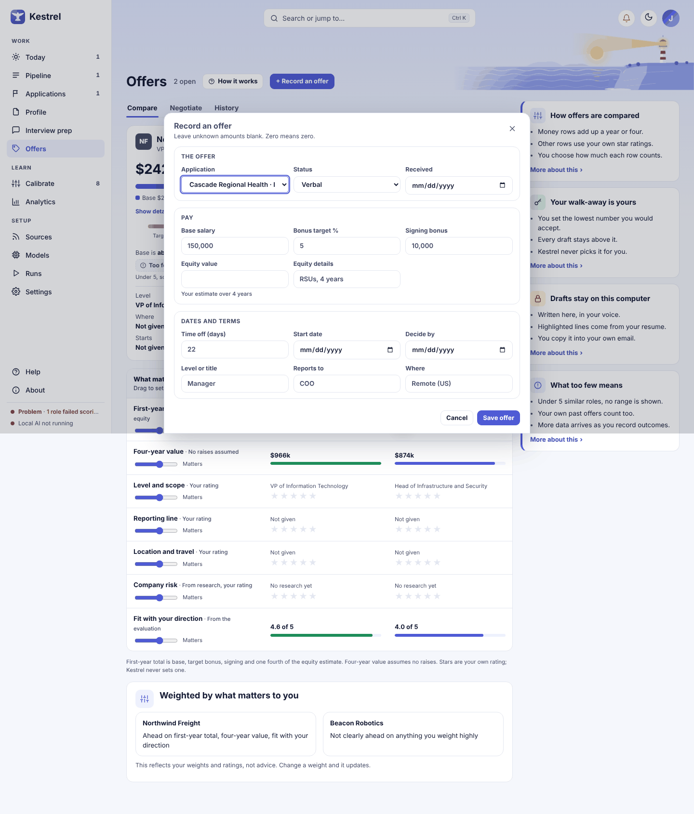
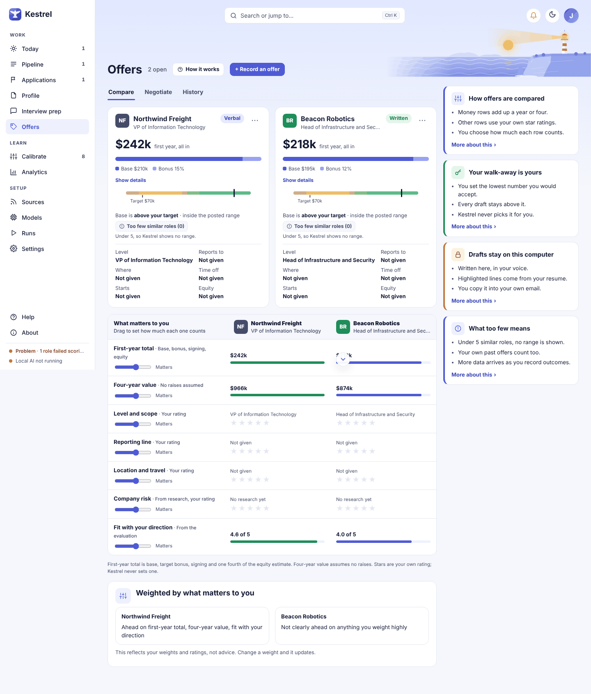
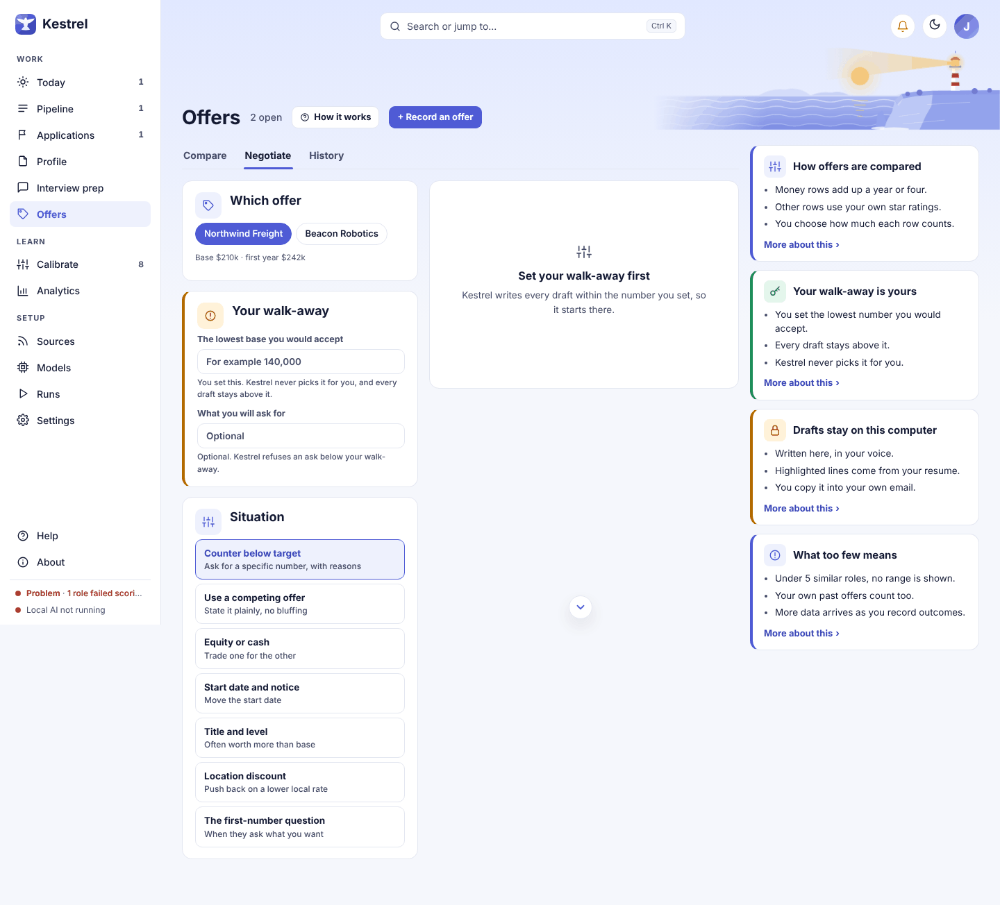
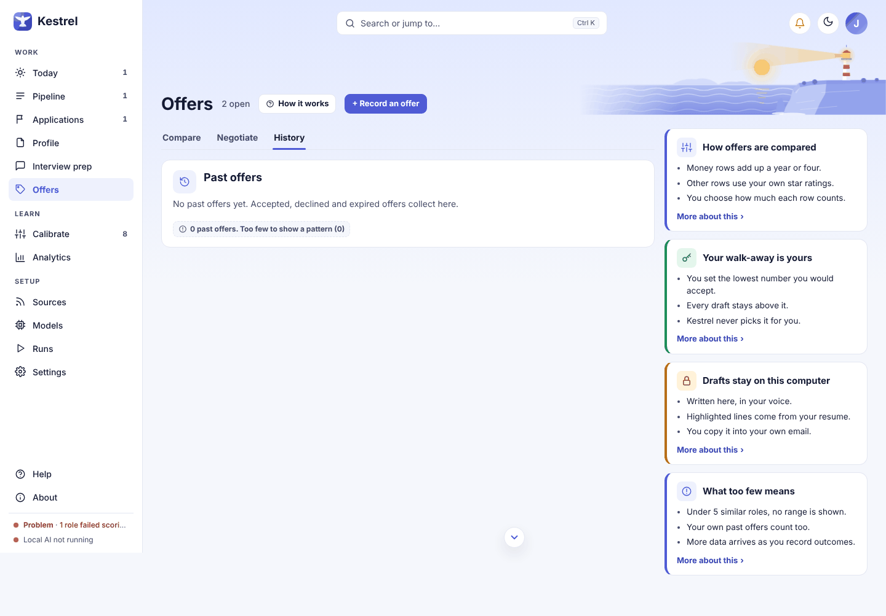

# Offers and engagement terms

Use Offers to record terms you receive and compare them with the factors you care about. The **Negotiate** tab drafts language for you to review and copy into your own message. Kestrel does not choose an offer or send a reply.

## Open the right track

Choose **Offers** in the Work menu for employment offers. With Consulting selected, the page is titled **Engagement offers** and records consulting leads. Each offer belongs to an application or lead already on [Applications and Leads](applications.md). For the track selector and setup, see [Settings](settings.md) and [Profile](profile.md).

The header shows how many offers are open. **How it works** explains the comparison. Choose **+ Record an offer** to open the entry form. When there are no offers, the page shows **No offers yet**, preparation tips, and **+ Record an offer**.

## Record or edit an offer

For a new employment offer, choose an **Application** and a **Status** of **Verbal** or **Written**. You can also enter a **Received** date. Enter the terms you know:

- **Pay:** **Base salary**, **Bonus target %**, **Signing bonus**, **Equity value**, and **Equity details**. Equity value is your estimate over four years.
- **Dates and terms:** **Time off (days)**, **Start date**, **Decide by**, **Level or title**, **Reports to**, and **Where**.

For a consulting engagement, choose a **Lead** and a **Status** of **Verbal** or **Written**. Enter **Day rate**, **Days committed**, **Length in weeks**, **Payment terms**, and **Expenses** under **Money**. Under **Terms**, enter **Renewal**, **Exclusivity**, **Who owns the work**, **Notice period**, and **Decide by**.

Leave unknown amounts blank. A zero means zero. **Save offer** records the information; if you leave the employment **Received** date blank, Kestrel uses the current date. **Cancel** closes the form without saving. To edit an open offer, open its card's ellipsis menu and choose **Edit details**. The form identifies its existing application or lead, and **Save offer** saves your changes. A successful new entry says **Offer saved and added to the comparison.** An edit says **Offer updated.**

If a required application or lead is missing, or the selected record no longer exists, the form stays open and shows an error beside its buttons. Messages include **Choose which application this offer is for.** and **That application no longer exists.** Correct the selection or open [Applications and Leads](applications.md) to add the record, then save again.

## Compare terms

Each card shows the offer status, first-year total or engagement value, deadline when known, your pay band, a similar-role sample, and the terms you entered. Expand **Show details** for the posted pay band, comp data, competing open offers, and your accepted history when available.

Employment's **First-year total** adds base salary, target bonus, signing pay, and one quarter of your equity estimate. **Four-year value** assumes no raises. A target bonus is not a promise. Consulting's **Engagement value** multiplies the day rate by the days committed; it is not guaranteed.

With two or more open offers, the comparison matrix appears below the cards. Its money rows show the values side by side. Other rows show facts and your own star ratings. Employment rows are **First-year total**, **Four-year value**, **Level and scope**, **Reporting line**, **Location and travel**, **Company risk**, and **Fit with your direction**. Consulting rows compare **Engagement value**, **Day rate**, **Payment terms**, **Expenses**, **Renewal option**, **Exclusivity**, and **Fit with your work**.

Choose one of the five stars to rate a judgment row yourself. Choose the selected star again to clear your rating. Drag each row's slider to set its weight: **Ignore**, **A little**, **Some**, **Matters**, **A lot**, or **Most**. The **Weighted by what matters to you** summary updates from your ratings and weights. It may say **Ahead on ...** or **Not clearly ahead on anything you weight highly**. This is not advice and does not name a winner.

With one open offer, the matrix says **The comparison appears when two or more offers are open.** Closing an offer can reduce the open count and remove the matrix.

### Read small samples carefully

Kestrel shows the count and no similar-role pay range when it has fewer than five comparable observations. The card says **Too few similar roles (n)**, or **Too few similar engagements (n)** in Consulting. Your own floor and target can still appear for context. Before you have offers, **What roles like yours pay** uses titles you are pursuing; it says **Too few to tell (n)** and shows no range when fewer than five observations are available. The sample count is shown so a small set is not mistaken for a firm market rate.

## Draft a reply

Open a card's ellipsis menu and choose **Draft a reply**, or select the **Negotiate** tab. Under **Which offer**, select the offer to work with. Enter **The lowest base you would accept** for employment or **The lowest day rate you would accept** for Consulting. Kestrel never fills in this walk-away number for you. The draft stays locked at **Set your walk-away first** until you enter it. **What you will ask for** is optional, but Kestrel refuses an ask below your walk-away.

Choose a **Situation**. Employment offers **Counter below target**, **Use a competing offer**, **Equity or cash**, **Start date and notice**, **Title and level**, **Location discount**, and **The first-number question**. **Use a competing offer** is unavailable until another real competing offer is on record. Consulting offers **Rate versus scope**, **Payment terms**, **Renewal option**, and **Exclusivity**. Kestrel writes the draft as soon as you choose a situation, as long as your walk-away is filled in. If it is empty, the cursor moves to that box. If the walk-away is missing, the draft stays locked; submitting without it shows **A walk-away number is required before drafting scripts.** If an ask is below it, Kestrel keeps the previous ask and says **Your ask is below your walk-away. Kestrel keeps drafts above it.** It also refuses an amount it cannot read or amounts with different units or currencies, and explains what to correct.

For a local model, the page says drafts stay on this computer. For an online model, the page names the provider and model, explains what will be sent, and asks you to check **Send this to [provider] to write the draft**. Kestrel sends nothing without that confirmation. If the confirmation is missing or the selected model or destination changed, the page says **Nothing was sent. Confirm the online draft first: tick the box that says what will be sent.** When Confidential mode is on but no current employer is selected, the online send is held and the page says **Nothing was sent. Confidential mode is on and no current employer is chosen, so Kestrel will not send this. Choose your employer in Settings.**

The result is labeled **Draft only · never sent**. Highlighted phrases identify text from your resume or stories; hover or focus a phrase to see its source. If the draft has no supporting material, it is flagged **Rests on nothing you supplied. Check it before use.** Use **Show details** to review the situation, basis, likely pushback, and any listed leverage or risks. **Draft again** requests another version. **Edit** lets you change the draft on screen. **Copy draft** copies it to your clipboard so you can paste it into your own message. Kestrel never emails, messages, or replies for you. If clipboard access fails, select the text and copy it by hand. If the model cannot draft, an error appears in the draft panel. It may say **Scripts need the local model running** or explain that Kestrel could not produce a valid response and quarantined it for review; follow the message and try again when the model is available.

If you have recorded offers but none is open, **Negotiate** says **No offer is open to negotiate.** Record an offer or choose **Reopen** from its card on **Compare** to make the draft tools available. If you have not recorded an offer, the page shows **No offers yet**.

## Review history and close an offer

Choose **History** to review accepted, declined, or expired offers. The list shows the role or engagement, base or day rate, outcome, and date received, with up to 12 recent records. Fewer than five past offers displays **Too few to show a pattern (n)**. With none, the page says **No past offers yet** and **0 past offers. Too few to show a pattern (0)**.

To record an outcome, open an open card's ellipsis menu and choose **I accepted**, **I declined**, or **It expired**. The toast offers **Undo**. Closing an offer also moves its application or lead to its matching closed outcome. For two weeks, the closed card remains dimmed on **Compare** with **Reopen** in its menu. After that it remains in **History**. Choose **Reopen** to return a recent closed card to the open comparison.

Undo reverses only the outcome change it belongs to. If later work changed the offer or its application, Kestrel refuses a stale Undo and says **This can no longer be undone.** An already-closed offer cannot be closed again; Kestrel says **That offer is already closed.** Review the current status before making another change.
