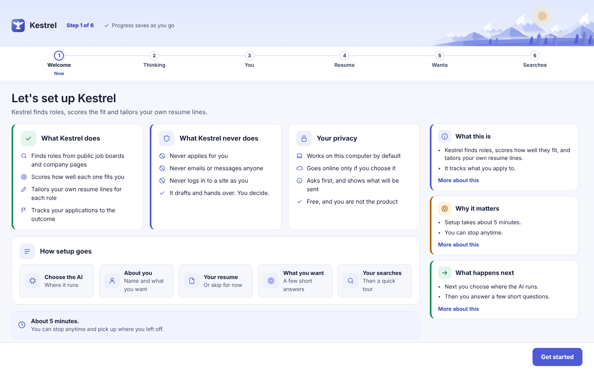
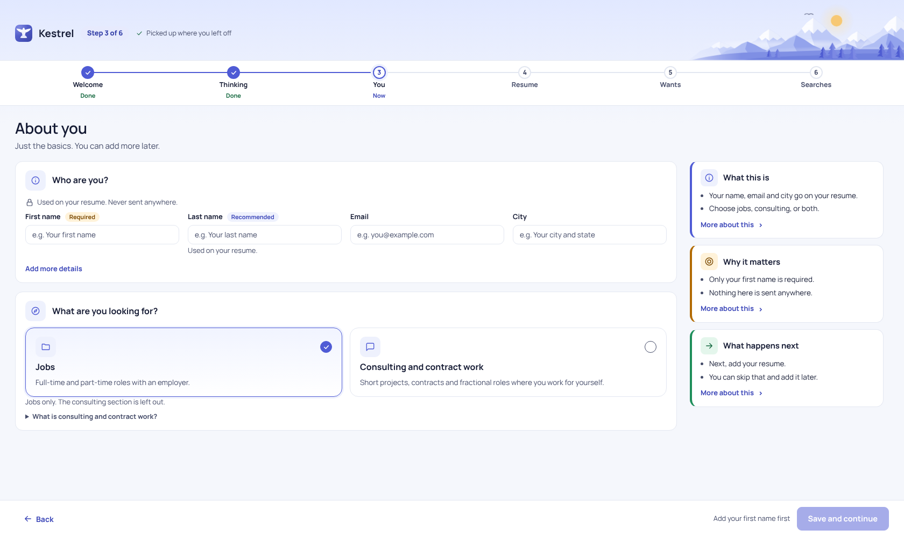
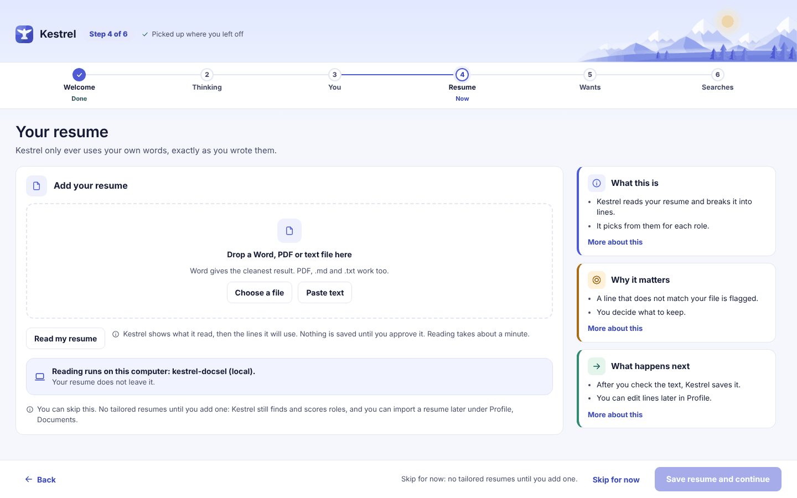
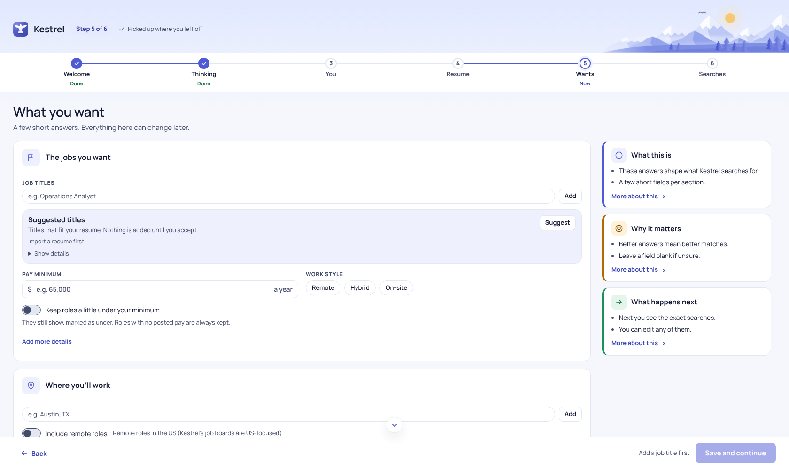

# Set up Kestrel

Complete these six screens to prepare your first search. Choose where Kestrel runs its AI, add your profile and optional resume, then review the searches before selecting **Start searching**. Your progress saves as you go; after the first scan is queued, Kestrel opens Today and starts a short tour.

The progress row shows **Welcome**, **Thinking**, **You**, **Resume**, **Wants**, and **Searches**. Use **Back** to return to the previous screen, or select a reached step in the progress row. Close the app at any point and setup opens at the same step next time.

## 1. Welcome

Review what Kestrel does and its limits. It finds public postings, scores their fit, helps tailor your own resume lines, and tracks applications. It never applies, emails, or messages anyone for you. You decide what to send.

Select **Get started**.

## 2. Thinking

Kestrel checks this computer and recommends a model setup. Nothing is sent during this check. Choose one of these cards:

- **On this computer** runs models locally. Kestrel may need to install Ollama, its local AI helper, and download models. The setup list shows progress. Use **Check again** to refresh the computer check; a failed step offers **Try again**. Downloads can continue while you move on.
- **Online model** uses a service account and API key you provide. Select the service, open its API keys page, paste the key, review **What leaves this computer**, tick **I understand what gets sent**, then select **Connect**. The key check asks the service whether the key works and which models are available. It does not send your profile or resume. The service bills your account for use.
- **Both** keeps quick sorting and fit scores on this computer. A deep read you start for a role can use the online service after Kestrel shows what it will send and asks you to confirm.

The Connect button stays disabled until its key and acknowledgement are ready. A missing or too-short key shows a hint beside the button. If the service rejects the key or no model fits, a result appears below the form. Correct the service or key and select **Connect** again. A failed connection attempt does not replace an earlier working connection. You can continue with **On this computer** while local models download.

Before an online model uses role or resume text, Kestrel shows what will be sent and waits for your confirmation. The setup acknowledgement does not approve future sends. If you cancel or do not confirm an online send, Kestrel does not send it. See [Models](models.md) for the choices and [Tailor a resume](tailor.md) for an example of the per-role confirmation.

Select **Save and continue** when a model choice is set. The first choice is required; connecting an online key can wait if you choose local models.

## 3. You

Enter your first name, which is required. Last name, email, and city are optional. These details fill the top of your resume and stay on this computer. **Add more details** reveals optional headline and phone fields. Kestrel does not record a LinkedIn link.

Choose at least one work track:

- **Jobs** searches for full-time and part-time roles with an employer.
- **Consulting and contract work** adds short projects, contract and fractional work, and public filing signals. Kestrel uses your profile to look for this work.

Choose either track or both. The consulting section is optional. The wizard adds the relevant questions on the next screen. Selecting neither keeps **Save and continue** disabled and explains what is missing.

Select **Save and continue**.

## 4. Resume

Add a resume if you want Kestrel to prepare tailored versions. Drop a Word, PDF, or text file, select **Choose a file**, or select **Paste text**. Word usually gives the cleanest import. If consulting is enabled, choose which track and document kind the file is for.

Select **Read my resume**. Kestrel shows where the reading will run. If it will use an online model, a separate confirmation names the service and what will be sent. Select **Send and import** only if you agree; canceling leaves the text unsent. With confidential mode on, Kestrel says so before it sends. It hides your current employer only after you mark it.

Check the text Kestrel read against the lines it proposes to use. A flagged line does not match your source. Fix the source file and select **Read again**; flagged invented text cannot be approved. When the lines are clean, select **I approve this resume text**, then **Save resume and continue**. Nothing is saved until you approve. [Documents](documents.md) explains how to manage resumes later.

You can select **Skip for now** on this screen only. Kestrel can still find and score roles, but cannot tailor resumes until you import one. If a file cannot be read or a model is unavailable, the import area shows an error. Correct the file or wait for setup to finish, then choose the file again and select **Read my resume**.

## 5. Wants

The wizard asks only for the track or tracks you selected.

For **Jobs**, enter job titles, a yearly pay minimum, preferred work styles, and places. **Add more details** reveals level and deal-breakers. You can keep roles slightly below your minimum; roles with no listed pay are kept. Deal-breakers lower a score but do not hide a role.

For **Consulting work**, enter the services you offer, minimum day rate, and shortest project length. **Add more details** reveals sectors to skip. Under **Where you'll work**, add places and choose whether to include remote US roles. Kestrel matches places by name, not by distance, so add nearby towns you would commute to.

Job searches need at least one title and either a place or remote work. Consulting searches also need the required profile details. The live preview shows what Kestrel will search. Save this screen with **Save and continue**.

## 6. Searches

Review the exact searches generated from your saved answers. Select **Edit** beside a search to return to the relevant screen, make a change, and save. The list also shows deal-breakers, sectors set aside, and whether a resume is available. Nothing is deleted because of a deal-breaker.

Kestrel checks public job boards and any company career pages already added. It never searches LinkedIn. You can paste a LinkedIn posting yourself. Add company pages later under [Sources](sources.md).

If there is nothing to search, **Start searching** is disabled. Follow the message and select **Go to that step** to add a job title, service, place, or other missing detail. Return here when the search list appears. If searches were already on, this screen says so and **Start searching** queues a fresh scan.

Select **Start searching** to turn on the generated searches and queue the first scan. A brief screen says **Starting your first search** while Kestrel opens sources, queues the scan, and gets Today ready. Today then shows live search and scoring progress. New roles appear as they finish; a large first scan can take an hour or more.

## First results and recovery

An empty **Top matches today** area while the first scan is active means results have not arrived yet. The status strip at the top of [Today](today.md) shows the current search and the counts of rated, failed, and waiting roles. The page updates while work runs.

If a source has a problem, the run can still finish with results from other sources. The status strip shows a problems count, and a source that had a problem is tried again on a later run. If roles fail scoring, select **Review** on Today or open **Failed scoring** in [Pipeline](pipeline.md), then retry them on [Needs another try](needs-another-try.md). A declined online-model confirmation means that send was not made; continue with local work or confirm a later send when you are ready.

## The Today tour

After the first search starts, Kestrel opens Today with the tour. It highlights Today, all roles, top matches, role review, Calibrate, and Applications. Select **Next** or **Back** to move through it, **Skip tour** to leave early, or **Close** on the last screen. Until a first run has been recorded, Today also shows a **Take a short tour of Today** link that opens it again.

## Resume setup later

The wizard saves its current step and completed answers. Use **Back** or the progress row to revisit reached steps. To start setup again after completing it, open **Settings**, then **Your data**, and select **Restart setup**. You can also edit your profile under [Profile](profile.md), change model choices under [Models](models.md), and manage sources under [Sources](sources.md).
