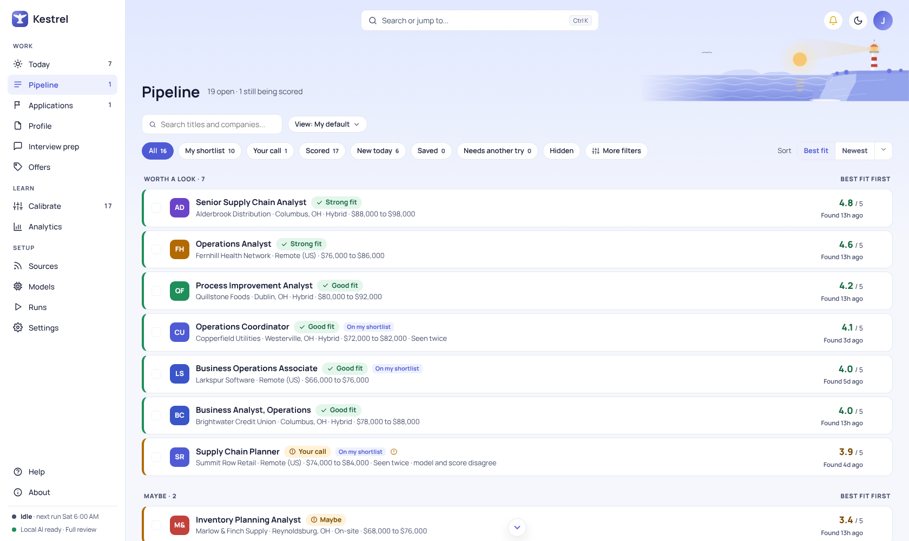
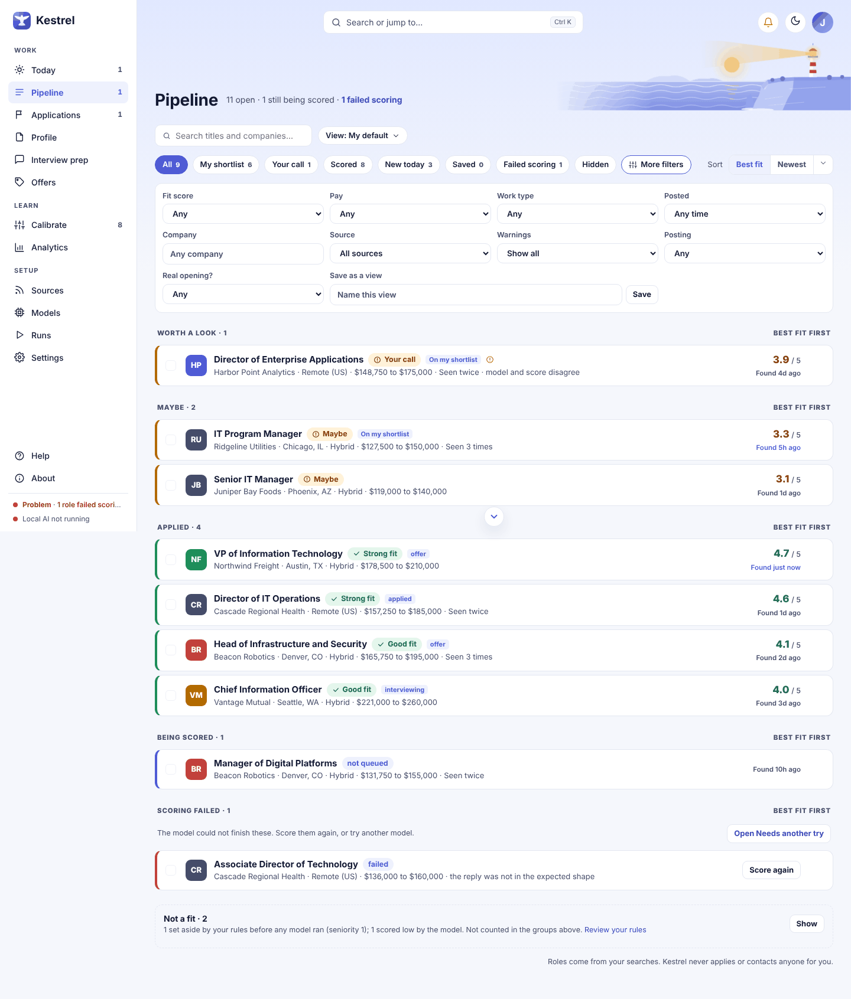
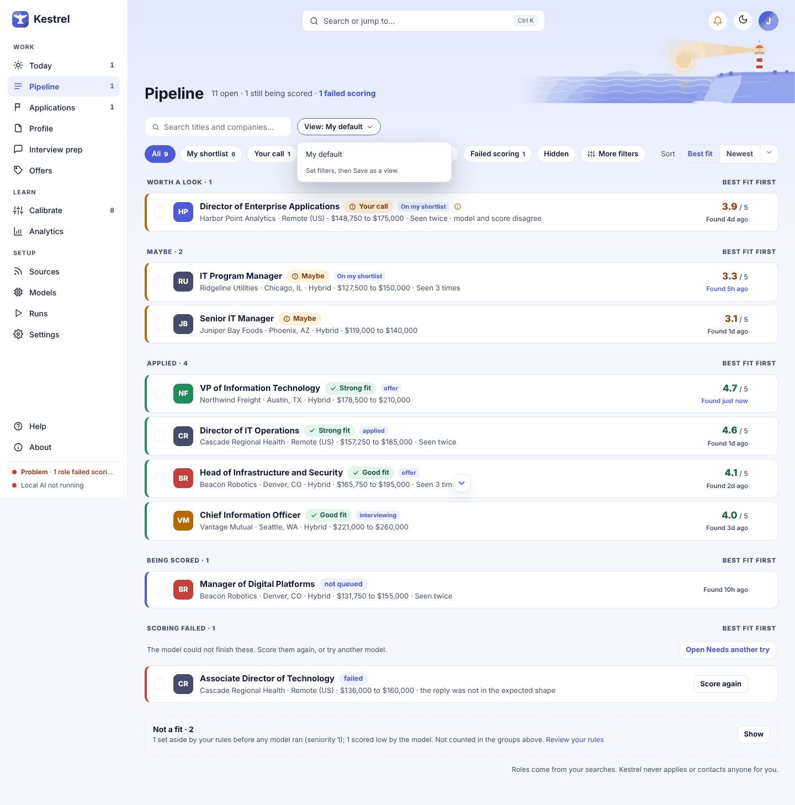
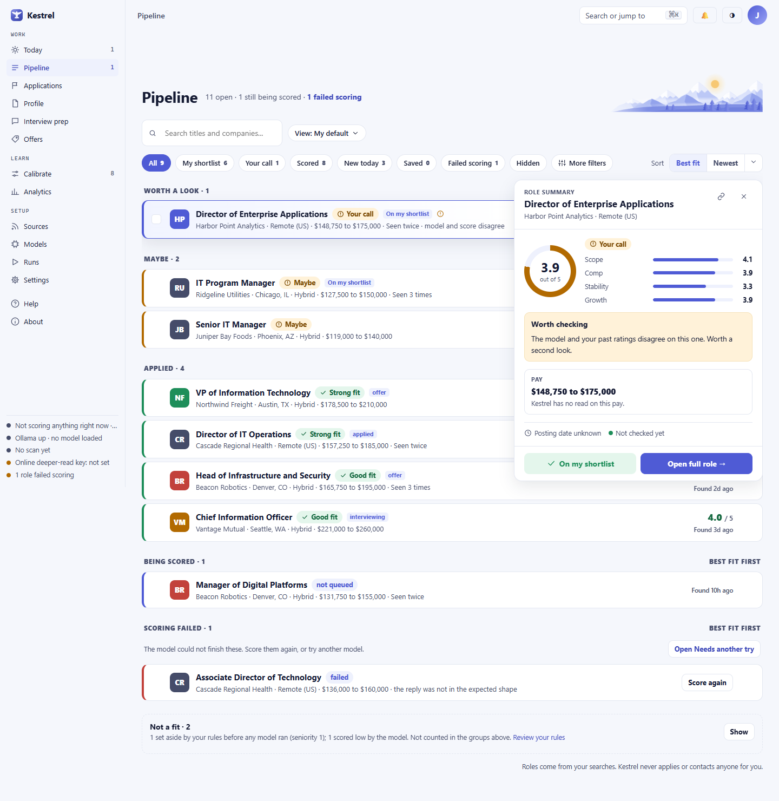

# Pipeline

Use Pipeline to review openings and consulting opportunities, understand how Kestrel scored them, and decide what to keep, hide, or investigate. Search, filter, and sort the list, then save a view if you want to return to the same filters later. Kestrel never applies or contacts anyone for you.

## Review the list

The list groups roles by what needs your attention: **Worth a look**, **Maybe**, **Applied**, **Being scored**, **Won't be scored unless you act**, and **Scoring failed**. Each row shows the title, company, location, fit label, and score when one is available. It can also show your shortlist or application status, a Saved tag, warnings, and why a role has not been scored. A role with no score carries one chip that says why: **Waiting** (Kestrel has not reached it, and it scores on its own), **Paused** (its track is off, or it waits for a free slot), or **Scoring** (a model is reading it now), or **Stopped** (scoring stopped before it finished; use **Score again**). These stay in **Being scored**. Three reasons mean nothing will score the role unless you act, so those roles sit in **Won't be scored unless you act**: **No description** (the posting had no text; open its panel and choose **Paste the description**, up to 50,000 characters, or **Open posting**; a hidden role must be unhidden first), **Hidden: applied** (you marked it applied; **Put it back** to score it), and **Taken off retry list** (you removed it from Needs another try; it was not rejected, and **Undo** puts it back). Roles hidden as applied appear only under the Hidden filter. Groups are sorted independently. A **Show N more** button under a group adds up to 25 more rows to it.

Select a row to open its panel beside the list. Select the checkbox on a row to add it to the selection bar. You can also use Shift-click to select a range, or use `j` and `k` to move through rows, `x` to select the current row, `Enter` to open its full page, and `Esc` to close the panel or clear the selection.

The row's **More** menu lets you save a role for later or hide its company. Saved roles remain available under the Saved filter. Hiding a company removes its roles from Pipeline and Today; you can undo the hide from the confirmation toast.

## Search, filters, and sort

Type in the search box to find titles or companies. The filter chips are:

- **All** shows the regular list.
- **My shortlist** shows roles on your shortlist. In Consulting, this is **My leads**.
- **Your call** shows roles that need your decision.
- **Scored** shows scored roles.
- **New today** and **Saved** narrow the list to those roles.
- **Failed scoring** opens [Needs another try](needs-another-try.md), where you can retry a role or remove it from that queue.
- **Hidden** shows roles you marked Not for me. Open a row and choose **Put it back** to restore it.
- **More filters** opens the additional filters below.

In **More filters**, choose:

- **Fit score:** Any, 3.5 and up, or 4.0 and up.
- **Pay** or **Day rate:** Any, At or above my minimum, or At or above my target.
- **Work type:** Any, Remote, Hybrid, or On-site.
- **Posted:** Any time, Last 3 days, Last week, or Last month.
- **Company** and **Source:** enter a company name or choose a source.
- **Warnings:** Show all, Hide possible ghost postings, or Only roles needing review.
- **Posting:** Any, Still live, or Closed.
- **Real opening?:** Any, Looks real, Check the posting, or May not be real.

The **Sort** control keeps **Best fit** and **Newest** visible. Its menu also offers **Date posted**, **First seen**, **Oldest first**, **Company A to Z**, **Quick-screen score**, and **Ghost posting risk**. **Clear** removes the active filters.

## Save and reuse a view

Set the filters and sort you want, open **More filters**, enter a name in **Save as a view**, and select **Save**. Names can be up to 60 characters. Saving a view with the same name replaces its saved filters. Views belong to the current track, Employment or Consulting.

Open **View** to choose a saved view, return to **My default**, make a view the default that opens first, or remove a view. Removing a view does not change any roles. A saved view remembers filters and sort, not the open panel or the list tab. In Consulting, choose the Opportunities or Signals tab separately.

## Read a role panel

The panel opens over the right side of the list. Its link button copies a URL that opens the same role, and **Close** returns focus to the list.

For a scored role, the panel explains its fit score and dimensions, pay or day rate, level, reasons it fits, gaps, and any points worth checking. It may include a summary written from the posting. Choose **Shortlist** or **Add to leads** to track it, **Not for me** to hide it and give Kestrel a reason, or **Open full role** for the full evaluation and other role tools. A hidden role has **Put it back** instead.

For a role that has not been scored, the panel explains whether it is in progress, waiting, held, or failed. A failed role can be sent to Needs another try or scored again. For a role set aside by your rules before AI ran, the panel explains the rule and offers **Keep it anyway**, **Review your rules**, or **Open full role**. Keeping it queues a score without changing your rules.

When you choose **Not for me**, Pipeline first asks why. Employment reasons are **Not my kind of role**, **Pay or location**, **Wrong level**, and **Just not now**. Consulting opportunity reasons are **Not my kind of work**, **Rate too low**, **Can't deliver it**, and **Just not now**. Choose one reason to hide the role. **Just not now** does not label the role as a poor fit.

## Consulting opportunities and signals

When Consulting is active, Pipeline has two tabs:

- **Opportunities** lists contract postings, RFPs, and referrals. Its shortlist actions are labeled **Add to leads**. The other filters and row controls work as they do in Employment.
- **Signals** lists public company events that may suggest a need for outside help. Filter signals to **All**, **This week**, **Leadership change**, **Acquisition**, **Expansion**, or **Funding**. The list groups events into **This week** and **Earlier**. A signal is not an open posting.

Open a signal to see what happened, its source when available, why the company may need outside help, who to approach, and a possible opening move. **Add to leads** lets you enter an optional next step and due date. **Research company** opens the company page. **Not relevant** asks for a reason: **Not my kind of work**, **Wrong size company**, **No real need**, or **Just not now**. Kestrel does not contact the company; you decide whether to reach out.

## Selection bar, Undo, and messages

Select one or more roles to show the selection bar. In Employment it offers **Shortlist**, **Not for me**, **Score again**, **Deeper read**, and **Mark reviewed**. In Consulting Signals it offers **Add to leads** and **Not relevant**. **Clear selection** removes the current selection.

Shortlist, hide, save, hide-company, and Mark reviewed actions show a toast with **Undo** when that action can be reversed. Undo only reverses its own change. If the original state has changed since the action, Kestrel refuses the stale Undo and says **This can no longer be undone.** Roles removed from Needs another try can be restored from that page.

Bulk **Deeper read** is not available as a group action. Kestrel asks you to open each role and approve its send separately, after showing what will be sent. If an online scoring action lacks the required confirmation, Kestrel does not send it and reports that confirmation is needed.

If a role disappears while its panel is open, the panel says **That role is gone** and you can return to the list. If a request fails, Pipeline says **Could not do that. Try again.** When no roles have been collected, the empty state links to [Sources](sources.md) to add a board or ATS, or to Setup. If roles exist but none match, choose **Clear filters**. The Hidden filter explains when no roles are hidden. On Signals, **No signals match** appears when the current filters find no events.

The **Not a fit** section is separate from the scored groups. It shows how many roles your rules set aside before scoring and how many scored low. Select **Show** to load the first 12, then **Load more** for another page. Select **Keep it anyway** on a rule-rejected role to queue it for scoring, or open [Profile](profile.md) to review the rules.

For the daily review queue, see [Today](today.md). Tracked applications are on [Applications](applications.md). The full evaluation and role-specific tools are on [Role details](role.md).
