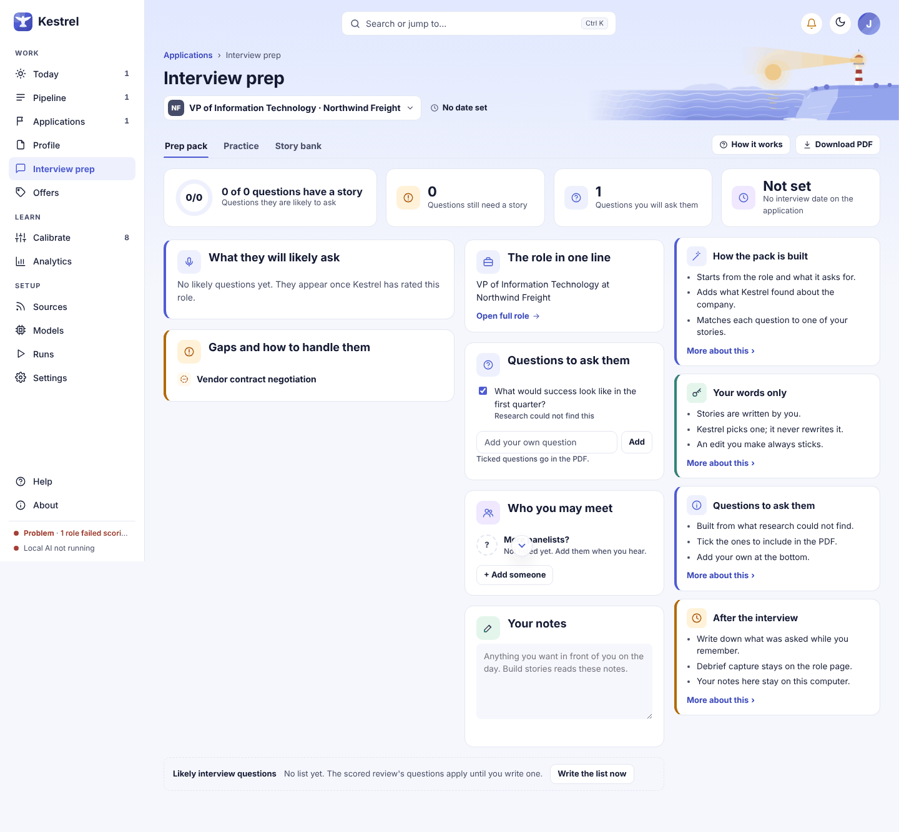

# Interview prep: prepare for an interview or discovery call

Open **Interview prep** from an application's side panel, at any stage, or open **Discovery call prep** for a consulting lead (its side-panel button reads **Meeting prep**). Build or review the prep pack, check the likely questions and your story matches, then practice or save a PDF for the meeting. Your notes and the people you add are for your own reference; Kestrel does not contact anyone.

## Choose a role and a tab

The role name under the page title opens a list of your other booked interviews or calls when you have more than one. The date and next step appear beside it when they are set. The three tabs are **Prep pack** (called **Call prep** for consulting), **Practice**, and **Story bank**. **How it works** opens a short guide to the page, and the column on the right explains the current tab. **Download PDF** is disabled until a pack has been built.

If you open Prep from a role link that asks Kestrel to build a pack, the page may start building it automatically. Otherwise, select **Build prep pack** or **Build call prep** in the empty state. The first build usually takes under a minute on your computer. While it runs, the button says **Putting together your prep pack. This can take a minute.** or **Putting together your call prep. This can take a minute.**

## Review the pack

The readiness cards count how many likely questions have a story, how many still need one, how many questions you have selected to ask, and the time until the interview or call. When the role has no likely questions yet, the count can read **0 of 0 questions have a story**.

The questions card is **What they will likely ask** for a job interview and **What they will want to know** for a consulting call. Each question shows a short line on where it came from, and a story from your bank when one fits. Select a story title to read its **Situation**, **What you did**, and **What changed** text. Kestrel uses your saved words as written.

- Select **Swap story** to choose another story for that question. Choose **+ Write a new story** to open the story sheet.
- If the card says **No story yet**, select **+ I have a story for this** to link or write one.
- Select **Practice** beside a question to open Practice with that question first.
- **Gaps and how to handle them** lists concerns Kestrel found when it rated the role. **No gaps were found when Kestrel rated this role** means there are no gaps to list. Select **Open full role** to return to the role page.

In **Questions to ask them**, check or clear each question to choose what appears in the PDF. The checked state is saved. Add another by typing in the **Add your own question** box and selecting **Add**. If there are no research questions, the card says **None yet. Research found no open unknowns. Add your own below.** A blank submission prompts **Write a question first.**

In **Who you may meet** (consulting: **Who you will talk to**), Kestrel may show people listed on public company pages. The **More panelists?** row is a reminder that others may be added. Select **+ Add someone** to record a name you heard and an optional title. This is a private note, not a contact action.

Use **Your notes** for details you want in front of you on the day. The text saves as you type, and the **Saved** indicator confirms the change. Build stories can read these notes. They stay on this computer.

## Practice an answer

Open **Practice** to rehearse by typing one answer at a time. For job interviews, choose **Behavioral**, **Leadership**, or **Executive panel**. For consulting, the mode is **Discovery call**. Select **Start practice** to begin. If you came from a question in the pack, Practice starts with that question.

Type your answer in **Your answer**. **Show a hint** reveals the matched story or a prompt to think of a relevant example; it changes to **Hide hint** when open. The word count updates as you type. Select **Get feedback** to review the answer, **Skip** to move to another question, or **End session** to save the session. After feedback, select **Next question** to continue.

Feedback scores **Structure**, **Specific numbers**, **Answered it**, and **Length** out of five, followed by what worked and possible improvements. If a claim is not in your resume or stories, Kestrel flags it and offers **Add it as a story** or **Got it**. Add only claims you can support.

The **Your practice so far** card shows session scores and lets you reopen a finished session for review. Before five finished sessions, it says **Not enough sessions yet to show a trend**. With no finished sessions it says **No finished sessions yet. Answer a question and the score shows here.**

Practice normally runs on your computer. The route line says **Runs on your computer** and may offer **Use an online model instead**. When Models already points full review at an online service, the page shows the provider and **See what is sent**. The confirmation dialog lists what will be sent and what will not. If it offers hosted model choices, the estimated cost appears beside each; select **Use online model** to proceed or **Stay on my computer** to keep the local route. An online route applies to the session, and **Switch back to my computer** returns to local practice.

If Hosted mode is off, the page says **Online models need Hosted mode, which is off** and links to **Open Models**. If confidential mode prevents the send, the page explains that **Nothing was sent** and directs you to choose your employer in Settings or practice on your computer. Other rejected sends also state that nothing was sent. If the local model is unavailable, the error starts **Practice needs the model running**. A failed critique says **The feedback failed and was set aside for review. Try again.**

## Download a PDF

After a pack exists, select **Download PDF** to preview the pages. In the **Your prep pack** dialog, select **Download PDF** to create the file and let your computer ask where to save it. Select **Close** to leave the preview. If Microsoft Edge cannot start, the dialog reports **The PDF needs Microsoft Edge on this computer, and it could not be started** with the specific error.

## Empty and error states

- **No interview is booked yet** appears when there is no booked interview. Select **Open Applications** to update an application. The **Story bank** stays open from the **Interview prep** item in the navigation.
- **No such role. Nothing to prep.** means the selected role is unavailable.
- Before a pack exists, the page says **No prep pack for this role yet** or **No call prep for this role yet** and shows the relevant build button. If a build fails, an alert explains the failure and the button remains available to try again.
- **No likely questions yet. They appear once Kestrel has rated this role.** means there are no scored questions to show. The questions status card may also say that it is **Writing the list** or that no list was made.
- If nothing fits a question, use **No story yet** and add or link your own example. If research found no questions to ask, add one yourself.

## What changes for consulting

The consulting page is titled **Discovery call prep**. Its first tab and build action say **Call prep** and **Build call prep**. Practice offers **Discovery call** only. The pack labels use call language, including **What they will want to know**, **Their likely questions on the call**, and **Until the call**. The story bank and its controls work the same way as for interviews.

For more detail, see [Practice](mock.md), [Story bank](stories.md), [role details](role.md), and [Applications](applications.md).
