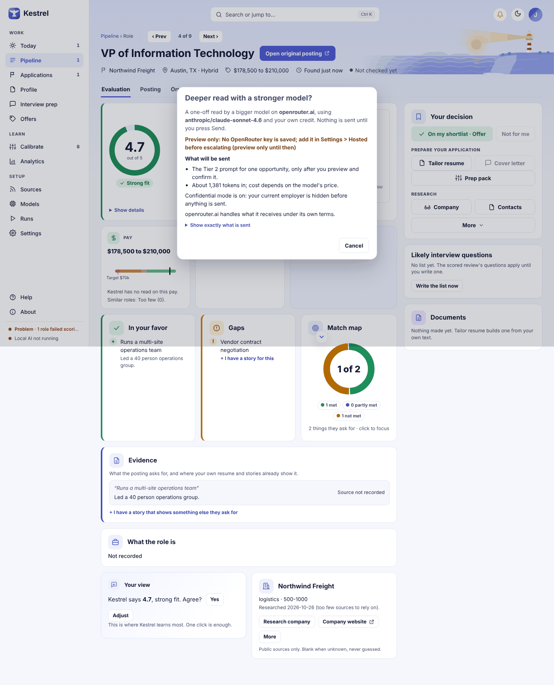

# Your data and privacy

To keep model work on this computer, choose **On this computer** in **Settings > This computer**. To use an online model, connect your own provider key, review the hosted data disclosure, and approve online actions when Kestrel asks; the confirmation names the provider, model, and information for that action.

## Choose where models run

In **Settings > This computer**, use **How should Kestrel run?** to choose **On this computer**, **Online model**, or **Both**. **On this computer** is the local option. It runs prompts on your device. **Online model** uses a provider you choose and your own key. **Both** uses local and online models for different steps. See [Settings](settings.md) for setup and [Models](models.md) for choosing a model for a specific step.

Before hosted work can run, accept **I understand what each hosted tier sends and that the provider's retention rules apply**. This disclosure describes what each tier may send. Routing a tier to an online model allows scheduled work for that tier to run under this standing approval, without asking again for every role. A user-started run shows its online scope before you start; choosing a one-time online model also requires a separate send confirmation.

An online model runs on the provider's computers. Its requests send the role and profile text listed in the hosted disclosure. Depending on the step, this can include a role title, organization, location and description; organization context; your profile; research about the role; or resume text and selected resume variants. For example, resume text is sent when you choose **Assess** on **Profile > Documents** or **Suggest again** on **Profile**. The disclosure and the action prompt state the information for the selected tier and task.

The provider handles received data under its own terms, and Kestrel cannot recall it. A free model may use its inputs for training. OpenRouter free models may train on inputs unless its data collection option is set to deny; denying collection can leave no free model available.

## Review an online action

When an action needs your approval, Kestrel shows the provider and model, what the action will send, and how confidential mode applies. For example, a role action is titled **Use an online model to [action]?** and has **Cancel** and **Send and continue** buttons. Other screens use a checkbox such as **Send this to [provider] to [task]**. Choosing an online model in the Models drawer uses **I understand this goes to [provider] and uses my credit** before you press **Save**.

Read **What will be sent** before confirming. The general ask-first card also says **Not sent: your name, contact details and your resume file**. Some actions explicitly send resume text, as listed in the disclosure. Press **Cancel** to leave without sending. If hosted approval is missing, the provider or model changed, or the action cannot safely proceed, Kestrel refuses it and says that nothing was sent. For runs where you select a one-time online model, review the send details in the run dialog and choose **Send and start** to proceed.

Kestrel never submits applications or sends emails or messages for you. An online model request goes to the provider you selected. Kestrel drafts and prepares information for you to review and hand over.

## Protect your current employer

In **Settings > Privacy and access**, turn on **Confidential mode** and choose the current employer marked in [Documents](documents.md). Set the **Hide** and **as** fields to the employer name and the label you want Kestrel to show. The preview updates as you edit. Confidential mode applies to resumes Kestrel builds, lists and cards in the app, and files you export. It does not change your source text.

For online requests, Kestrel replaces each chosen current-employer name with a temporary code before sending. The **as** label is used in what Kestrel shows or creates. If Confidential mode is on but no current employer is chosen, Kestrel holds the online action and does not send it. Settings offers **Choose your current employer**; select the role in Documents, then retry the action. A first resume import has its own warning: if you confirm that online import before marking an employer, the whole resume, including the employer's name, is sent. Cancel if you do not want that sent, or import locally and mark the employer before a later online action.

## Keys and backups

Your provider key stays on this computer. Connecting or testing a key and loading the provider's model list sends the key and a provider request, but does not send your profile or role text. Later model actions send the information shown in their disclosure. Keys are not included in backups or logs.

Backups include your profile and documents with their original employer names. Confidential mode changes what Kestrel shows, creates, and sends; it does not rewrite your source files or redact a backup. Store backup files privately. See [Settings > Your data](settings.md#your-data) for backup contents and restore details.

Related guides: [Settings](settings.md), [Models](models.md), [Documents](documents.md), and [Profile](profile.md).
