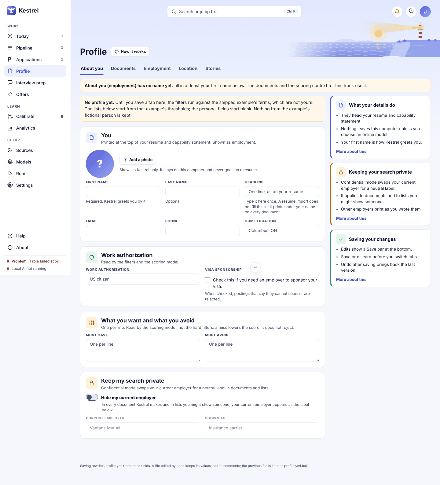
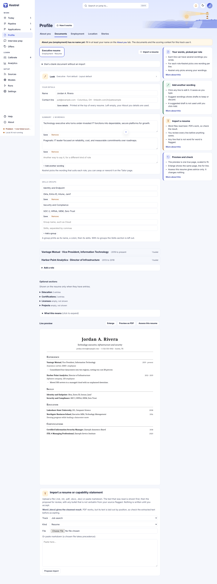
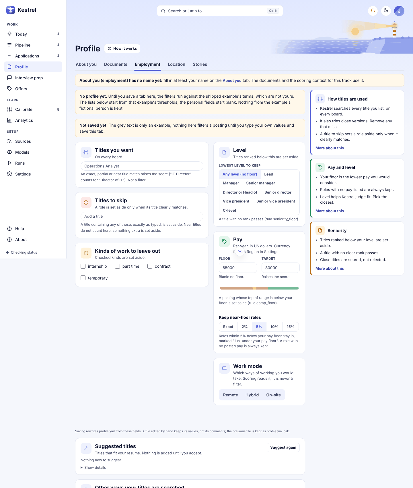
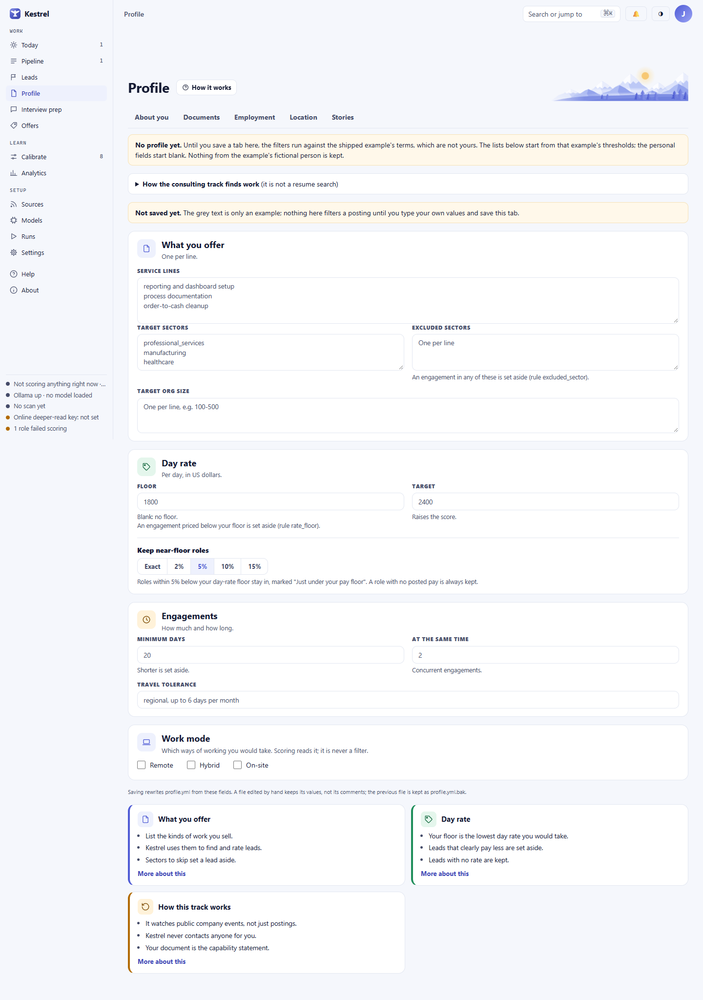
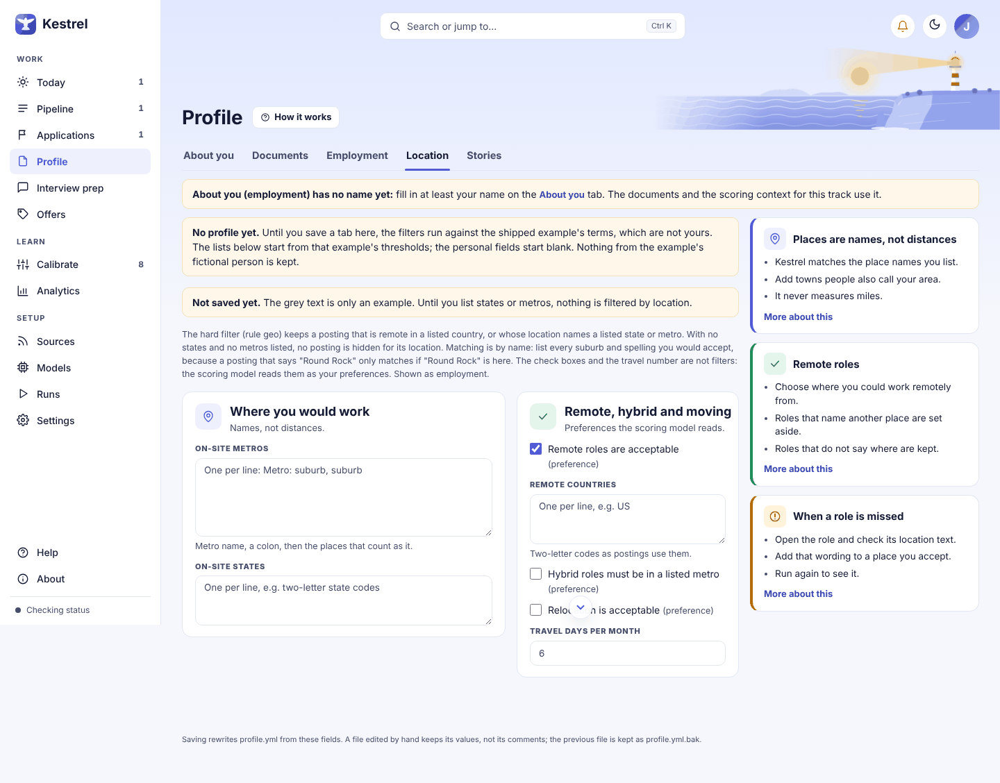
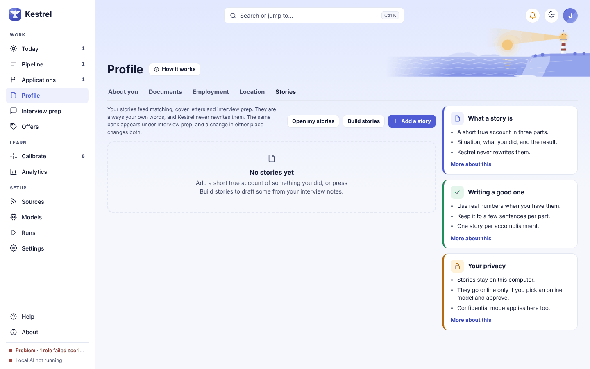

# Profile: set up your search

Use Profile to add your contact details, search preferences, location rules, stories, and source documents. Save changes on **About you**, **Employment**, **Location**, and **Consulting** when that track is on; **Stories** and **Documents** have their own save behavior. Most profile work stays on this computer, and Kestrel asks before an online model receives information.

## Choose a section and track

The tabs are **About you**, **Documents**, **Employment**, **Consulting**, **Location**, and **Stories**. The **Consulting** tab appears when the consulting track is on. **Employment** and **Consulting** each edit their own track. When Consulting is on, the **Track** selector on **About you** and **Location** chooses which track's information you are editing.

**Documents** opens the resume and capability statement editor. See the [Documents guide](documents.md) for importing, editing, previewing, and checking those materials. **Stories** opens the same story bank available from Interview prep. See the [Story bank guide](stories.md) and [Interview prep guide](prep.md).

The page title's **How it works** button opens guidance. The help cards beside the form open more detail. In Employment and Consulting, the tabs named for each track are also the track selector.

## About you

### You

**First name** is required and is how Kestrel greets you. **Last name** is optional. **Headline**, **Email**, and **Phone** are optional details for your document header. **Home location** is also part of that header; it is separate from the location rules on the **Location** tab.

**Add a photo** or **Change photo** opens the local file picker. **Remove** switches back to your initials. A photo appears only in Kestrel, stays on this computer, and is not added to a resume. If the file cannot be used, a message appears below the photo controls.

### Work authorization

Enter **Work authorization** in your own words, such as `US citizen` or `UK citizen who needs sponsorship`. The gray example in the empty field is not saved. Under **Visa sponsorship**, select **Check this if you need an employer to sponsor your visa.** when you need sponsorship. Kestrel then rejects postings that say they cannot sponsor.

### What you want and what you avoid

Enter one preference per line in **Must have** and **Must avoid**. These preferences affect the role's score. They do not reject a role on their own.

### Keep my search private

The **Hide my current employer** switch, **Current employer**, and **Shown as** fields each save on change, separately from the main profile save bar. The employer must match a role in Documents. If no matching role exists, Kestrel explains that you need to add the role on **Documents** first. If you turn on the switch before entering an employer, Kestrel saves the switch and asks you to name the employer.

When the switch is on, Kestrel replaces that employer in generated documents and lists. It does not change text inside your resume bullets, so edit those separately on **Documents**. If Kestrel inferred an employer from your newest open role, a note says so; you can change the employer or confirm it by saving this privacy card.

## Employment

Employment settings define which job postings to search, keep, or score lower. If a new profile has not been saved, a notice explains that gray terms are examples only. Type your own values and save before those terms are used.

### Titles and work types

Under **Titles you want**, add a title in **Target titles** and press Enter or a comma. Leaving the field also adds the text. Use the x on a chip to remove it. Kestrel searches each title on every board. Exact, partial, and near-title matches raise the score; titles are not a filter.

Under **Titles to skip**, add titles the same way. A clearly matching title is set aside. Kestrel does not skip a role for a near match.

Under **Kinds of work to leave out**, select any of **internship**, **part time**, **contract**, or **temporary**. A checked kind is set aside.

### Level and pay

**Lowest level to keep** has these choices: **Any level (no floor)**, **Lead**, **Manager**, **Senior manager**, **Director or Head of**, **Senior director**, **Vice president**, **Senior vice president**, and **C-level**. Kestrel sets aside titles ranked below your selection. A title with no clear rank is kept.

Under **Pay**, enter an annual US dollar **Floor** and optional **Target**. A posting whose highest listed pay is below your floor can be set aside. A blank floor means there is no pay floor; the target raises the score.

The **Keep near-floor roles** control offers **Exact**, **2%**, **5%**, **10%**, and **15%**. With a percentage selected, a posting within that amount below your floor stays in the results and is marked **Just under your pay floor**. A posting without listed pay is always kept. **Exact** sets aside pay below your floor.

### Work mode and suggested titles

Under **Work mode**, select **Remote**, **Hybrid**, or **On-site**, or any combination. These choices affect scoring and do not act as filters.

**Suggested titles** lists titles inferred from your resume. Open **Why** to see the reason and evidence. **Accept** adds a suggestion to your target titles; **Dismiss** keeps it from being suggested again. Nothing is added until you accept it. **Suggest again** queues another pass when available and is disabled while a pass is pending. If the selected model is online, the page shows the provider, what will be sent, and what will not be sent, then asks you to check **Send this to [provider] to suggest titles**. **Show details** explains where suggestions come from and when they appear. If there is no resume, the section says **Import a resume first**; while a pass is running it says **Reading your resume**.

Under **Other ways your titles are searched**, Kestrel lists close title variants. Use the x on a variant to stop searching it, or its search-again icon to restore it. Variants can increase the number of searches. If there are no variants yet, the section says so. If the employment track is off, the section explains that these titles are not searched.

## Consulting

Consulting tracks leads for advisory and contract work. It can watch public company events that may signal a need for outside help before a role is posted. Posted fractional and interim roles are also searched. This track uses a capability statement from **Documents**, rather than a resume. A consulting pursuit is a lead and conversation to develop, not a job application. See the [Sources guide](sources.md) for search and public signal sources.

Open **How the consulting track finds work** for more detail about trigger events, searches, and pursuits.

### What you offer

Enter one **Service lines**, **Target sectors**, **Excluded sectors**, and **Target org size** value per line. The service lines, sectors, and organization sizes help Kestrel identify and score relevant leads. A clear match to an excluded sector is set aside.

### Day rate and engagements

Under **Day rate**, enter a per-day US dollar **Floor** and optional **Target**. A lead priced below the floor can be set aside; a blank floor means there is no rate floor. **Keep near-floor roles** offers the same **Exact**, **2%**, **5%**, **10%**, and **15%** choices as Employment. A lead within the selected percentage below your floor stays in the results with a label. Leads without a rate are kept.

Under **Engagements**, set **Minimum days**, the **At the same time** count, and **Travel tolerance**. Engagements shorter than your minimum can be set aside. The **At the same time** field records how many engagements you can run at once; Kestrel does not use it to score or filter leads. Travel tolerance describes the travel you would accept.

Under **Work mode**, select **Remote**, **Hybrid**, or **On-site**, or any combination. As in Employment, these are preferences used for scoring.

## Location

Location matching uses place names and aliases. It does not calculate distance. With no on-site states or metros listed, Kestrel does not set aside a role based on its on-site location. If a posting uses a suburb or alternate spelling you accept, add that name.

Under **Where you would work**, enter **On-site metros** one per line. A line can use `Metro: suburb, suburb` to list place names that count as that metro. Enter **On-site states** one per line, using the state codes found in postings.

Under **Remote, hybrid and moving**, list accepted **Remote countries** as two-letter codes. This list and the on-site place names are used for location matching. **Remote roles are acceptable**, **Hybrid roles must be in a listed metro**, and **Relocation is acceptable** are scoring preferences. **Travel days per month** sets your travel preference. These checkboxes and the travel number do not filter roles.

## Stories

Stories are short accounts in your own words. They can support role matching, cover letters, and interview prep. The same story bank appears under Interview prep, so a change in either place appears in both. Kestrel does not rewrite saved stories.

Choose **Open my stories** to open the full story bank. Choose **Add a story** to enter a **Title**, **Situation**, **What I did**, and **What changed**, then select **Save story**. A title is required. If it is missing, Kestrel says, **Not added: give the story a title.** The story is saved as your own writing.

Choose **Build stories** to draft stories from your interview notes. If an online model is selected, the page shows the provider, what will be sent, and what will not be sent, then asks you to check **Send this to [provider] to build drafts**. While the build runs, the page says drafts will appear when it finishes. If there are no stories, the empty state offers the options to add one or build drafts. A failed build or missing approval appears as a message on this page.

Stories marked **Draft** were proposed from notes and have not been edited by you. The x button says **Dismiss draft** for a draft or **Delete story** for a story you edited. Confirming a dismissal keeps the draft from being proposed again. Confirming a deletion removes your edited story and cannot be undone. Story cards also show their themes and how many roles used them, or **Not used yet**.

## Save, discard, and fix problems

On **About you**, **Employment**, **Consulting**, and **Location**, editing a field shows the save bar with **Unsaved changes**, **Discard**, and **Save changes**. Save or discard before switching tabs. If you try to switch with unsaved edits, the save bar asks you to save or discard first. **Discard** reloads the saved values.

After a successful save, Kestrel confirms once, with a **Saved** message at the bottom of the window. It may also say that job searches were updated or that roles set aside by the rules will be checked again. That message offers **Undo**, which restores the previous saved version. Undo covers one save; saving again makes the earlier Undo unavailable.

A refused save leaves your edits on screen and shows **Not saved** with the reason. If `profile.yml` cannot be read, the page says that nothing can be saved and disables **Save changes**. Fix the file or restore its backup through **Settings > LAN & backup**, then reload. See the [Settings guide](settings.md). If there is no profile yet, a notice explains that the filters use the shipped example's terms until you save, and that the personal fields start blank. Enter your own details and save.

Saving rewrites `profile.yml` from the fields on the current tab. If you edited the file by hand, its values are kept but its comments are not. Kestrel keeps the previous file as `profile.yml.bak`.

