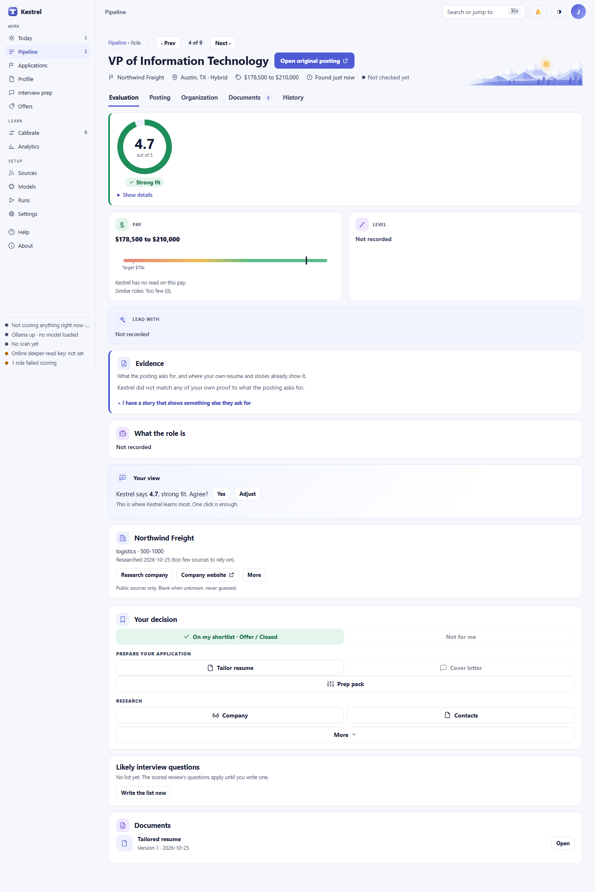
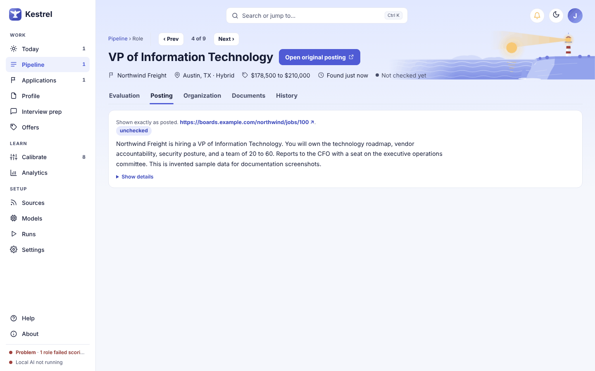
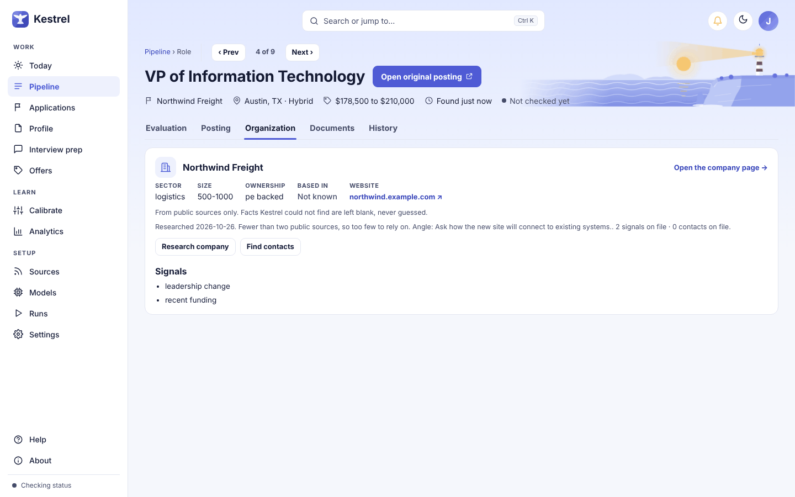
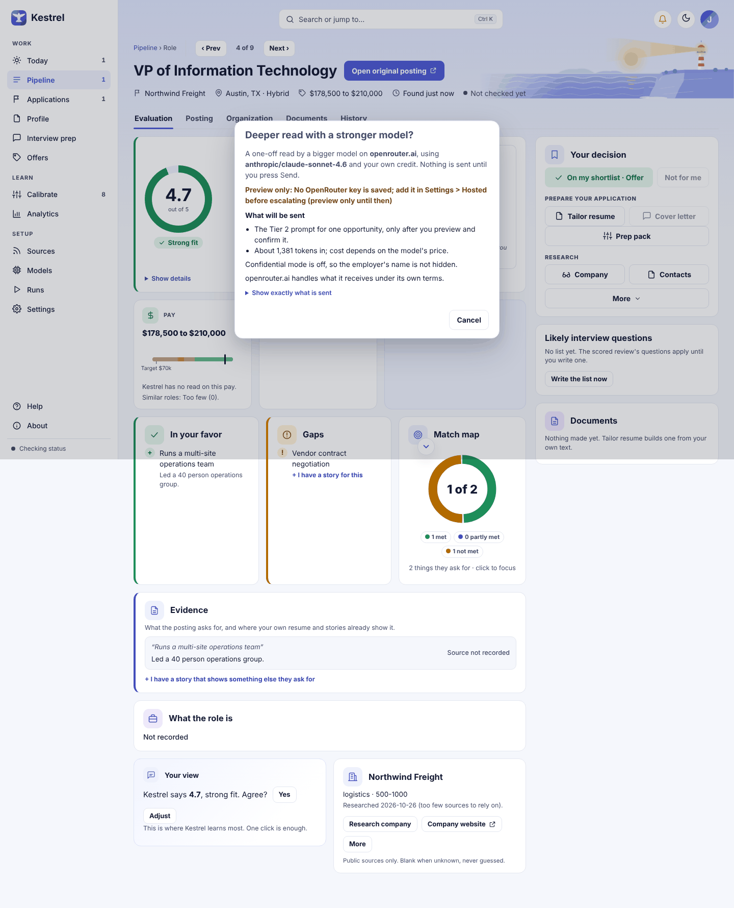
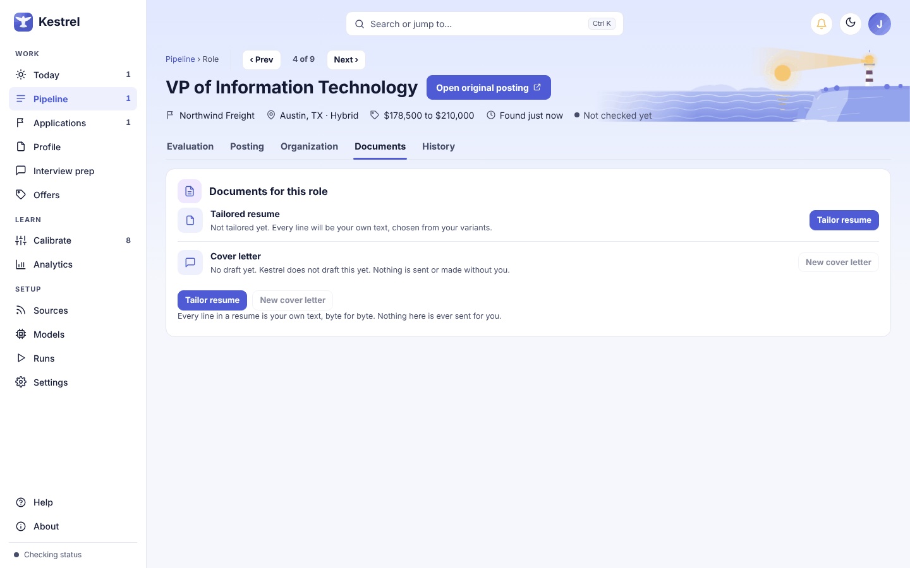
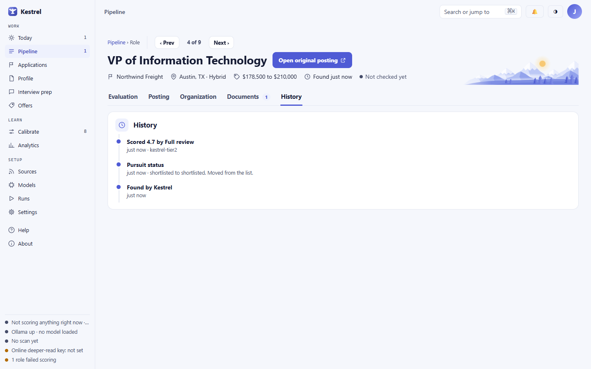

# Role

Open a role from [Pipeline](pipeline.md) to check its fit, read the posting and company details, and choose what to do next. Evaluation puts the score, evidence, gaps, and your rating together; the other tabs show the posting, organization, documents, and history. Kestrel does not apply or contact anyone for you.

## Navigate the role

The **Pipeline** breadcrumb returns to the list. **Prev** and **Next** move through the Pipeline list and show your position; they are disabled at either end of the list. The title band shows known company, location, pay, type, posting date, and liveness. **Open original posting** opens the source in your browser. If no safe link is available, the button reads **No posting link** or **Link hidden**. The five tabs are **Evaluation**, **Posting**, **Organization**, **Documents**, and **History**. A missing role says **Not found**; an invalid tab says **No such tab**.

## Evaluation

The score card shows the fit score out of five, fit label, dimension bars, and Kestrel's explanation. **Show details** expands model, prompt, time, and scoring provenance. **Worth checking** flags risks such as a listing that may not be real. Pay is compared with your saved floor and target. **est.** marks inferred pay, and similar roles read **Too few** below five observations. Level and **Lead with** summarize seniority and an opening point; unknown facts say **Not recorded**.

The Match map groups posting requirements as met, partly met, or not met. **+ I have a story for this** opens the story form. Evidence links only to a matching saved story or resume bullet; otherwise it says **Source not recorded**. The summary is **What the role is** in Employment, and **The situation** in Consulting. **Read the full posting** opens Posting.

In **Your view**, choose **Yes** to agree with Kestrel or **Adjust** to rate the match yourself. Adjust also offers optional nudges to any dimension score and an optional note of up to 500 characters. Select **Save my rating** to keep it. After saving, use **Change** to revise it.

If review is underway, the page says **Being scored** and offers **Score again**. If a rule set the role aside, the card names the rule, links to it, and may offer **Score this role anyway**. If the posting had no description, the card reads **Won't be scored unless you act**, says there is nothing to read, and offers **Paste the description** (Kestrel checks the text against your rules, then scores it), **Open posting**, and **Score anyway**. A hidden role asks you to unhide it first. If model or service details changed while approval was pending, **Waiting for your confirmation** says nothing was sent and offers **Score again** to review the destination.

## Decide and prepare

The **Your decision** panel stays beside Evaluation or below the page on a narrow window. In Employment, **Shortlist** adds the role to your shortlist; in Consulting, **Add to leads** adds a lead.

**Not for me** opens four reasons and **Cancel**. Employment: **Not my kind of role**, **Pay or location**, **Wrong level**, and **Just not now**. Consulting: **Not my kind of work**, **Rate too low**, **Can't deliver it**, and **Just not now**. A reason hides the role and records your choice. For a hidden role, **Put it back** restores it to Pipeline. The panel then offers **Back to Pipeline**.

Preparation stays locked until you add the role to your list. **Tailor resume** or **Tailor capability statement** also needs an active document master. **Cover letter** and **Engagement outline** are disabled because Kestrel does not draft them yet. **Prep pack** (in Consulting, **Discovery call prep**) opens the prep page once the role is on your list. **Why?** explains why an item is locked. See [Documents](documents.md), [Tailor](tailor.md), and [Interview prep](prep.md).

**Company** and **Contacts** start research. **More** contains **Deeper read**, **Score again…**, **Archive**, and **Copy link**. **Mock interview** appears after a prep pack exists. A progressed pursuit also has a confirmed remove action. **Archive** hides the role. A stale Undo can be refused if later work changed the same item. The Documents card shows **Nothing made yet** until a render exists.

## Posting

Posting shows the captured description and source, safe links to the original, and duplicate copies under **Also posted on**. Liveness can read **live**, **gone**, **closed**, or **unchecked**. After one closed-looking check, Kestrel says **Looked closed once; checking again**. **Show details** expands posted and seen dates, sightings, changes, source, ghost score, and type. Missing descriptions show **(no description)**; missing dates or source details are labeled unknown or manual.

## Organization

Known sector, size, ownership, headquarters, and website appear here; unknown facts say **Not known**. **Open the company page** opens [Company](company.md), and a website link opens in your browser. If no company is linked, the page says **No company linked**.

**Research company** and **Find contacts** queue background work from public sources. Active work shows progress and **Cancel**. A canceled task says **Cancelled**; a failed task says **Could not finish. Start again to try another pass.** Research based on fewer than two public sources is marked too few to rely on. Signals and public business contacts appear when available. Contact links open public pages; Kestrel never sends outreach.

If research uses an online model, an ask-first dialog names the provider, model, and information involved. It explains whether Confidential mode hides your current employer and that the provider's terms apply; free models may use received data for training. With Confidential mode on and no employer selected, the request is held and the dialog links to Settings. **Cancel** or closing the dialog sends nothing. The primary confirmation is shown only after this preview. See [Privacy and online models](privacy-and-online-models.md).

**More > Deeper read** opens a separate preview for a one-time stronger-model review. It names the service and model, estimates tokens and cost, states whether the employer is hidden, and offers **Show exactly what is sent**. If no eligible online model is available, it says **Preview only** and has no confirmation button. **Cancel** closes the preview without a request. This is a model request, not an application or employer message.

## Documents

The tab lists the latest saved render. **Open** shows a scaled preview; **Edit** opens its review page, and **Download PDF** saves a local copy when available. **Tailor resume** or **Tailor capability statement** opens tailoring. **Earlier versions** expands prior renders with **Review** links. Before a render exists, the tab offers tailoring if a master is available. Without an active master, the control is disabled and points to Documents. The cover letter or engagement outline stays disabled because Kestrel does not draft it yet. See [Tailor](tailor.md).

## History

History lists events newest first: discovery, screening and scoring, rules, list or application status, your rating, and deeper reads. Events may include the model, prompt version, date, and other recorded details.
## Consulting differences

On the Consulting track, this page calls the item a **lead** and uses **Add to leads**. **Not for me** offers **Not my kind of work**, **Rate too low**, **Can't deliver it**, and **Just not now**. Preparation uses **Tailor capability statement**, **Discovery call prep**, and **Engagement outline**. **Buyer access** replaces Level, **Opening move** replaces Lead with, and **The situation** replaces What the role is. Rate is shown per day against your consulting floor and target; the evaluation uses consulting dimensions. Other tab names and source, research, preview, and history controls work the same way.

Added leads appear on [Applications](applications.md) under Leads. The two tracks keep separate lists. For setup and the track switch, see [Profile](profile.md) and [Settings](settings.md).
