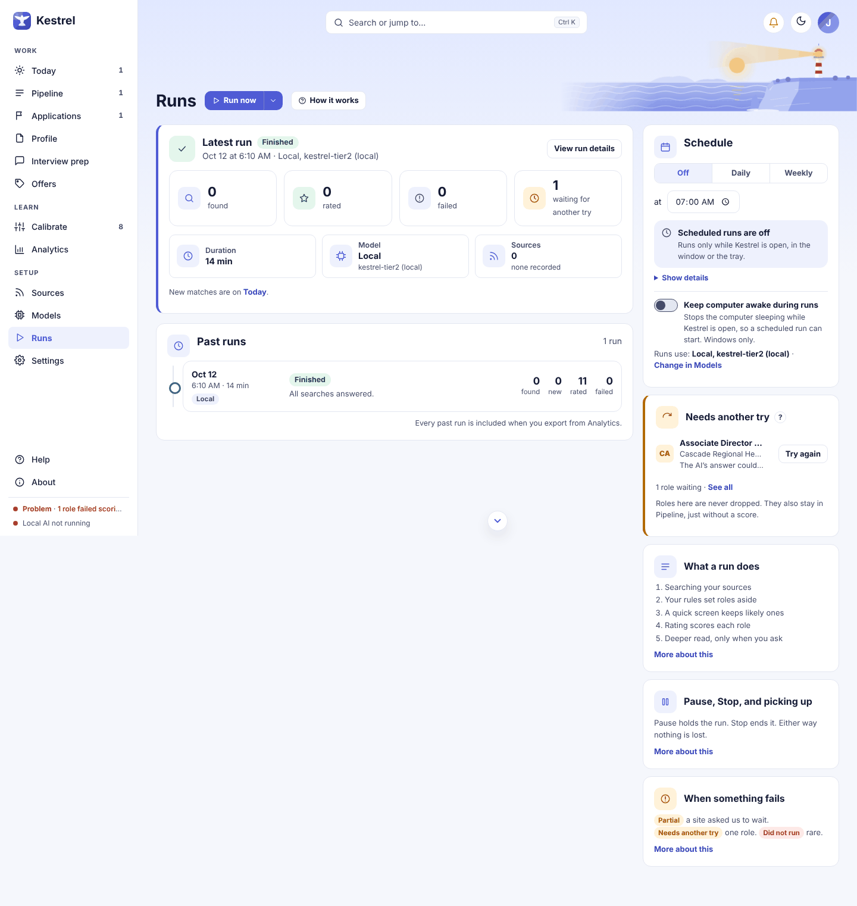
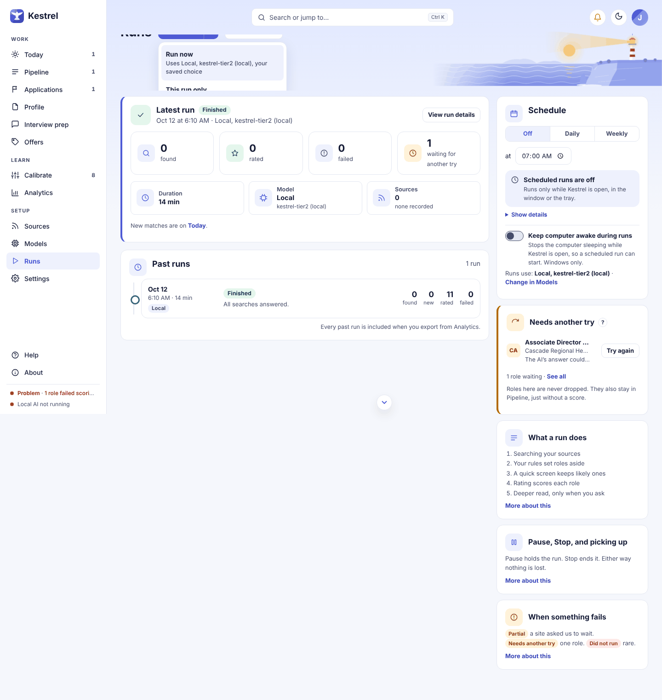

# Runs: start and check scans

Use **Runs** to start a scan, watch its progress, and see what each source and scoring step did. Pause or stop work from the live card, then open a past run for its counts and source results. A source problem leaves the rest of the run intact, and a role Kestrel could not score stays in Pipeline for another try.

## Start a run

Choose **Run now** to check every enabled search using your saved model choice. To use a different choice once, open the arrow beside **Run now** and choose **This run only…**. The sheet offers **Local**, **Both**, or **Online** when those choices are available. **Both** runs the quick screen on this computer and the rating online. The one-time choice does not change your saved settings.

For **Online** or **Both**, read **What will be sent**, the provider and model, and the cost note. Select **I understand what is sent and approve this one run.** to enable **Start this run**. The sheet also lists what is not sent: your name, contact details, and resume file. Cancel the sheet to leave without starting or sending anything. If confidential mode is on but no current employer is selected, the online send is held until you choose the employer in Settings.

If no searches are enabled, Kestrel says **No searches are on. Turn one on under Sources.** Nothing starts; turn on a search in [Sources](sources.md) and try again. See [Models](models.md) to check model availability and your saved choice.

## Watch a run

While work is active, the header shows **Running** with the current step. The live card reads **Running now** and tracks five stages: **Searching**, **Your rules**, **Quick screen**, **Rating**, and **Deeper read**. **Deeper read** says **Only when you ask** because it runs only when you request it for a role. Recent activity appears under **Latest**. The page refreshes its progress every few seconds.

The controls are:

- **Pause** holds the run. Nothing new starts until you choose **Resume**, which carries on from the same work.
- **Stop** asks you to confirm: "Stop this run? Everything done so far is kept, and Run now or Resume picks up the rest." Choose **Stop** to end the run or **Keep running** to dismiss the question.

For an online run, the card names the provider and model and shows **This run so far** and, when available, **To finish**. These figures are estimates from recorded token use and the model's listed prices. Your provider's bill is the exact amount; Kestrel does not store a separate bill for each rating. In **Both**, the quick screen stays on this computer.

## Read the status

Past runs use text labels as well as color:

- **Finished** means all searches answered.
- **Partial** means a site asked Kestrel to slow down, or part of the run did not finish. The rest of the run is kept, and that source is tried again on the next run. If one source is Partial every time, check it under [Sources](sources.md).
- **Stopped by you** means you stopped the run. Work already completed is kept.
- **Did not run** means Kestrel could not reach the AI at all, for example because the model app was closed. Open [Models](models.md) and run the check again. Nothing is lost.
- **Running** and **Paused** describe work that is still open.

The **Needs another try** card on the Runs page lists roles whose AI answer could not be read, up to three at a time. Choose **Try again** on a listed role to queue it, or **See all** to open [Needs another try](needs-another-try.md). These roles also remain in [Pipeline](pipeline.md), without a score. When nothing is waiting, the card says **All clear** and **Nothing is waiting.**

## Review a past run

**Past runs** lists the latest ten runs. Each row shows the date, time, duration, mode, status, and counts for found, new, rated, and failed roles. Online runs also show their online cost. Select a row to open its details in a side panel. Choose **Show N more** to see older runs, and **Show fewer** to return to the latest ten. Every past run is included when you export from [Analytics](analytics.md).

Before the first run finishes, the history says **No runs yet. The first one appears here when it finishes.**

The run details panel opens with **Loading…**, then shows the status, counts, online cost when available, roles per minute by step, and **Sources**. Source results may read **OK**, **Rate-limited**, **Partial**, **Problem**, or **Cut off**. Open **Show details** for the source error text and saved counts. If fewer than five roles were scored, the rate says **too few** instead of presenting a rate from a small sample. A search that matches no run shows **No searches are matched to this run.**

For the full record, choose **Open the full page**. Kestrel does not link searches and scores to a run by ID, so it matches them by start time. Treat the searches and scores on that page as a best-effort view. A missing run opens a **Not found** page.

## Set a schedule

The **Schedule** card offers **Off**, **Daily**, and **Weekly**. Choose a time, and a weekday for a weekly schedule. Changes save automatically, and the card shows **Saved** with the schedule. Scheduled runs only start while Kestrel is open, either in the window or the tray. **Keep computer awake during runs** stops the computer sleeping while Kestrel is open, so a scheduled run can start; it is available on Windows only. **Runs use** shows the saved model choice; choose **Change in Models** to update it. If online credit runs out, scheduled runs using an online model wait until it is topped up.

## Related guides

- [Today](today.md)
- [Sources](sources.md)
- [Needs another try](needs-another-try.md)
- [Models](models.md)
- [Profile](profile.md)
- [Analytics](analytics.md)
- [Screenshot index](../images/walk/INDEX.md)
