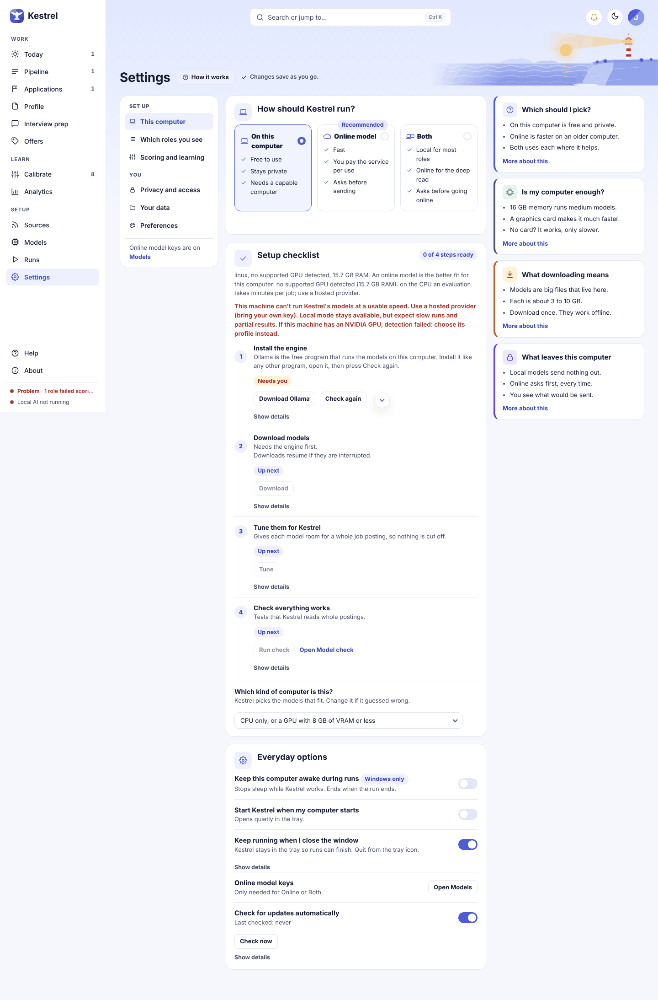
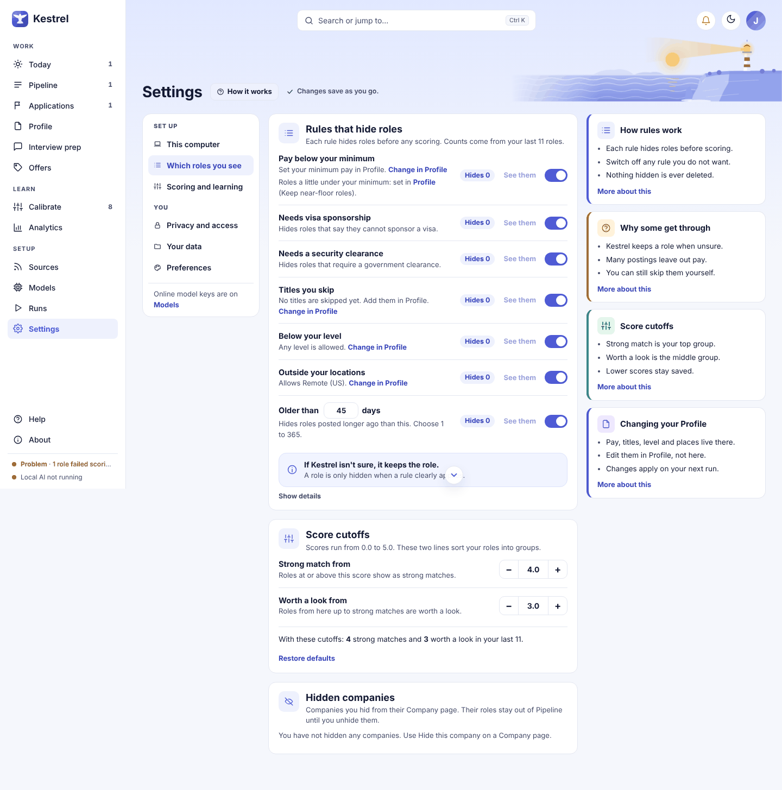
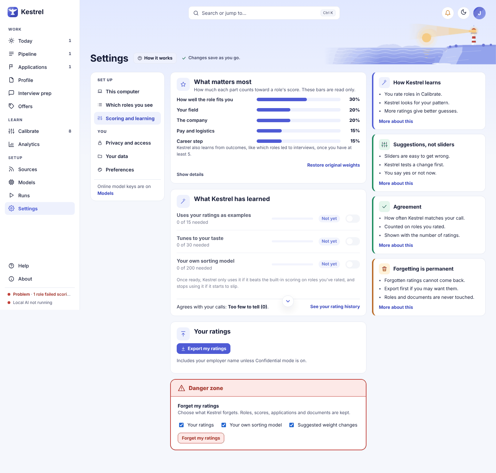
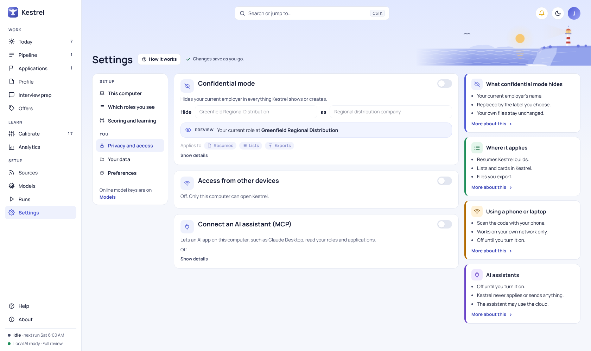
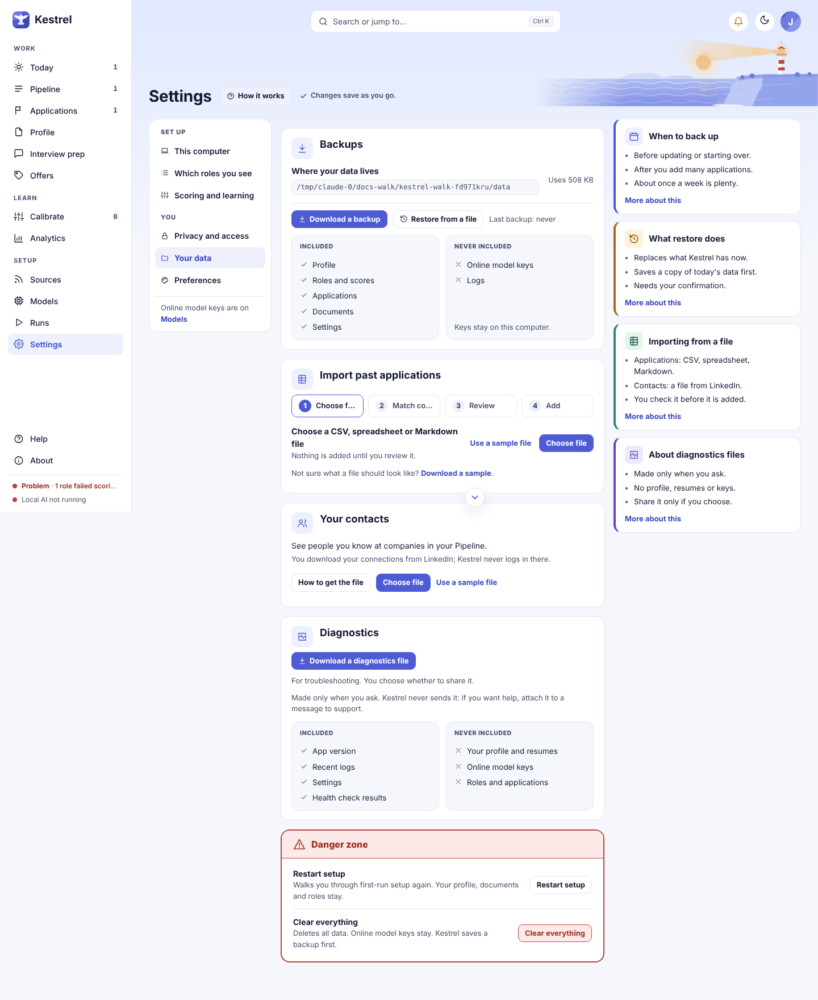
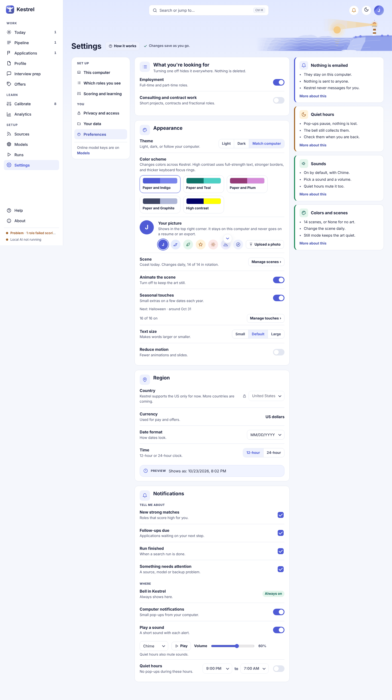

# Settings

Use Settings to choose how Kestrel runs, tune the roles it keeps and scores, protect private details, and manage your data and display. Changes save as you make them; most can be reversed with **Undo**. The six sections are grouped under **Set up** and **You**.

## This computer

Under **How should Kestrel run?**, choose **On this computer**, **Online model**, or **Both**. Online requests always ask before sending and show what will be sent. Choosing an online option alone sends nothing. When using an online model, select a service, enter its key, and choose **Test key** or **Test connection**, then **Save key** or **Save**. For **Other**, enter the service address. Keys and addresses stay on this computer and are not included in backups. **Show details** reveals technical information. See [Models](models.md) for model choices.

The **Setup checklist** guides you through **Install the engine**, **Download models**, **Tune them for Kestrel**, and **Check everything works**. Its buttons include **Check again**, **Download**, **Pause**, **Tune**, **Tune again**, and **Run check** as each step becomes available. Downloads can resume. Choose **Which kind of computer is this?** if the hardware estimate is wrong.

**Everyday options** controls **Keep this computer awake during runs**, **Start Kestrel when my computer starts**, **Keep running when I close the window**, and **Check for updates automatically**. The tray option keeps runs going after you close the window; with it off, Kestrel quits. Use **Check now** for a manual update check. Kestrel never downloads or installs updates automatically. **Open Models** leads to online keys and model setup.

## Which roles you see

Use **Track** to switch between **Employment** and **Consulting** when both are enabled. Rules are separate for each track. The two score cutoffs are shared by both tracks, and the preview shows the selected track. A new install starts with Employment on and Consulting off. Turning a track off hides it but does not delete its work. In a narrow window, 1100 pixels wide or less, the sidebar shows only icons and the inactive track switch is hidden. Use the **Track** control in Settings or widen the window to switch.

**Rules that hide roles** lists the pre-score checks for pay or rate, sponsorship, clearance, skipped titles, level, location, excluded sectors, minimum project length, and posting age. Which rules appear depends on the selected track. Switch off a rule to keep roles it would hide. **Change in Profile** opens the editor for profile-based rules. Adjust **Older than** in days and **Too short (under ... weeks)** here. Counts show how many recent roles a rule would hide; **See them** opens the hidden roles for review. Uncertain or incomplete postings stay visible. Counts under five are labeled as too small to tell much.

Under **Score cutoffs**, set **Strong match from** and **Worth a look from**. Scores range from 0.0 to 5.0; the initial values are 4.0 and 3.0. The preview shows how recent scored roles divide into groups. With fewer than five scored roles, Kestrel says there are too few to preview. **Restore defaults** resets the cutoffs. **Hidden companies** lists companies hidden from their Company page; **Unhide** returns their roles to Pipeline.

## Scoring and learning

Use **Track** to view a track's weights and learning. **What matters most** shows read-only scoring bars. **Restore original weights** resets them. If Kestrel finds an improvement from your ratings, **Kestrel suggests a change** compares **Now** with **Suggested**. Choose **Accept** or **Not now**. An accepted change can be undone from its message or reset with **Restore original weights**.

**What Kestrel has learned** shows progress for examples, weight tuning, and your own sorting model. The stages become available after enough ratings: weight tuning needs 30 and a personal model needs 200. Learning uses your ratings on this computer. **Agrees with your calls** reports its sample size, or says **Too few to tell** when there are fewer than five. Use **See your rating history** to open [Calibrate](calibrate.md).

**Export my ratings** saves a copy and includes your employer name unless Confidential mode is on. Under **Forget my ratings**, select whether to remove **Your ratings**, **Your own sorting model**, and **Suggested weight changes**. Choose **Forget my ratings**, review the confirmation, type **RESET**, then choose **Forget**. This cannot be undone; roles, scores, applications, documents, and accepted weights are kept.

## Privacy and access

**Confidential mode** replaces the current employer marked in [Documents](documents.md) with the label in **Hide ... as ...**. The preview shows the replacement. It applies to resumes, lists, and exports; your source text stays unchanged. If no employer is marked, choose **Choose your current employer**. Until then, Kestrel cannot redact it and will not send data to an online model. **Show details** explains how names are handled, including for online requests. Backups retain the original data.

**Access from other devices** is off by default. Turn it on by checking **I understand** and choosing **Turn on**. Use the QR code or **Copy address** from a phone or laptop on your own network. It uses one shared key over plain HTTP, so use only a home network or VPN you control. The change takes effect after a restart. **Show details** reveals the address; **Make a new key** signs out all devices using the old key; **Turn off** disables access.

**Connect an AI assistant (MCP)** is off by default. When enabled, it lets a compatible app read your roles and applications. It can also make some changes, marked **Changes your lists** on the card: adding a role from a link or text, asking for a search or a new score, moving an application to a new stage, and adding a note. Copy the address into that app. The card lists what it can and cannot do through Kestrel. The assistant is a separate app and may use an online service. **Show details** displays the port; **Start again** appears if the service stops.

## Your data

**Backups** shows the data folder and last backup time. **Download a backup** saves a ZIP with your profile, roles and scores, applications, documents, and settings. Online model keys and logs are excluded. Store the ZIP privately. **Restore from a file** replaces current data only after you confirm. Kestrel saves a backup of the current data first. Invalid or unreadable files produce an explanation in the section.

**Import past applications** accepts CSV, spreadsheet, or Markdown files. Choose **Choose file** or **Use a sample file**, match columns, review the rows and warnings, then press the **Add** button, which shows how many applications it will add. Nothing is imported before Add. **Undo**, shown after you add, removes only rows from that import.

**Your contacts** imports a connections file you download yourself. Kestrel does not sign in to LinkedIn and does not keep email addresses. Use **How to get the file**, **Choose file**, or **Use a sample file**; review company matches before **Apply changes**. **Import a newer file** updates the list. **Remove all contacts** asks for confirmation.

**Download a diagnostics file** creates a file only when requested. It includes app version, recent logs, settings, and health checks, but not your profile, resumes, keys, roles, or applications. Kestrel never sends it for you.

In **Danger zone**, **Restart setup** repeats first-run setup while keeping your profile, documents, and roles. **Clear everything** saves a backup first, then deletes your profile, roles, applications, and documents. **Keep my online model keys** is checked by default. Type **RESET** to enable **Clear everything**.

## Preferences

Under **What you're looking for**, switch **Employment** and **Consulting and contract work** on or off. At least one must stay on. Turning a track off hides it everywhere but keeps its data.

Under **Appearance**, **Theme** offers **Light**, **Dark**, and **Match computer**; Match computer is the default. This choice is saved in the current browser. **Color scheme** applies across devices: **Paper and Indigo** is the default, with **Paper and Teal**, **Paper and Plum**, **Paper and Graphite**, and **High contrast** also available. High contrast strengthens text, borders, and keyboard focus rings. **Your picture** selects an initial, icon, or **Upload a photo**; **Remove photo** deletes it. The picture stays on this computer and is not added to resumes or exports.

**Scene** shows the current artwork. **Manage scenes** previews scenes, including **None** and daily rotation. **Animate the scene** controls movement. **Seasonal touches** enables calendar extras, and **Manage touches** selects which ones appear. **Text size** offers **Small**, **Default**, and **Large**. **Reduce motion** limits animation and slides.

Under **Region**, **Country** is fixed to **United States** and **Currency** to **US dollars**. **Date format** and **Time** control how dates and times appear; the preview updates as you choose.

Under **Notifications**, choose which events to receive: **New strong matches**, **Follow-ups due**, **Run finished**, and **Something needs attention**. The in-app bell is always on. **Computer notifications** controls desktop pop-ups. **Play a sound** is on by default with **Chime**. Choose **Soft click** or **Bell**, set **Volume**, and use **Play** to hear the sound. Alerts do not play sounds yet, so these choices are saved but do not change what you hear during a run. **Quiet hours** sets **From** and **To** times, but it is not active yet: the times are saved and do not mute pop-ups or sound. Alerts always collect in the bell.

## Saving, errors, and Undo

Changes save as you make them. A message confirms a saved choice; many offer **Undo**. Undo restores that specific change only while it remains the current value. If a later change prevents a safe reversal, Kestrel says **This can no longer be undone.**

Invalid values, failed key tests, unreadable imports or backups, and refused changes produce an explanation near the relevant control. Correct the value or choose another file and try again. The previous setting remains in place after a refusal. Restoring data, clearing data, forgetting ratings, and removing contacts require confirmation.

Related guides: [Models](models.md), [Profile](profile.md), [Documents](documents.md), [Calibrate](calibrate.md), and [Applications](applications.md).
