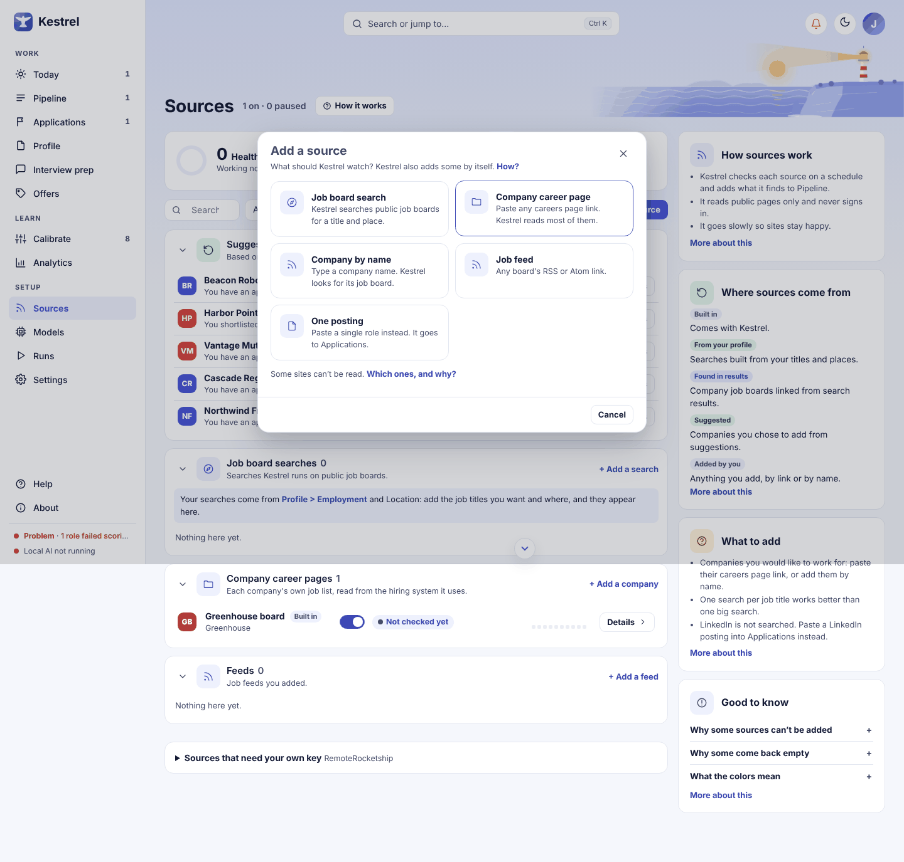

# Sources: choose what Kestrel watches

Use **Sources** to manage public searches, company career pages, feeds, and consulting signals. Check one source or all enabled sources, see what worked, and fix or pause sources that need attention. If you only have one posting to add, use **One posting** to send its link or text to Applications or Leads instead of setting up a recurring source.

## Find a source and read its status

The page shows sources for the selected track. When Employment and Consulting are both on, choose the track from the tabs at the top of the sidebar. The line beside the **Sources** heading shows how many sources are on and paused, for example **1 on · 0 paused**.

The three health tiles count only sources that are on. Select a tile to filter the list:

- **Healthy** means the source is working normally.
- **Slowed down** means a site asked Kestrel to wait, or part of a check did not finish. Kestrel tries again on the next check.
- **Needs you** means Kestrel could not read the source, often because its address moved or the page was removed. The reason appears on the row and in its drawer.

Sources you turned off appear under **Paused**. Their settings stay in Kestrel. A source that has never run shows **Not checked yet**. A source that is on but has not found any postings can still be healthy. When a board finds nothing on a check, its row shows a warning that names the board.

Use **Search sources** to find a name, company, origin, or source type. The **Type**, **Where it came from**, and **Health** menus narrow the list; their starting choices are **All types**, **All origins**, and **All health**. Origins are **Built in**, **From your profile**, **Found in results**, **Suggested**, and **Added by you**. When no rows match, choose **Clear the filters**.

Each source row shows its name and type, its origin, its health, when it was last checked, the number of open postings (for sources that are on), and a small history of its last 10 checks. The switch turns that source on or off. Select **Details** to open its drawer with its history and settings. Each group has an arrow that shows or hides its rows; **Paused** starts folded. An empty group says **Nothing here yet**, and an empty Paused group says **Nothing paused**.

## Where sources come from

- **From your profile** searches use the titles and places in [Profile](profile.md). They are rebuilt when you save your profile. In **Job board searches**, use **Turn searching off** or **Turn searching on** to control the generated searches together. Editing one makes it your own search, so it no longer follows profile changes.
- **Found in results** company job boards are added when a job search result links to a company's own job board on a hiring system Kestrel can read. Kestrel checks them daily, up to a set number per track. Turn one off and it stays off: Kestrel does not add it again.
- **Suggested companies** are based on roles you shortlisted and applied to in Employment, or on companies you work with in Consulting. Nothing is added until you choose **Add**. In Employment, Kestrel looks for the company's public job board. In Consulting, it watches the company's public SEC filings. Choose **Dismiss** to stop a suggestion from returning; its toast offers **Undo**.
- **Built in** sources come with Kestrel. You can turn them off, but not remove them. Sources you add yourself can be edited or removed. A company Kestrel found can be turned off, but not edited or removed.

Select **How it works** for how checks run, how often they repeat, and how Kestrel treats the sites it reads. The help cards on the right cover how sources work, where sources come from, what to add, and what to know. Under **Good to know**, expand **Why some sources can’t be added**, **Why some come back empty**, or **What the colors mean**.

## Add a source

Select **Add a source**, or use a group's link: **Add a search**, **Add a company**, **Add a feed**, **Add a bid search**, or **Watch a company**. The choices depend on the selected track. In Employment the sheet offers **Job board search**, **Company career page**, **Company by name**, and **Job feed**. In Consulting it offers **Job board search**, **Public bids**, **Watch a company**, and **Company news**. **One posting** is also on the sheet.

Choose a type to open its form. Select **Back** to choose another type, or **Cancel** or **Close** to leave the sheet.

### Employment sources

- **Job board search** asks for **Job title or keywords**, **Place**, and one or more **Boards**. Use a city and state, or **Remote**. Indeed and Glassdoor work best. ZipRecruiter is marked **Limited** because it blocks automated searches, so it always finds 0. Google Jobs is also marked **Limited** and returns nothing right now. Dice is shown as **Cannot be added** because Kestrel cannot read a public feed for it yet. The sheet also lists **USAJobs** and **Adzuna** (each asks for your own free keys when ticked) and a **Remote jobs** group with **Himalayas** and **We Work Remotely**, which need no key. Ticking more than one board adds one search for each, and **Undo** removes all of them.
- If you select Indeed, choose one extra filter under **Indeed allows one extra filter per search**: **Posted within** a day, 3 days, or a week; **Job type**; **Remote only**; **Easy apply only**; or **No extra filter**. To use two filters, add a second search.
- **Company career page** takes a public careers or job link. Select **Check it** to identify the hiring system and count its open roles, then **Add source**. Kestrel reads Greenhouse, Lever, Ashby, Workday, SmartRecruiters, Rippling, ADP, Paylocity, Workable, Recruitee, Teamtailor, Personio, and Breezy HR. If the page is not one of those, Kestrel reads the job data the page publishes for search engines (up to 25 job pages a run). If the page builds its list with JavaScript, the check says "This page lists its jobs with JavaScript, which Kestrel cannot read yet." and suggests **One posting**. A supported page with no open roles can still be added and checked daily.
- **Company by name** uses **Find it** to look for the company's public board. Check the match and hiring system before selecting **Add source**. If no board is found, use **Company career page** and paste the careers link. If the board is already one of your sources, Kestrel says so and adds nothing.
- **Job feed** accepts an RSS or Atom **Feed link**. Select **Check it** to read the feed and count its items, then select **Add source**. In Consulting, the same choice is called **Company news**, and each new item is read for signs the company may need help.

### Consulting sources

- **Job board search** searches for contract and freelance postings, using the same title, place, board, and Indeed controls as Employment.
- **Public bids** searches public US federal requests for proposals on SAM.gov. Set the **Industry codes** (NAICS) for the work you take. It requires your own free SAM.gov key.
- **Watch a company** monitors its public SEC filings for possible consulting signals, such as a new leader or an acquisition. Kestrel identifies itself to the SEC as required and does not contact the company.
- **Company news** reads a company's RSS or Atom newsroom feed for signals. These news and filing sources identify possible needs; they are not open job postings. Track contract postings and bids as opportunities, and review signals before deciding whether to pursue the company. See [Pipeline](pipeline.md) and [Applications and Leads](applications.md).

In the **Company signals** group, the checkbox **Use my target titles in SEC filing searches. SEC sees these searches alongside the contact email it requires.** is off by default. Turn it on only if you want your target titles included in those public SEC searches.

### Sources that need your own key

Expand **Sources that need your own key** to see **USAJobs** (government jobs, with a free key you get from USAJobs: paste the key and the email you used, then **Save**), **Adzuna** (job ads, with a free app ID and app key from Adzuna: paste both, then **Save**; each check uses up to 8 of your free calls, and Adzuna sends only the start of each description), **RemoteRocketship**, an optional service that needs its own paid subscription, and, in Consulting, **SAM.gov**.

- The RemoteRocketship card has a key field, **Save key**, and **Turn on** or **Turn off**. Turning it on needs a saved key first. **Run now** appears once the source exists.
- The SAM.gov card explains how to get a free public API key. Paste the key and select **Save key and turn on SAM.gov**.

A saved key is shown in masked form. Kestrel saves each key on this computer and sends it only to that source.

### Add one posting manually

Choose **One posting** in the add sheet to open the right list: **Applications** for Employment or **Leads** for Consulting. This does not create a recurring source. On that page, choose **Add a role I found elsewhere** or **Add a lead I found elsewhere**, then paste a public posting link (Kestrel reads it once), the posting text, or both. See [Applications and Leads](applications.md) for the form.

Kestrel does not search LinkedIn or sign in to job sites. If a site needs you to sign in, or Kestrel cannot read a page, copy the public posting text or save the posting as a PDF, then add it on Applications or Leads. Other common limits are listed under **Good to know**.

## Check sources and review results

Select **Check all now** to queue a check for every source that is on. A dialog titled **Check all sources now?** explains what will happen. If scoring uses an online model, it names the model and service and shows what will be sent. In Confidential mode, it says when your current employer is hidden. Check **I approve this online check and scoring.** before selecting **Check all now**. If you cancel, nothing is sent. With local scoring, the dialog says scoring stays on this computer and Kestrel reads the public pages for each enabled source. Scheduled checks use your saved settings. Checks held after a model or destination change also resume once you confirm.

While checks run, a note says **Checking** and the number of sources, and each row updates when its check finishes. A completed check can add new postings to [Pipeline](pipeline.md), where Kestrel scores them in the background. Postings Kestrel already has are skipped, including duplicates found on more than one board. A board rate limit is shown as **Slowed down** and does not stop the other sources in the run. See [Runs](runs.md) for the run history and counts.

Select **Details** on a source to open its drawer. It shows **Last 10 checks**, the counts from its last run, and, when recorded, the model it used and any links that could not be read. **How often** changes its schedule to **Every 6 hours**, **Twice a day**, **Daily**, or **Weekly**. Choose **Check now** to run that source with the usual models. For enabled sources that support it, **Another model** opens a choice of model for that check. A consulting signal read with an online model waits for its schedule; clicking **Check now** reports **Nothing was sent**, because that click cannot approve sending signal text to a model.

Select **Show details** in the drawer to see the saved settings and the raw last status. **Edit** opens the settings form inside Show details, with **Name**, **Track**, **Kind**, **Check every (hours)**, **Settings (JSON)**, and **On**. Source settings are checked before saving. A company page that needs a new address can show **Update the address**. Profile searches show **Change on Profile**, which opens [Profile](profile.md). Built-in and Kestrel-found sources can be turned off from the drawer but not removed. Sources you added show **Remove**.

If a job board search has no usable boards, **Show details** may offer **Use Kestrel's default boards**. If a careers page, feed, or other source cannot be read, its row and drawer show the reason and the next step. A check that finds no board for a company suggests pasting its careers page link; a check that identifies a site Kestrel does not support suggests **One posting**.

## Waiting roles and fast scoring

Unrelated titles are skipped before storage and counted on each run, for searches and company career pages alike. Uncertain matches are kept. Roles waiting from earlier runs are rechecked against your current area and titles before scoring; clear mismatches are set aside with a reason. **Score everything now** opens a confirmation with an estimated local scoring time. Confirm with **Yes, score them all now** to recheck and score the remaining matches once. This backlog uses local models only, including after confirmation. If your scoring uses an online model, choose local models for both scoring tiers in [Models](models.md) first. Choose **Cancel** to leave the roles waiting. Hand-pasted roles are always kept.

## Undo an addition or removal

Adding a source shows a toast with **Undo**. Removing a source you added hides it and turns it off; the roles it found stay in Pipeline. The removal toast also offers **Undo**, which restores the source and its previous on/off state. If Undo can no longer safely restore the earlier state, Kestrel says **This can no longer be undone.** Built-in and Kestrel-found sources can only be turned off.

## Related guides and screenshots

- [Profile](profile.md)
- [Pipeline](pipeline.md)
- [Applications and Leads](applications.md)
- [Runs](runs.md)
- [Models](models.md)
- [Settings](settings.md)
- [Screenshot index](../images/walk/INDEX.md)
