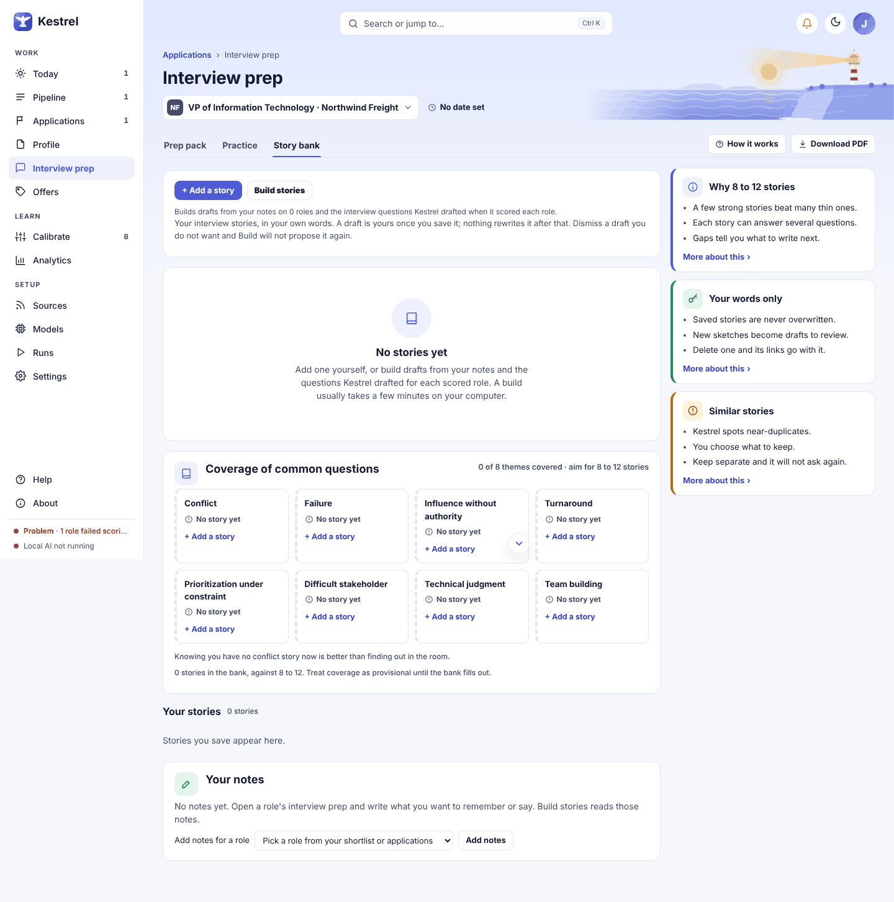

# Story bank: keep your own examples

Use **Story bank** to keep short, true accounts that Kestrel can match to interview and discovery call questions. Interview prep and Discovery call prep use the same bank, and Kestrel selects your story without rewriting the words you save.

Open **Story bank** from **Interview prep** or **Discovery call prep**, or open **Profile** and choose **Stories**. The bank shows your stories, common question themes, build status, and notes that can be used to prepare drafts.

## Add and edit a story

In the bank, select **+ Add a story**. The sheet asks **What was the situation?**, **What did you do?**, and **What changed?** Write a sentence or two under each prompt, in your own words. This sheet has no title field. Kestrel derives a short title from the first sentence you wrote. If all three fields are blank, it says **Not added: give the story a title, or write what the situation was.**

You can also add a story under **Profile > Stories**. There, **Add a story** opens fields for **Title**, **Situation**, **What I did**, and **What changed**. Enter a title and select **Save story**. If you leave the title blank, Kestrel says **Not added: give the story a title.**

To edit a saved story from the bank, select its card under **Your stories**. Change the text in the sheet headed **Your story**, then select **Save story**. The save message is **Saved. Your words, unchanged.** The Profile story cards are a read-only list; select **Open my stories** to edit in the bank.

## Themes, tags, and finding a story

**Coverage of common questions** shows eight themes and whether the bank has no story, one story, or stronger coverage for each. Select an uncovered theme to add a story tagged with that theme. The sheet opened from a question also links a saved story to that question. Existing theme tags appear below each story, along with **Used in N roles** or **no themes tagged**.

Theme tags are not editable in the story sheet. Add from a theme tile to apply that theme; otherwise, write and save the story without a theme tag. There is no search field or tag filter in the story list, so scan the **Your stories** list for a title or example.

## Use a story in prep

For example, if a likely question is about handling a failure, look at the **Failure** tile in **Coverage of common questions**. If the bank has no suitable example, select the tile or use **+ I have a story for this** on the question, then write what happened, what you did, and what changed. When a question already has a story, select its title to read the saved text. Use **Swap story** to choose a different example, or **+ Write a new story** to add one from that question. Practice with the question and use the story as a reminder while you answer in your own words.

The same bank supports consulting calls. Open a lead's **Discovery call prep** and use its **Story bank** tab or the call prep questions. The labels use call language, but story cards and matching controls work the same way.

## Build and review drafts

**Build stories** queues a background task that can use your saved prep notes and questions Kestrel drafted when it scored roles. If the selected route uses an online model, review the provider and the send details, then confirm before anything is sent. Without that confirmation, the build is refused and nothing is sent.

While a build runs, its button is disabled and the page says **Building now. This page updates when it finishes.** The page refreshes the bank automatically. A completed build reports how many drafts were created and matched to existing stories. To give the build material, save notes on a prep page or score more roles first. If a build fails, the page shows **Last build failed** with the reason; use **Try again**, or select **Build stories** and confirm the online send if that route requires approval.

Drafts appear under **Kestrel found similar stories**. Select **Review and merge** to read and rewrite a draft in your own words. Saving it makes it yours, and later builds will not overwrite it. Select **Keep separate** to dismiss a draft so an unchanged proposal will not return. A toast offers **Undo** after dismissal. Undo is available for ten minutes and is refused if later changes make restoration unsafe.

## Delete, Undo, and empty states

Select a story you have edited to open it, then choose **Delete**. Drafts show **Dismiss** instead. The confirmation names the story and explains that prep stops matching it to questions. **Cancel** closes the confirmation; **Delete story** removes it and its links to questions. Deletion cannot be undone.

After adding a story, the toast offers **Undo** while the saved story and its links remain unchanged. If a later edit or use makes an Undo unsafe, Kestrel says **This can no longer be undone.** Editing a saved story has no separate Undo; edit it again to change its words.

With an empty bank, the page says **No stories yet** and offers **+ Add a story** or **Build stories**. Coverage starts at **0 of 8 themes covered** and recommends 8 to 12 stories. With fewer than eight stories, Kestrel labels coverage provisional. If a saved item disappears before you open it, the page says **That story is already gone.**

For the full prep workflow, see [Interview prep](prep.md). For the Profile tabs and story list, see [Profile](profile.md). For spoken and typed practice, see [Practice](mock.md).
