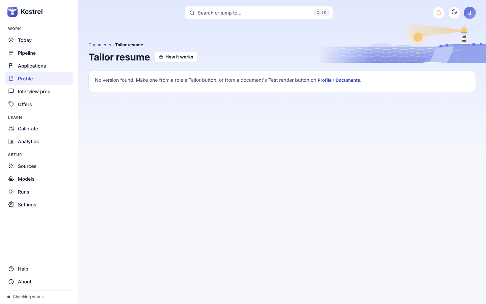

# Tailor a resume or capability statement

Open Tailor from a role's **Documents** tab, or from a card in **Applications** or **Leads**, to review the document for that role. Kestrel selects only wording you have already saved in [Profile, Documents](documents.md); check the picks, resolve any flagged lines, then download or attach the version yourself. Tailor does not write new claims, submit applications, or contact anyone.

For Consulting, the same review is titled **Tailor capability statement** and shows the sections of your capability statement, such as service lines and proof engagements.

## Open the review

From a role, open **Documents** and select **Tailor resume**. Once a version exists, the button reads **Tailor resume again**. For Consulting, the button reads **Tailor capability statement**. You can also use **Tailor resume** or **Capability statement** from an **Applications** or **Leads** card's **More actions** menu. The breadcrumb returns to the role, application, lead, or Documents page you came from.

In **Profile › Documents**, **Preview as PDF** opens a Tailor page that is not tied to a role. It uses the document's saved default wordings. The page says **Open this from a role to have Kestrel pick**; role-specific actions and posting comparisons are unavailable until you open a role render.

The header shows the role, organization, location or pay when known, and the fit score. **Not scored** means the role has not been scored. Select the role title or **View posting** to open its posting in a side panel. **How it works** explains the three columns.

## Review and change the lines

The left column has one card for each summary or document line, grouped by section. Each card shows the wording used in the preview, a status badge, and why Kestrel selected it. The badges are **Picked**, **Your choice**, **Left out**, **Your first wording**, and **Needs your pick**. Your own changes are marked **Your choice** and saved so Kestrel can learn from your selections.

Open **Other wordings (N)** to see the alternatives you saved. Select a wording to use it for this version. Optional lines also offer **Leave this line out**. Hiding a line affects this version only; it does not remove the saved wording. If there is just one wording, the card links to **Profile › Documents** to add another. To edit text or add a new wording, go to [Documents](documents.md); Tailor has no free-text editor.

Skills appear as switches, one for each skills group, labeled with the group name. Turn a switch off to omit that group from this version. For a line that is too long or does not fit, the page-limit notice also lists optional lines you can leave out.

Changes update the preview in place. A toast confirms a swap and offers **Undo**. The **What Kestrel chose** tab lists each choice and its reason, with status labels **AI**, **You**, **Out**, **First**, or **Needs you**. This view reports selections; it does not contain rewritten text.

If Kestrel names a wording that does not exist, or a saved choice is no longer available, the line is marked **Needs your pick**. Kestrel shows your first saved wording until you choose an available one. The warning explains the problem and **Show me** opens the first unresolved card. A failed pick is never silently replaced with an invented line.

## Preview, page fit, and appearance

The **Preview** tab shows the page as it will print. It is the same document used for the PDF, shown at true page size and scaled to fit the window. Hover over a line to highlight its card and any matching requirement. Use **−** and **+** to zoom, or select **Enlarge** or click the page to open the full-size preview. Select **Close** to return.

The page-count guard reports **Fits on 1 page** (or **Fits on** the number of pages) when the document is within its limit. When it is over the limit, the guard shows the page count and your limit, and lists the optional lines that are currently included. Select one to leave it out. If every optional line is already left out, the guard says so; then try a shorter saved wording or choose **Smaller** under **Font size**.

The **Look** controls apply to this render: choose an available layout, a **Font size** of **Smaller**, **Default**, or **Larger**, and **Margins** of **Narrow** or **Normal**. The note tells you whether the render matches your Profile look. Select **Make this my default** to save this layout, size, and margin choice for future renders of the document. Otherwise, the change is for this application only. The saved document look is managed in [Documents](documents.md).

## Check role coverage and privacy

**What they ask for** lists role requirements as **Covered**, **Partly covered**, or **Not in your documents**. Hover over a marked requirement to highlight the related line in the document. If there is no comparison yet, score the role from [Pipeline](pipeline.md).

**Words from the posting** marks terms already present in the text being shown. Kestrel will not add missing terms. If a term belongs in your resume or capability statement, add wording you can support in [Documents](documents.md), then return to Tailor.

Under **Privacy**, **Hide my current employer** shows the neutral label you set for that employer. The switch is disabled when no current employer is marked in Documents. With Confidential mode enabled in [Settings](settings.md), the employer remains hidden and the switch is locked on. The PDF file details contain no company names.

## Pick or pick again

**Pick for this role** asks the configured document-selection model to choose from your saved wordings. After a pick, the proof strip says **Picked on this computer** or **Picked by an online model** and shows how many seconds the pick took. **Show details** reveals the model name. Select **Pick again** to ask it to choose again; choices you made yourself stay in place. A local pick runs on this computer, and the button shows a busy message while it works. See [Models](models.md) for the configured model route.

If the route uses an online model, the page opens **Pick again with an online model** before sending anything. Review the provider, model, information that will be sent for this pick, and whether the current employer is hidden. The dialog also says what is not sent, including your name, contact details, and resume file. Check **Send this to [provider] to pick my wordings**, then select **Send and pick**. **Cancel** closes the dialog without sending. The provider's terms apply, and the request uses your own credit. Kestrel checks the destination and confirmation again when you submit.

If Confidential mode is on but no current employer is selected, the dialog says **This send will be held** and provides a link to choose the employer in **Profile › Documents**. It has no **Send and pick** button. If the consent checkbox is missing or the configured destination changed, Kestrel refuses the request and says **Nothing was sent**. Review the current disclosure before trying again.

If the model is unavailable or returns an invalid selection, an error appears on the review page and existing picks stay unchanged. An invalid wording is shown as **Needs your pick** for you to resolve. When there is no role, the document source is missing, or the model cannot make a valid pick, the page explains why the action stopped.

If a saved document or wording changes after the review was opened, Kestrel refuses an unavailable choice without changing the render. The page may say the source document no longer exists or show a brief refusal message; return to **Profile › Documents** and open a fresh render. If the test render cannot be created, the page shows an error with the reason. A missing or stale render link says **No version found**.

## Download or attach

Select **Download PDF** to save the current version. Kestrel rebuilds the PDF when your picks or appearance changed, so it matches the preview. The download stays on your computer. If PDF creation fails or the file is missing, Tailor displays the error on the page and keeps the review open.

If a line still needs a pick, **Download PDF** or **Use for this application** opens a confirmation that says **1 line still needs your pick.** It then asks **Download anyway?** for the PDF or **Use it anyway?** for attaching. Select **Choose now** to go to the line, or **Download anyway** or **Use anyway** to proceed with your own first wording. Kestrel records that unresolved choice; it never sends the PDF.

**Use for this application** attaches the version to the role in Applications so you can find it later. On a consulting lead, the label is **Use for this lead** and the version is attached in Leads. When the button reads **Attached**, the version is already linked; selecting it again removes the link. A toast confirms the change and offers **Undo**. If the role is not yet in Applications or Leads, add it there first. Neither action applies, emails, or sends anything for you.

If an **Undo** is no longer safe because later work changed the same item, Kestrel says **This can no longer be undone** and leaves the later work intact.

## Consulting capability statements

The consulting version has its own sections, such as positioning, service lines, proof engagements, and differentiators. Its summary card is **What I do**, and its skills card is **How I work**. It uses the capability statement's own saved wording and groups. It uses the same review, preview, pick, privacy, page-fit, and download controls, with lead wording such as **Use for this lead**. See [Documents](documents.md) to edit the source and [Role](role.md) for the consulting role page.

For the employment workflow, see [Applications](applications.md). For the source resume and saved alternate wordings, see [Documents](documents.md).
