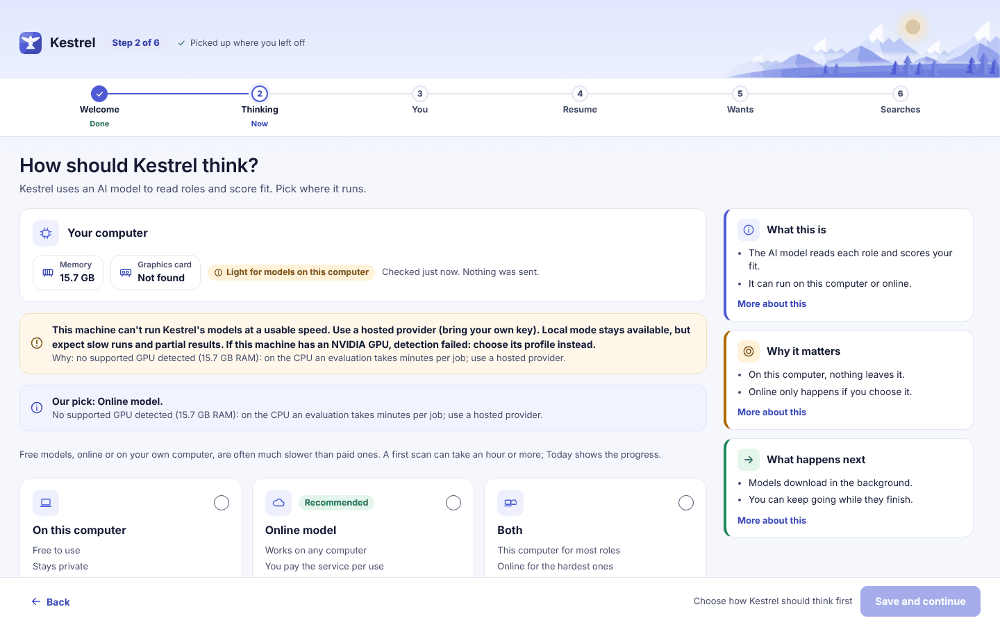

# Troubleshooting

Use this guide to match a message or symptom to its cause and next in-app action. Open the linked page and follow the named control after fixing the cause. A refusal leaves that action unchanged; an online refusal tells you when nothing was sent.

## First search does not start

**Today says “No runs yet.”** Kestrel has not recorded a scan. If setup is unfinished, choose **Finish setup**, complete the required steps, and select **Start searching** on the **Your searches** step. Otherwise choose **Run now** on Today or Runs.

**A setup step will not save.** Check the message beside the step. **About you** requires a first name and at least one track: jobs, consulting, or both. **What you want** needs a job title. Return to the named step, fill the missing field, choose **Save and continue**, then select **Start searching** on the **Your searches** step. See [Onboarding](onboarding.md).

**The model step says “Connect your key first.”** This applies when you choose **Online model** or **Both**. On the model step, select **Online model**, choose the provider, enter its key, read the disclosure, check **I understand what gets sent**, and select **Connect**. To start without a provider, choose **On this computer**. See [Models](models.md).

## Models or online keys fail

**Models says “AI engine not running” or the health check cannot reach Ollama.** Open Ollama, return to **Models**, and select **Run check** under **Health check**. If Kestrel is set to online-only, the local engine is not needed for those steps; check the online setup instead. See [Models](models.md).

**Models says downloads are missing, or a download stopped.** Under **Models on this computer**, choose **Download _n_ missing**. When downloads finish, choose **Tune models for Kestrel** if the page still says tuning is needed, then run the health check again.

**A health check shows a reading-room, thinking, or answer-format problem.** Choose **Fix it** on that row. Kestrel rebuilds its models and tests them again. If the check still fails, open **Show details** on the health card, follow the row's remediation, or choose **Change** for the affected step and select another model. A failed health check does not change your documents or ratings.

**“Browser (PDF)” is warned or PDF rendering fails.** The PDF renderer could not find or start a supported browser. Open **Models** and inspect **Health check** and **Show details**. Make sure Edge or Chrome is installed and can open, then select **Run check** and try **Preview as PDF** again from **Profile > Documents**. Other Kestrel features can work without PDF rendering.

**A provider rejects a key or cannot list models.** Open **Models**, choose **Manage keys** under **Online with your key**, select the provider, paste the key into **Key**, and select **Test**. Copy the key again from that provider's site if the test fails. If the test succeeds, select **Save**. A failed test does not save the typed key; a failed connection attempt does not replace an earlier working connection. See [Models](models.md).

**The page says no online provider is connected, hosted approval is missing, or an online action was not started.** Set up a provider under **Online with your key** on **Models** (choose **Manage keys** or **Set up**), then accept the disclosure and turn on online models there. For the specific run or action, review **What will be sent** and check its approval box if you want to proceed. If you cancel or decline, nothing is sent and the action does not start. To keep information on this computer, choose a local model. See [Settings](settings.md) and [Runs](runs.md).

## Sources find no roles or need attention

**A source says “Slowed down.”** The site asked Kestrel to slow down. The rest of the run can finish. If the same source is slowed down every day, open **Sources**, review its details, and use **Check now** after the site is available.

**A source says “Needs you.”** Its address may have moved or the source was removed. Open **Sources**, open that source's details, correct or replace its address, then choose **Check now**. Use **Check all now** to check every enabled source after fixing more than one.

**A source returns zero roles repeatedly.** Some sites block automated searches or do not provide a public feed. In **Sources**, read **Good to know** and the source's details. Split a broad search by title or place, or add another public source. Kestrel does not sign in to job sites or search LinkedIn. For a posting from a site Kestrel cannot read, copy its text or save it as a PDF and add it through **Applications** or **Leads**. See [Sources](sources.md).

## Runs stop or scoring fails

**The run says “Partial.”** At least one source had a problem, but the remaining work was saved. If it happens repeatedly for the same source, open **Sources** and check that source.

**A role says “Scoring failed” or appears under “Needs another try.”** Kestrel could not read the model's answer after its retry. Open the role and choose **Score again**, or choose **Try again** from **Needs another try** on Runs. If the same model fails again, open **Models**, run the health check, and change the model for that step.

**The run says “Did not run.”** Kestrel could not reach the AI, or it closed before the run ended. Open **Models** and select **Run check**. If the check passes, reopen **Runs** and choose **Run now** or **Resume** for saved work. For a stalled live card that says **No activity for 10 minutes**, choose **Diagnostics** on that card to open About.

**You stopped or paused a run by mistake.** Choose **Resume** for paused work. There is no Undo for Pause or Stop. See [Runs](runs.md) and [Needs another try](needs-another-try.md).

## Resume import or PDF has a problem

**A resume file cannot be read or the extracted text is wrong.** In **Profile > Documents**, use a `.docx` file for the cleanest import, or paste the text. For a PDF, review the extracted text carefully because PDF layout can reorder lines. Correct the source and select **Propose import** again. Nothing is saved until you approve the proposed import. During first-run setup, choose **Read again** after fixing the file. See [Documents](documents.md).

**A bullet is flagged as not matching the source, or a line says “Needs your pick.”** Do not approve invented wording. Fix the source text and read it again, or choose one of the available wordings yourself. Kestrel only places wording from your document in the PDF. See [Documents](documents.md) and [Tailor a resume](tailor.md).

**The preview or PDF does not appear.** On **Profile > Documents**, choose **Preview as PDF** again after the browser check passes. On a tailored resume, if the page says **No PDF file is on record yet**, choose **Download PDF** to make a file from the picks shown. If the renderer continues to fail, read the **Browser (PDF)** row in **Models > Health check** and follow its details.

## Backup download or restore fails

**“Could not build the backup” appears.** Open **Settings > Your data > Backups** and choose **Download a backup** again. If the message repeats, open **About**, expand **Diagnostics for a bug report**, and choose **Save diagnostics** in the desktop app or **Download diagnostics** in a browser. Include the exact backup message when you report the issue.

**A restore says the file is invalid, unreadable, or from a newer Kestrel version.** Open **Settings > Your data**, choose **Restore from a file**, and select a Kestrel backup ZIP. If the file came from a newer version, update Kestrel before restoring it. A valid restore requires confirmation and saves a copy of the current database first; there is no Undo button for a completed restore. See [Settings](settings.md).

## Network access or a connection fails

**A source check, model download, or key test cannot connect.** These actions need the computer to reach the public site, model host, or provider. Check that the computer is online and the named service is available, then repeat the page's action: **Check now**, **Download**, or **Test**. Help articles and locally saved Kestrel data remain available offline. A rate-limited source is shown as **Slowed down**.

**Another device cannot open Kestrel.** On the computer running Kestrel, open **Settings > Privacy and access** and find the **Access from other devices** card. Read the notice, check **I understand**, and choose **Turn on**. The change takes effect after Kestrel restarts. Then use **Copy address** or the QR code from a phone or computer on the same home network or a VPN you control. Kestrel must stay open. The connection uses plain HTTP and a shared key. See [Settings](settings.md).

## Retry, Undo, and refused actions

Use **Try again**, **Score again**, **Run check**, or **Check now** after correcting the cause named on the page. A refusal is not a successful change: fix the missing setup or approval and start the action again. For online work, review the disclosure each time and continue only if you approve the send.

**Undo** appears only after supported changes, such as a saved model choice or a role decision. If a later change prevents reversal, Kestrel says **This can no longer be undone.** See [Help](help.md) for offline articles and more troubleshooting.

## Related guides

[About](about.md) · [Documents](documents.md) · [Help](help.md) · [Models](models.md) · [Onboarding](onboarding.md) · [Runs](runs.md) · [Settings](settings.md) · [Sources](sources.md) · [Today](today.md) · [Screenshot index](../images/walk/INDEX.md)
